# Tổng hợp OSCE Sản khoa Y21 – viết lại từng bước

Nguồn: tài liệu *Tổng hợp OSCE Y21* (Tổng hợp và biên soạn: Phùng Gia Bảo; hiệu đính: Bùi Lê Hải, Nguyễn Chí Hiển, Nguyễn Đăng Huy), 171 trang.

Cách đọc:

- Giữ nguyên nội dung, không tóm tắt; chỉ đổi đoạn văn và bảng thành danh sách từng bước.
- Ký hiệu cấp: **-** cấp 1 → **+** cấp 2 → **\*** cấp 3; **1.** là bước có đánh số.
- Bảng trong tài liệu gốc được chép thành danh sách (mỗi hàng/cột là một mục).
- Lưu đồ, ảnh chụp bảng, sản đồ, CTG giữ nguyên dạng hình ở đúng vị trí.
- Chữ viết tay (ghi chú bút) trên bản gốc không chép lại.
- Mục lục đầu sách bỏ, thay bằng tiêu đề chương/mục bên dưới.

## CHƯƠNG 1: 3 THÁNG ĐẦU THAI KÌ

### HỎI BỆNH SỬ KHÁM THAI THƯỜNG QUY

#### 1. LÝ THUYẾT CẦN NHỚ

#### 2. CÁC ĐỀ

##### 2.1 Y20 đợt 3

- Thai phụ 24 tuổi, làm giáo viên, sống tại TPHCM, đến khám và tư vấn đề các xét nghiệm ở 3 tháng đầu.
- Yêu cầu: Khai thác bệnh sử, tiền sử, giải thích kết quả bất thường cho thai phụ, đưa ra hướng quản lí tiếp theo.
- **Lưu ý:**

- PARA 1001 (SV tự khai thác thêm), kinh chót không nhớ, tuổi thai chưa xác định chính xác. Siêu âm có một lần đo CRL lúc 6 tuần (CRL chưa đủ xác định tuổi thai).
- CLS: sinh viên phải yêu cầu BN đưa sổ khám thai: Glucose máu cao (10mmol/L), Rubella IgG +, IgM -.

##### 2.2 Y19 – đợt 1

- BN 23 tuổi, PARA 0010, đến khám vì trễ kinh 2 ngày, QS (+)

1. Hỏi tiền sử, bệnh sử
2. Giải thích vấn đề của BN
3. Hướng quản lý tiếp theo

- Review: Trạm này ban đầu chỉ có thông tin quickstick đêm hôm trước (+), cần đề nghị làm siêu âm BN mới đưa kết quả (siêu âm không thấy túi thai). Ngoài ra BN có cầm 1 tờ định lượng β-hCG (= 200 mIU/mL), nếu đề nghị định lượng BN cũng đưa ra NHƯNG sẽ bị trừ điểm (vì không cần thiết). Phải xác nhận được có thai, kết quả siêu âm không thấy ở giai đoạn này là bình thường do còn quá sớm. Quản lý như thai kỳ bình thường.

- Ngày khám: 26/10/2022 (trùng vs ngày thi)
- Kinh chót: 26/9/2022, tc kinh giống lần trước
- Kinh áp chót: 26/8/2022, tc kinh giống lần trước
- Kinh đều 28 ngày, hành kinh 3 ngày
- Hỏi bệnh sử và tiền căn: PARA 0010, từng bỏ thai 1 năm trước lúc thai 6 tuần do ngoài kế hoạch. Không sử dụng biện pháp tránh thai. Đang mong con
- Xác đinh tình trạng hiện tại: Thai sinh hóa, tuy nhiên chưa xác định được vị trí
- Xử trí: Hẹn tái khám sau 4 tuần để xét nghiệm tổng quát huyết học, nhiễm trùng, đái tháo đường (nếu tiền căn thai ngoài tử cung -> 2 tuần) + B9, Theo dõi các bất thường: ra máu âm đạo, đau bụng -> Tái khám sớm hơn nếu có bất thường, Ăn uống đủ chất, ngủ đúng giờ, không sử dụng rượu bia thuốc lá trong thai kỳ, không vận động nặng

##### 2.3 Y19 – đợt 2 – trạm 1: HBS – tính tuổi thai – tư vấn cho thai phụ

- YÊU CẦU: yêu cầu thu thập thông tin và thông báo cụ thể vấn đề cho bà ta
- Lý do tới khám: trễ kinh
- Trại này dễ, chỉ cần tiền căn, xong quay ra hỏi kinh chót, áp chót, xong xin kết quả siêu âm của bả
- Tiền căn thai lưu ở tuần thứ 7, ko biết nguyên nhân.
- Kinh đều, 28-30 ngày
- Kinh áp chót: …/10 (… ko nhớ)
- Kinh chót: 14/11 (tính chất giống)
- Siêu âm: 21/12: thấy túi thai trong lòng tử cung, MSD =… , có yolksac nhưng ko có tim thai -> nhận định là thai của bả là 5w nên chưa có tim thai, kết quả trên SA cũng ko có gợi ý 1 cái thai nghén thất bại sớm → khá yên tâm nên hỏi bả lo lắng gì + giải đáp thắc mắc của bả

1. Tại sao bả thử thai 2 vạch rồi mà ko nghén gì hết vậy
2. Thai của bả có làm sao ko
3. Hẹn tái khám sau 2 tuần, dặn dò thôi

- -> trại này không có gì khó hết, trên bàn có vòng tính tuổi thai để ai thích quay thì quay dựa vào kinh cuối, chứ ngày gần quá nên nhẩm cũng nhanh hơn
- Ps: trên tay bả có 1 cái xét nghiệm gì đó, mà t hỏi có phải xn máu, siêu âm khác, … mà bả đều ko đưa … t cũng quằn lắm mà thôi…
- “Không phải ai khi mang thai cũng có triệu chứng nghén, chị nhé. Nghén là một phản ứng tự nhiên của cơ thể trong thai kỳ, thường xuất hiện do sự thay đổi hormone, đặc biệt là hCG và progesterone.
- Tuy nhiên, mức độ nghén khác nhau ở mỗi người. Một số thai phụ có thể không nghén chút nào hoặc chỉ nghén rất nhẹ, điều này vẫn hoàn toàn bình thường và không ảnh hưởng đến sự phát triển của thai nhi.
- Điều quan trọng là chúng ta theo dõi sức khỏe tổng quát và sự phát triển của thai kỳ qua các lần tái khám và xét nghiệm định kỳ”

##### 2.4 Y18 – đợt 1: IVF (13/04/2022)

- Đề: BN giả chuyển phôi IVF 5 ngày vào ngày 7/3/2022 hôm nay là ngày 13/4/2022 siêu âm ứng với tuổi thai 8 tuần, bình thường. Đề yêu cầu 01 yêu cầu duy nhất là giải đáp các thắc mắc của BN, không yêu cầu hỏi bệnh sử có thể hỏi bệnh sử hoặc không cân nhắc quỹ thời gian.

- **BN hỏi BN tự tính là thấy 6 tuần nhưng sao siêu âm ra 8 tuần có sai không?** >>> giải thích cách tính tuổi thai cho bệnh nhân.
- **BN hỏi sức khỏe thai có bình thường hay không?** theo kết quả siêu âm thì có tim thai bình thường hết.
- **BN hỏi ngày dự sanh là bao nhiêu?** >>> tính theo ngày IVF cho chắc ra cỡ ngày 23/11/2022.
- **Khi nào cần tái khám:** lúc sản phụ là 8 tuần thì hẹn 4 tuần sau tái khám để làm lệch bội và siêu âm NT kèm theo hiện tại chỉ định tầm soát nhiễm trùng của thai kì, công thức máu xem thiếu máu nếu chưa làm (HIV, Rubella, HbsAg, giang mai, …)
- Thông tin trên sổ khám thai
    + Tờ 1: thông tin hành chính + ngày chuyển phôi được in đậm
    + Tờ 2 + 3: kết quả siêu âm (chú ý nhìn ngày để biết lúc đó thai bao nhiêu tuần có tương xứng với tuổi ngày chuyển phôi không)
    + Tờ 4: bảng liệt kê các lần tái khám của thai phụ và những xét nghiệm thai phụ đã làm trong lần khám đó

##### 2.5 Y18 – đợt 2: tính tuổi thai, dự sinh, tư vấn xét nghiệm TCN 1

- BN vô đưa 2 cái siêu âm hỏi sao tự tính thì ra thai 9w mà siêu âm ra 10w. Giải thích cho bả.
    + SÂ 1: thai 6 tuần, CRL 3.5mm
    + SÂ 2: thai 10wk, CRL 32mm
- Hỏi kinh chót rồi so với siêu âm thì kinh chót là 10 tuần => tin kinh chót => dự sinh cho bả
- Bả hỏi thai có tốt không? Tốt, thai nhịp 168 l/phút, không bất thường
- Hẹn 3 tuần nữa làm combined test, nếu hiện tại chưa có XN nhiễm trùng thì nhớ đề nghị

##### 2.6 Y18 – đợt 3: Thai nghén thất bại sớm

- BN nữ 44 tuổi, PARA 2002. Đến khám vì siêu âm ngày hôm qua BS nói có bất thường (tờ siêu âm sẽ có kích thước MSD 31*2x*2x mm (chỉ có 1 con số lớn hơn 31 > 25, còn 2 số kia <25)).
    + Không có dấu hiệu ra huyết, đau bụng.
    + Xử trí ngày hôm nay? cho đi siêu âm lại, kết quả siêu âm khác số nhưng vẫn đủ chẩn đoán TNTBS -> thông báo cho BN đây là TNTBS.
    + BN hỏi “có phải là lỗi của tôi do không phát hiện sớm và dưỡng thai không?”.
    + BN hỏi “bây giờ sẽ giải quyết như thế nào”? tư vấn 3 phương pháp, ưu – nhược điểm.

##### 2.7 Y17 đợt 1

- Đề: Thai phụ đến khám tam cá nguyệt thứ nhất.

1. Xác định tuổi thai chính xác và tính ngày dự sinh
2. Xác định những giấy tờ khám thai
3. Đưa ra quyết định làm những gì trong lần khám này, giải thích

- Giải đáp trạm 5:

- Xem siêu âm có thể định tuổi thai, cộng với việc định theo ngày kinh chót để xem dự sinh có chính xác không, hỏi bệnh sử và tiền căn của bà ta.
- Cần phải hỏi theo hướng đi tìm dữ kiện chứ không nên lan man theo checklist. Trạm này có một tiền căn thai ngoài tử cung, cần hỏi rõ các vấn đề liên quan.

##### 2.8 Y17 đợt 3

- Đề: BN nữ 35 tuổi đến tư vấn về vấn đề trễ kinh 2 ngày , thử que QS 1 đậm 1 nhạt , giải quyết thắc mắc cho bà này

1. Giải thích tình trạng hiện tại cho BN
2. Kế hoạch , quản lý cho BN như thế nào
- BN khai trễ kinh 2 ngày , kinh chót ½ , kinh đều 28 ngày , PARA 1O1O , thai ngoài tử cung . BN hỏi TNTC này do nguyên nhân gì ? có thể mắc lại hay không
- Nhớ hỏi bà có siêu âm chưa , BN sẽ đưa ra siêu âm cho mình , siêu âm thì ngày 2/3 không thấy túi thai cả trong và ngoài TC , {tuần 4} ,nội mạc tử cung dày.

##### 2.9 Y17 đợt 4: thai nghén thất bại sớm

- Bạn là BS ở phòng khám BV phụ sản E ở thành phố. Một thai phụ đến gặp bạn để được tư vấn.
- Yêu cầu:

1. Hãy hỏi bệnh sử, tiền căn có liên quan đến đợt bệnh này.
2. Đưa ra nhận định về tình trạng hiện tại của thai
3. Tư vấn hướng giải quyết và giải đáp thắc mắc của thai phụ.

- Tình huống:
- BN nữ 31 tuổi, đến khám vì có kết quả SÂ bất thường.
- Kết quả SÂ:

- Lần 1 lúc thai được 6w: MSD = 18, có yolk-sac, không có túi phôi
- Lần 2: ngày hôm nay lúc thai được 8w: MSD=26, yolk-sac = 10, không có phôi
- Thắc mắc của thai phụ:

1. Tại sao con tôi lại gặp tình trạng này?
2. Đứa sau có bị như vậy không? Và tôi cần làm gì để phòng tránh?
- Comment: lúc thi run quá nên không biết làm gì! Lúc vào thi được bạn đóng BN chuẩn đưa cả 2 tờ siêu âm luôn, nên nhảy luôn đến bước kết luận :’(. Theo mình thì có lẽ kịch bản phải kiểu: hôm nay là lịch hẹn tái khám của BN. BN sẽ đưa XN lần trước cho mình xem, sau đó mình tư vấn trước, rồi sau đó đưa ra đề nghị CLS. Có đó rồi mới tư vấn tiếp. Lẽ thường là vậy mà sao mình được quăng luôn 2 tờ SÂ. Khok!
- Lưu ý: ở trong phòng có vòng tính tuổi thai, cần sử dụng nó để tính tuổi thai theo KC và theo SÂ

##### 2.10 Y20 đợt 1

- Thai phụ 21 tuổi, đến khám vì trễ kinh 2 ngày kèm que thử thai 1 vạch đậm, 1 vạch nhạt.
- Yêu cầu: Hỏi bệnh sử và tư vấn các vấn đề hiện tại của thai phụ (thật sự có thai chưa ?).
- Lưu ý: hỏi được kỹ và chính xác kinh chót, kinh áp chót, tính tin cậy, tiền căn sản khoa, phụ khoa, lập gia đình (ngày đầu tiên hành kinh hay ngày sạch kinh, ngày âm hay dương, lập gia đình được vài tháng, trước đó năm 16 tuổi có thai ngoài ý muốn đã bỏ thai bằng thuốc,…).

#### 3. CÁC BƯỚC TIẾP CẬN

##### 3.1 Bước 1: Mở đầu buổi tư vấn

- Chào hỏi, tự giới thiệu: “Chào chị tôi là ... hôm nay tôi sẽ phụ trách khám/tư vấn cho chị”
- Mời thai phụ tự giới thiệu: “Trước tiên thì mời chị tự giới thiệu tên tuối, nghề nghiệp của bản thân mình với tôi nhé”
- Thai phụ trình bày về mục đích buổi tư vấn: “Điều gì khiến cho chị phải đến buổi tư vấn hôm nay?”
- “Bác sĩ ơi tôi trễ kinh đến nay là … rồi. Sáng qua tôi thử que thì lên 2 vạch đậm/1 mờ 1 đậm.
    + Tôi nghĩ là có thai rồi nên hôm nay đến khám ngay. Có phải tôi có thai rồi không bác sĩ?”
- (Hỏi trễ kinh bao nhiêu ngày, có thử que chưa nếu sản phụ không khai)
- “Chị có bất thường mà chị đi khám thì rất là tốt ha chị. Bình thường thì trễ kinh + thử thai 2 vạch như chị thì nghĩ nhiều là đã có thai, nhưng để xác định chính xác hơn thì tiếp theo đây tôi sẽ tiến hành hỏi bệnh sử và tiền căn của mình để có định hướng đúng hơn cho buổi khám bệnh ngày hôm nay nhé”

##### 3.2 Bước 2: Khai thác tiền căn và bệnh sử

###### 3.2.1 Tiền căn

- Chị có đi khám ở đâu trước đó chưa? Có được lập sổ khám thai không? Có siêu âm không?

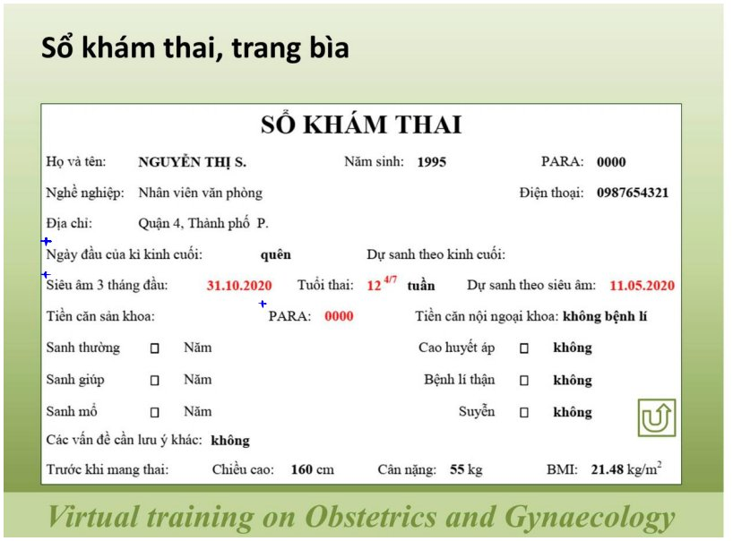

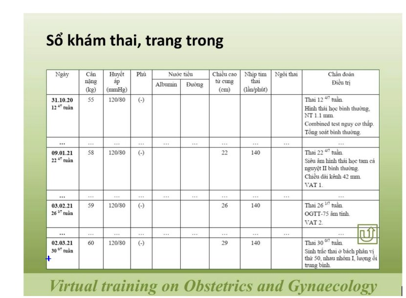

- **Sản khoa: PARA**
- Mang thai mấy lần rồi?
- Lần đầu tiên là năm nào? Sinh vào tuần thứ mấy? Chị sinh thường hay sinh mổ? (Vì sao phải sinh mổ?) Lúc sinh có tai biến hay biến chứng gì không? Lúc sinh xong nằm viện bao nhiêu ngày? Con nặng bao nhiêu kí? Bé dạo này khoẻ không?
- Lần 2,3….
- Trong những lần mang thai thì có bao giờ chị được chẩn đoán bệnh gì như thiếu máu, nhiễm trùng, tiền sản giật hay đái tháo đường thai kì không ạ?
- Có sẩy thai, bỏ thai không?
- Có thai ngoài tử cung hay thai trứng không?
    + (Năm nào, bên nào, điều trị bằng pp nào, tránh thai sau đó bao lâu?)
- **Phụ khoa**
- Có kinh lần đầu nằm nhiêu tuổi?
- Kinh có đều không? Chu kì kinh bao nhiêu ngày?
- Mỗi lần hành kinh bao nhiêu ngày? Mỗi ngày dùng bao nhiêu băng vệ sinh?
- Có được chẩn đoán bệnh phụ khoa như viêm nhiễm âm đạo, u xơ tử cung, u nang buồng trứng không?
- Có được chẩn đoán bệnh lây qua đường tình dục không?
- **KHHGD**
- Lập gia đình năm bao nhiêu tuổi?
- Có dùng phương pháp tránh thai nào không? Thả bao lâu thì phát hiện có thai đợt này?
- Lần có thai này có nằm trong kế hoạch không? Nếu không trong kế hoạch thì muốn giữ thai hay bỏ thai?
- Thai lần này là tự nhiên hay hỗ trợ sinh sản?
- **Nội khoa:** Có tăng huyết áp hay đái tháo đường, bệnh lý tuyến giáp, bệnh tự miễn không?
- **Ngoại khoa:** Có mổ lần nào chưa?
- **Dị ứng:** Có dị ứng với thuốc hay thức ăn gì không?
- **Thuốc**
- Có đang dùng thuốc gì không? Có sử dụng thuốc nội tiết trong vòng 3 tháng trước kinh chót không?
- Có được tiêm ngừa Rubella, HBV, uốn ván chưa?
- **Gia đình:** ĐTĐ, THA

###### 3.2.2 Bệnh sử

- **Kinh chót**
- Ngày nào? Kinh chót tính theo lịch âm hay lịch dương? Đó là ngày đầu có kinh hay ngày sạch kinh?
- Kinh chót có gì bất thường so với những lần có kinh trước đó không?

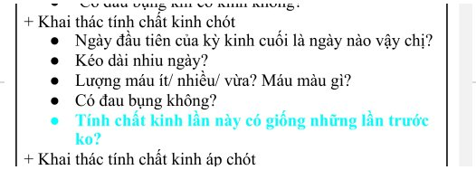

- Kinh áp chót là khi nào?
- Trước đó có sử dụng thuốc nội tiết hay tránh thai gì không ?
- **Triệu chứng**
- Có đau bụng, ra huyết không?
- Có nghén không?

###### 3.2.3 Khám (nếu chưa được khám trước đó)

- Bây giờ tôi sẽ khám, đo sinh hiệu, khám tổng quát các hệ cơ quan, khám bằng mỏ vịt cho chị để khảo sát tình trạng âm đạo, cổ tử cung.

###### 3.2.4 Tư vấn

- **Thông báo có thai**
    + Sau khi hỏi bệnh sử, tiền căn, kết hợp với kết quả thử que của chị tôi nghĩ chị đang có bằng chứng của thai sinh hóa.
        * Hoặc/và
    + Kết quả siêu âm chưa thấy thai là do nhiều lý do, ở đây là làm quá sớm, khi thai còn quá nhỏ, tôi chỉ có thể nói là hiện thai chưa xác định vị trí
        * Hoặc/và
    + Trễ kinh >= 2 tuần => bây giờ tôi sẽ đề nghị siêu âm qua ngã âm đạo cho chị để có thêm thông tin về vị trí thai, sinh tồn thai nha.

##### 3.3 Giải đáp thắc mắc

###### 3.3.1 Lần trước tôi có TNTC thì có khi nào tôi bị lại?

- Tôi rất hiểu nỗi lo lắng của mình khi mình đã từng bị TNTC chị nhé, nhưng TNTC thì do nhiều nguyên nhân gây nên. Theo như thông tin chị đã cung cấp thì tôi chưa kết luận được nguyên nhân thai ngoài tử cung lần trước là do đâu, vì thế cũng không thể tiên lượng được khả năng bị lần này. Có thể do bất thường về làm tổ của thai, thay vì là thụ tinh rồi thì làm tổ ở phần đáy/thân TC thì cơ chế chủ quan hoặc khách quan nào đó thai chị lại làm tổ sai chỗ dẫn đến mình bị thai ngoài tử cung.
- Điều tiếp theo cần làm là tiếp tục theo dõi thai kì này một cách thận trọng
- Các phương án tiếp theo với thai của chị là
- Sẽ theo dõi các triệu chứng như đau bụng, ra huyết trong thời gian chờ xét nghiệm
- Hẹn chị 7-10 ngày, tiến hành siêu âm sớm nhằm nhận định vị trí của túi thai
- Kết hợp siêu âm và định lượng beta-hCG (thử máu) để có thông tin thêm về vị trí làm tổ của thai

###### 3.3.2 Thai kì này bình thường, quản lý sao?

- Do chị chưa từng mang thai/chưa từng có vấn đề gì các thai kì trước, nên tôi sẽ theo dõi thai kì này theo tiêu chuẩn. Nếu chị có thai thì ước tính tuổi thai chị là ... tuần, chưa thấy trên SA.
- Tôi sẽ hẹn chị tái khám vào ... tuần (mốc 8 tuần) tiếp theo để thực hiện siêu âm lại. Đồng thời sẽ lên kế hoạch khám thai, tính toán thời điểm thai khoảng 11 tuần đến 13 tuần 6 ngày để làm siêu âm đánh giá phát triển thai và thực hiện các xét nghiệm tầm soát cần thiết cho mình.

###### 3.3.3 Tuổi thai không trùng khớp giữa 2 lần siêu âm

- Tôi tính tuổi thai ngày hôm nay dựa vào kết quả siêu âm ngày … có CRL là 6mm có tuổi thai là … tuần thì không trùng khớp với tuổi thai được kết luận trên siêu âm ngày hôm nay, tại sao vậy bác sĩ”.
- Siêu âm lúc CRL 6mm để tính tuổi thai là không đáng tin cậy. Muốn định tuổi thai người ta có thể dựa vào ngày kinh cuối tin cậy, qua siêu âm, và qua ngày chuyển phôi trên IVF. Ở đây chị có thai tự nhiên nên phải định tuổi thai theo ngày kinh cuối hoặc qua siêu âm. Nếu định tuổi thai theo siêu âm người ta sẽ dùng CRL là chiều dài đầu mông của thai, CRL đạt chuẩn để tính tuổi thai khi >=30mm, ở đây thai còn quá nhỏ CRL = 6mm nên không dùng được ha chị, bây giờ mình sẽ tính tuổi thai theo ngày kinh chót của chị ha tại vì CK kinh chị đều, 28- 30 ngày, không dùng tránh thai nội tiết, tính chất kinh giống những lần kinh trước, sau đó khoảng 11 tuần đến 13 tuần 6 ngày tôi sẽ dùng siêu âm để đánh giá lại tuổi thai

###### 3.3.4 TRƯỜNG HỢP IVF: “Tại sao tuổi thai tính theo ngày chuyển phôi và tuổi thai trên siêu âm lệch nhau 2 tuần vậy bác sĩ, bác sĩ giải thích giúp tôi với?”.

- Tuổi thai theo quy ước của sản khoa là tính từ ngày thứ nhất của lần hành kinh cuối cùng của sản phụ, với điều kiện đó là ngày kinh cuối tin cậy. Khi mình làm siêu âm thì tuổi thai cũng được tính theo mốc ngày kinh cuối luôn. Ngày kinh cuối lý thuyết cách ngày thụ tinh khoảng 14 ngày nếu chu kì kinh đều, 28 ngày. Từ ngày chuyển phôi mình sẽ tính được ngày thụ tinh, rồi sau đó mình +2 tuần sẽ ra được ngày kinh cuối lý thuyết, và đó cũng là tuổi thai ha chị ha.

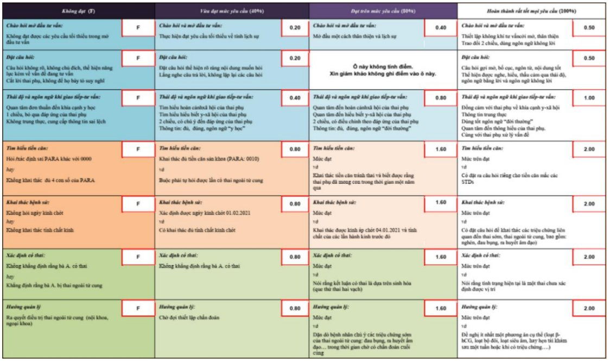

### TIẾP CẬN XUẤT HUYẾT ÂM ĐẠO

#### 1. LÝ THUYẾT CẦN NHỚ

- **TH1: Thai nghén thất bại sớm. 4 tiêu chuẩn trên SA:**
    + CRL ≥ 7mm và (-) tim thai
    + MSD ≥ 25mm và (-) phôi thai
    + Không thấy phôi có hoạt động tim thai sau 14 ngày mà trước đó đã có túi thai không có yolk-sac
    + Không thấy phôi có hoạt động tim thai sau 11 ngày, tính từ khi SA có túi thai và yolk-sac
- **TH2: Thai ngoài TC (ngưỡng phân định + TVS)**
    + -> Tư vấn điều trị nội và ngoại
- **TH3: Theo dõi thai ngoài TC (PUL)**
    + -> Tư vấn nhập viện + đề nghị thêm 1 xét nghiệm TVS + beta hCG sau 48h
    + -> Nếu đạt ngưỡng phân định-> Nguy cơ cao thai ngoài TC
    + -> Hỏi kiến thức thai phụ về thai ngoài TC

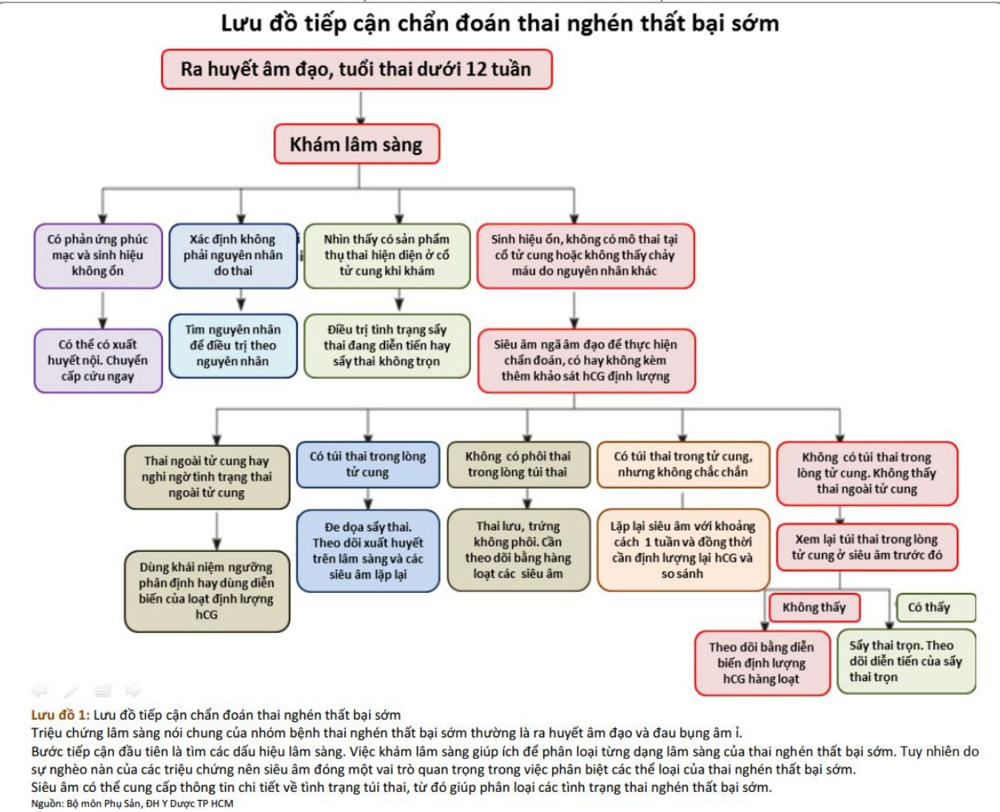

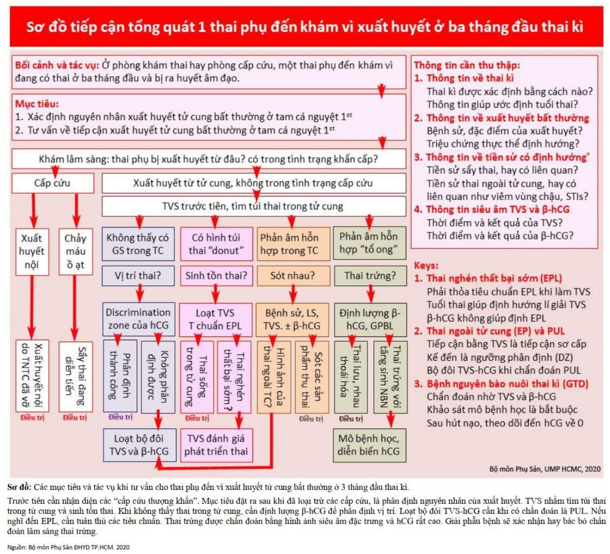

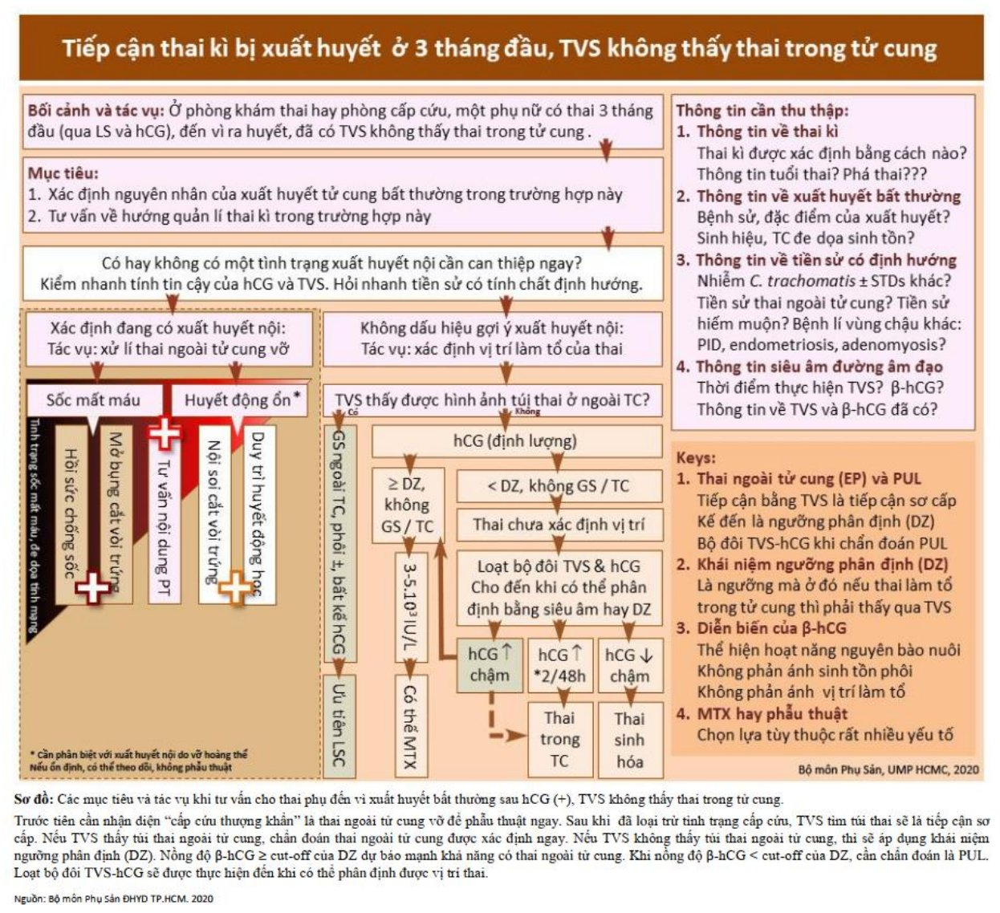

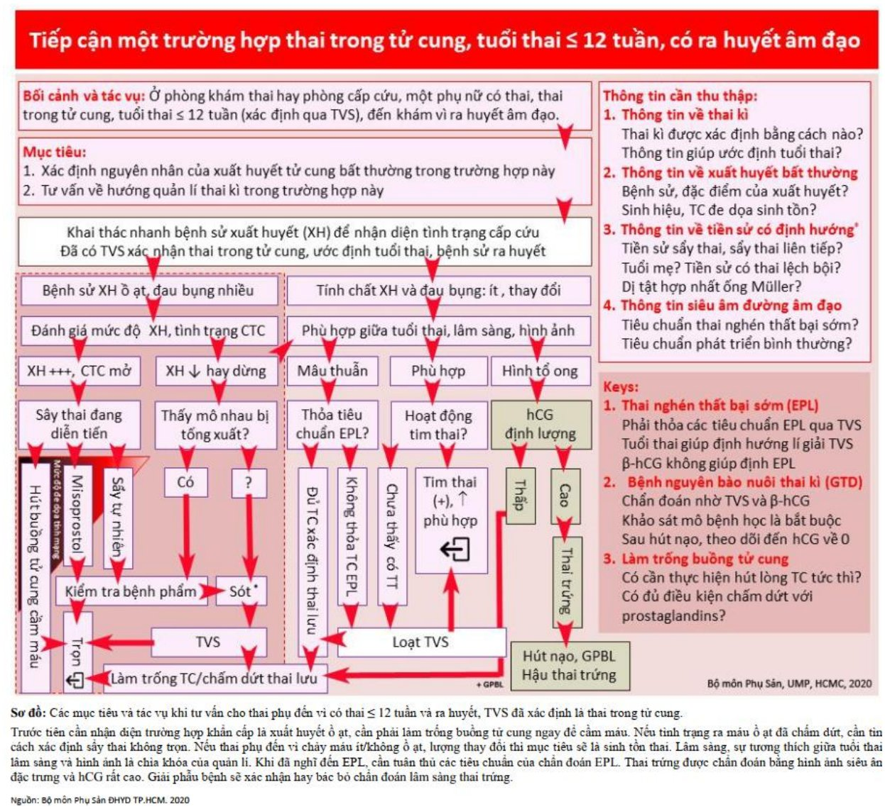

#### 2. CÁC ĐỀ

- Các tình huống ra thi

- XH âm đạo không cấp cứu, QS (+), chưa làm TVS
- XH âm đạo không cấp cứu, TVS có thai trong TC, thai <12 tuần
- XH âm đạo không cấp cứu 3 tháng đầu, QS (+), TVS không có túi thai trong TC

##### 2.1 Y18 – đợt 4: thai nghén thất bại sớm dạng sẩy thai không trọn

- Đề: BN đến khám vì đau bụng và ra máu
- Xác định tình trạng thai có trước đó
- Đau bụng và ra máu thì có thể TNTC vỡ là 1 cấp cứu => phải khám bụng, sinh hiệu, chỉ số shock.
- Sau khám xác định lại bằng siêu âm => thai nghén thất bại sớm dạng thức sẩy thai không trọn

##### 2.2 Y20 đợt 4 – K4

- Bạn là một bác sĩ phụ trách phòng khám tại bệnh viện, 1 thai phụ đến khám lần đầu với kết quả siêu âm, trước đó 2 tuần có quickstick dương tính.
- Yêu cầu: Hỏi bệnh sử, tiền căn và giải đáp thắc mắc của thai phụ.
- Nội dung trạm:

- Kết quả siêu âm: chưa thấy phôi trong lòng tử cung
- Hỏi tiền sử, bệnh sử: tất cả đều bình thường, chỉ có 1 lần sẩy thai trước đó 2 năm (PARA 0010, thai phụ khai có bị mất thai 1 lần, đến khám thì bác nói là đã sảy rồi → hỏi xử trí khi đó thế nào thì khai “nó diễn ra tự nhiên vậy thôi chứ tôi cũng không rõ” nên mình nghĩ thời điểm đó đã là sẩy thai trọn), hiện tại trễ kinh gần đúng 6 tuần, không đau bụng ra máu
- Sau khi hỏi bệnh thì nhận định được là thai kỳ nguy cơ cao (tiền căn sảy thai), kết luận kết quả siêu âm có thể phù hợp vì còn sớm, trán ăn thai phụ và hẹn tái khám sau 2 tuần để siêu âm lại để xác định có hay không có, vị trí, số lượng và sinh tồn của thai (còn thời gian thì nói thêm bên cạnh đó cần làm thêm các xét nghiệm tầm soát thiếu máu, nhiễm trùng, chức năng gan, thận, đường huyết) và có thể đến sớm hơn nếu có đau bụng, ra huyết, bất kỳ lo lắng ảnh hưởng thai phụ

#### 3. CÁC BƯỚC TIẾP CẬN

##### 3.1 Bước 1: Mở đầu buổi tư vấn

- Chào hỏi, tự giới thiệu: “Chào chị, tôi là ... hôm nay tôi sẽ phụ trách khám/tư vấn cho chị”
- Mời thai phụ tự giới thiệu: “Trước tiên thì mời chị tự giới thiệu tên tuối, nghề nghiệp của bản thân mình ạ.”
- Hỏi lý do đến khám: “Hôm nay sao mình đến khám/tư vấn vậy chị?”
- “Bác sĩ ơi, em đang có thai mà sáng nay tự dưng thức dậy em thấy có ra huyết âm đạo. Không biết có vấn đề gì không. Em lo quá ạ”.

##### 3.2 Bước 2: Khai thác tiền căn và bệnh sử

- Chị có đi khám ở đâu trước đó chưa? Có được lập sổ khám thai không? Có siêu âm không?

###### 3.2.1 PARA

###### 3.2.2 Bệnh sử

- **Triệu chứng** <Hỏi triệu chứng lý do đến khám trước – thường là xuất huyết>
    + Ra huyết
        * Ra huyết bao lâu rồi
        * Đang làm gì thì ra huyết? Trước đó có chấn thương gì không
        * Ra huyết bao nhiêu lần/ngày? Ra huyết lượng khoảng bao nhiêu BVS?
        * Kiểu: ồ ạt, rỉ rả
        * Máu có màu gì?
        * Máu có lẫn máu cục không?
        * Chóng mặt, xây xẩm?
        * Có thấy khối mô gì không?
        * A,R: Diễn tiến mấy ngày nay như thế nào?
    + Có đau bụng không? (7 tính chất đau bụng)
    + Có nghén không?
- **Kinh chót**
    + Kinh chót ngày nào? Đó là ngày đầu có kinh hay ngày sạch kinh?
    + Kinh chót có gì bất thường so với những lần có kinh trước đó không?
    + Kinh áp chót của mình là hồi nào?
    + Từ lúc kinh chót, mình có tiếp xúc hoá chất hay sử dụng thuốc gì không?

###### 3.2.3 Tiền căn

- **Phụ khoa**
- Có kinh lần đầu nằm nhiêu tuổi?
- Kinh có đều không? Chu kì kinh bao nhiêu ngày?
- Mỗi lần hành kinh bao nhiêu ngày? Mỗi ngày dùng bao nhiêu bvs?
- Bệnh phụ khoa như u xơ tử cung, u nang buồng trứng?
- Có từng mắc bệnh lây truyền qua đường tình dục chưa?
- **KHHGĐ:**
- Lập gia đình năm bao nhiêu tuổi?
- Có dùng phương pháp tránh thai nào không? Thả bao lâu thì phát hiện có thai đợt này?
- Lần có thai này có nằm trong kế hoạch không? Nếu không trong kế hoạch thì muốn giữ thai hay bỏ thai?
- Thai lần này là tự nhiên hay hỗ trợ sinh sản?
- **Nội khoa:** Có tăng huyết áp hay đái tháo đường, bệnh lý tuyến giáp, bệnh tự miễn không?
- **Ngoại khoa:** Có mổ lần nào chưa?
- **Dị ứng:** Có dị ứng với thuốc hay thức ăn gì không?
- **Thuốc**
- Có đang dùng thuốc gì không? Có sử dụng thuốc nội tiết trong vòng 3 tháng trước kinh chót không?
- Có được tiêm ngừa Rubella, HBV, uốn ván chưa?
- **Gia đình:** ĐTĐ, THA

###### 3.2.4 Khám

- Vì chị đang có **tình trạng xuất huyết** nên trước tiên tôi sẽ thăm khám cho chị, tôi sẽ đo sinh hiệu, khám tổng quát các hệ cơ quan, khám bụng tìm điểm đau cũng như phản ứng thành bụng nếu có, và cuối cùng sẽ đặt mỏ vịt để khám âm đạo để biết tình trạng xoá mở ctc, nguồn gốc máu chảy

##### 3.3 Bước 3: Đề nghị cận lâm sàng – Tư vấn

- Tôi cho rằng tình trạng xuất huyết của chị có lẽ do thai kì lần này gây ra, và tôi đề nghị đánh giá bằng siêu âm qua ngã âm đạo, chị có đồng ý không?

###### 3.3.1 TRƯỜNG HỢP 1: Thai nghén thất bại sớm

- Tôi rất tiếc khi phải thông báo rằng: thai của chị đã ngưng tiến triển. Vì đã hơn 2 tuần từ lúc thấy túi thai có túi noãn hoàng nhưng vẫn chưa thấy được hình ảnh phôi thai có hoạt động tim thai (4 lý do của thai nghén thất bại sớm).
- Chị có biết thai nghén thất bại sớm là gì không? Đó là khi thai trong lòng tử cung nhưng không sống nữa. Thai lúc này có thể vẫn ở trong lòng tử cung gọi là thai lưu hoặc có thể tống xuất ra ngoài gọi là sẩy thai. Biến chứng có thể có của thai nghén thất bại sớm là xuất huyết, sốc mất máu, còn của thai lưu là rối loạn đông máu mẹ, vỡ ối gây nhiễm trùng
- **Nguyên nhân gây ra thai nghén thất bại sớm. (Tại sao tôi lại bị như vậy bác sĩ ơi?)**
    + Đây là một vấn đề phổ biến, thường là do thai đã bị bất thường về vật chất di truyền, hầu hết là tai nạn trong giảm phân tạo giao tử, không phải là lỗi chủ quan của chị, tuy nhiên cũng có thể do mình tiếp xúc với hoá chất hay thuốc vào đầu thai kì gây ra tình trạng này.
- **Hướng xử lý: (Giờ tôi phải làm sau đây bác sĩ?)**
    + Vì thai kỳ bây giờ đã ngưng tiến triển, tôi đề nghị chị nên chấm dứt thai kì. Vì tình trạng của chị hiện tại là ổn định, nên chị có thể tự do lựa chọn theo dõi chờ sẩy tự nhiên, chấm dứt thai kì bằng thuốc hoặc thủ thuật.
        * Theo dõi chờ sẩy thai tự nhiên bằng triệu chứng lâm sàng là ra huyết và đau bụng, ưu điểm là không tác động hoá chất hay thủ thuật, nhược điểm là dễ thất bại và không tiên lượng được thời gian kết thúc, nếu thất bại chị sẽ phải điều trị bằng hai phương pháp còn lại
        * Nội khoa bằng misoprostol: ưu điểm là thời gian nhanh hơn theo dõi, nhược điểm là có thể chảy máu và đau bụng sau đó nhưng không đáng lo vì sau đó nhanh chóng ổn định.
        * Ngoại khoa: hút lòng tử cung, ưu điểm là nhanh, ít chảy máu nhưng nhược điểm là đối mặt với nguy cơ nhiễm trùng, thủng tử cung.
- **Tiên lượng cho thai kì sau. (Ở thai kỳ sau thì tôi có bị lại không bác sĩ)**
    + Chị có thể bị thai lưu lặp lại nhưng nguy cơ bị lại ở thai kỳ sau là không tăng thêm, vì vốn dĩ đây là 1 tai nạn giảm phân mang tính chất ngẫu nhiên hoặc do chị có tiếp xúc với hoá chất.

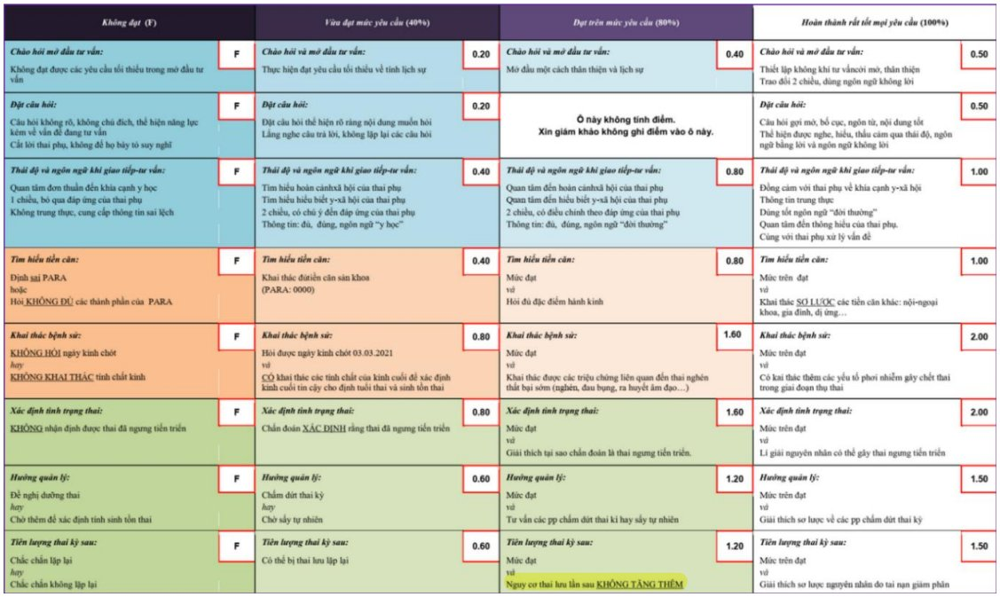

###### 3.3.2 TRƯỜNG HỢP 2: XUẤT HUYẾT DO THAI LÀM TỔ

- Bệnh nhân xuất huyết:
- Chào hỏi đồ
- Trước giờ…
- Hỏi triệu chứng trước:

- Xuất huyết: tính DOLCART/biến chứng
- Trước giờ?
- Kèm theo: đau bụng, nghén
- Tiền căn:

- Sản
- Phụ
- Biện pháp tránh thai, hiếm muộn, mong con.
- Kinh chót, test
- Dị ứng, thuốc/dị ứng.
- Nội ngoại
- YTNC thai ngoài: lây truyền qua đường tình dục, phẫu thuật, can thiệp, tử cung/vòi trứng hay không.
- YTNC sẩy thai: hút thuốc lá, sử dụng thuốc đầu thai kì, gia đình có nhiều người sinh con lệch bội.
- Đo mạch – huyết áp/Xem xuất huyết này có nguy hiểm hay không?
- Khám ngoài: bụng ngoại khoa
- Khám trong: mỏ vịt – âm đạo
- Đề nghị CLS.

- Đầu tiên tôi cho rằng tình trạng xuất huyết của chị có lẽ do thai kì lần này gây ra, nên tôi đề nghị đánh giá bằng siêu âm qua ngã âm đạo ngày hôm nay, chị có đồng ý không?  Kết quả siêu âm. (cho rất là nhiều dữ kiện CRL – số nào cũng gạch dưới). – tuổi thai nhiêu đây tuần, đã có các cấu trúc này chưa  Có thoả đủ tiêu chuẩn chưa
- Tư vấn gần:

- Có thể thấy qua kết quả siêu âm, thai ... tuần, vẫn đang xác định
- Bởi vì ở tuổi thai này, bé sẽ có phôi, có tim, thai của mình đang có đầy đủ.
- Mình nghĩ là xuất huyết là do làm tổ, báo hiệu cho tình trạng bất thường của thai kì
- Tư vấn xa:

- Tái khám bs khi có trch: đau bụng ra huyết, khi ra huyết ko thuyên giảm
- Sau đó tôi sẽ gặp lại chị 11 – 13
- Siêu âm đánh giá phát triển thai + NT
    + ⑳ ⑪
- Nhiễm trùng lệch bội thiếu máu

###### 3.3.3 TRƯỜNG HỢP 3: Thai ngoài tử cung

- **Thông báo chẩn đoán thai ngoài tử cung:**
    + (Nếu chưa có kết quả Beta và cần định lượng) Vì cô đã trễ kinh 1 tuần (thai 5 tuần) lúc này đáng ra phải thấy túi thai trong lòng tử cung nhưng kết quả siêu âm lại không cho thấy điều đó nên, tôi đề nghị chị làm xét nghiệm máu để định lượng mức beta hcg để cho biết ý niệm về vị trí làm tổ của thai.
    + (Nếu đã có kết quả Beta dưới ngưỡng phân định) Vì cô đã trễ kinh 1 tuần (thai 5 tuần) lúc này đáng ra phải thấy túi thai trong lòng tử cung, kết quả siêu âm lại không cho thấy điều đó nhưng mức beta hcg là … (<1500) nên tôi chỉ có thể kết luận là thai chưa xác định vị trí.
    + **(Beta > 1500, siêu âm thấy khối echo hỗn hợp ngoài buồng tử cung → cần thảo luận với bệnh nhân).** Vì cô đã trễ kinh x tuần (tức thai x + 4 tuần), lúc này đã phải thấy túi thai trong tử cung nhưng kết quả siêu âm lại không cho thấy điều đó mà phát hiện một khối echo hỗn hợp ngoài buồng tử cung nghi ngờ là khối thai cùng với kết quả Beta > 1500, tôi có thể nói rằng khả năng cao là thai đã nằm ngoài buồng tử cung nhưng cũng chưa khẳng định được. Quyết định là ở chị! Nếu điều trị ngay thì khả năng điều trị thành công sẽ cao nhưng vẫn có thể điều trị lầm thai trong tử cung. Nếu muốn chắc chắn hơn, tôi sẽ cho chị nhập viện để làm lại bộ đôi siêu âm và định lượng Beta hcg sau 48h, nếu phát hiện bất thường trên siêu âm, hoặc Beta không tăng 50% so với hôm nay thì chúng ta sẽ tiến hành điều trị, nhưng chị sẽ đối mặt với nguy cơ bị vỡ khối thai ngoài trong quá trình chờ đợi.
    + **(Siêu âm thấy túi thai có hoạt động tim ngoài buồng).** Chẩn đoán xác định chị có thai ngoài tử cung vì chị có một cấu trúc hoàn toàn giống khối thai nhưng lại nằm bên ngoài buồng tử cung. Vì không nằm trong đúng vị trí của nó, nên nó sẽ không sống được và nguy cơ sẽ vỡ nếu mình không xử trí. Vì thế rất tiếc phải thông báo rằng chị sẽ phải chấm dứt thai kì.

- **Hướng xử lý:**
- Tình trạng của chị hiện tại ổn định, sinh hiệu (mạch, huyết áp, nhiệt, nhịp thở) ổn định, không có dấu hiệu của tình trạng thai ngoài tử cung vỡ/choáng mất máu/nhiễm trùng nhưng chúng ta sẽ xử lí phù hợp để ngăn tình huống xấu nhất xảy ra.
- **Điều trị:**
- Với trường hợp của chị, chúng tôi nhận thấy có 2 cách, đó là điều trị nội khoa bằng thuốc hoặc điều trị ngoại khoa bằng cách mổ để cắt vòi trứng hoặc xẻ vòi trứng để bảo tồn.
- Nội khoa: Chúng tôi sẽ tiêm bắp cho chị 1 liều thuốc Methotrexate sau đó chị cần đến tái khám để theo dõi kết quả, cụ thể là ngày 4 và ngày 7 sau tiêm MTX, nếu hiệu quả thì sẽ tái khám mỗi tuần sau đó cho đến khi β-hCG âm tính. Trong quá trình theo dõi, nếu chị đau bụng nhiều không giảm, ra huyết âm đạo lượng nhiều, đau đầu chóng mặt thì cần nhập viện liền.

- Ưu điểm: sẽ tránh được một cuộc mổ với gây mê, nếu thành công → tiết kiệm chi phí.
- Nhược điểm: đối mặt với nguy cơ vỡ thai ngoài tử cung, chị phải tránh thai cho tới khi kết thức liệu trình, nguy cơ thất bại cao.
- Ngoại khoa: Ưu điểm chung là nhìn thấy được toàn bộ khung chậu từ đó biết được nguyên nhân tại sao chị bị TNTC lần này từ đó tiên lượng cho những lần sau.

- Cắt vòi trứng toàn phần: chứng tôi tiến hành mổ và cắt vòi trứng bên có TNTC cho chị.
    + Ưu điểm: giải quyết được triệt để khối thai, tỉ lệ thành công cao, chị có thể có thai lại ngay khi hết chu kì kinh đầu tiên.
    + Nhược điểm: chị sẽ không còn một bên ống dẫn trứng, và nếu bên còn lại cũng có vấn đề thì chị phải sử dụng đến biện pháp hỗ trợ sinh sản nếu muốn có thai trong lần sau
- Xẻ vòi trứng bảo tồn: cố gắng lấy khối mô thai mà vẫn bảo tồn được ống dẫn trứng của chị. Tái khám sau 3 ngày để chúng tôi tiến hành xét nghiệm theo dõi cuộc mổ có thành công không.
    + Ưu điểm: bảo tồn được ống dẫn trứng với hi vọng có thai tự nhiên trong tương lai.
    + Nhược điểm: Tỉ lệ thất bại cao, thời gian theo dõi dài, số lần tái khám nhiều và có thể phải điều trị nội khoa nếu vẫn còn sót.

- **CHẨN ĐOÁN.**

- Qua quá trình hỏi bệnh, thăm khám và những xét nghiệm chẩn đoán cho chị, tôi rất tiếc
- phải thông báo với chị rằng tình trạng này có thể là do nguyên nhân <cái chẩn đoán>, cái trường hợp của chị nó sẽ có những nguy cơ <nguy cơ>.

- **Thai ngoài tử cung**
    + Vỡ khi TNTC phát triển, và thai càng lớn thì nguy cơ vỡ vòi trứng là rất cao, có thể gây xuất huyết nội – phải truyền máu – có thể tử vong
- **Thai lưu**
    + Rối loạn đông máu (khi lưu lâu hơn 6 tuần), gây mất máu nhiều.
    + Nhiễm trùng, nguy cơ phải cắt tử cung.
    + Mẹ có thể bị ám ảnh tâm lý.

- **Dọa sảy thai – Sảy thai**
    + Sảy thai, thai ngừng phát triển.
    + Nhiễm trùng, băng huyết, tụt huyết áp.

- Tình trạng của chị trong hiện tại là ổn định, sinh hiệu vẫn ổn định, không có dấu hiệu **<thai**
- **ngoài tử cung vỡ/sốc mất máu/nhiễm trùng>** nhưng chúng ta cần điều trị để ngăn những tình huống xấu này xảy ra.

- Chúng tôi sẽ đưa ra những lựa chọn cho chị quyết định. Với trường hợp của chị, chúng tôi
- nhận thấy có những cách là <phần điều trị kèm ưu điểm, nhược điểm>

- **Thai ngoài tử cung**
    + Theo dõi đến khi thai thoái triển
        * **Ưu điểm:** (trống)
        * **Nhược điểm:**
            - Mất thời gian.
            - Nếu thai không thoái triển phải tiến hành phương pháp khác.
    + Nội khoa: tiêm bắp 1 liều methotrexate, sau tiêm 4 ngày và 7 ngày chị cần quay lại tái khám và theo dõi mỗi tuần sau đó đến khi beta HCG âm tính
        * **Ưu điểm:** Tránh được 1 cuộc phẫu thuật.
        * **Nhược điểm:**
            - Theo dõi lâu hơn.
            - Nguy cơ vỡ thai ngoài tử cung.
            - Không biết được nguyên nhân.
    + Ngoại khoa bảo tồn: xẻ vòi trứng.
        * **Ưu điểm:** Có thể có thai trong tương lai nhưng chức năng vòi trứng không đảm bảo hoạt động như vòi trứng lành lặn.
        * **Nhược điểm:**
            - Tùy vào mức tổn thương vòi trứng.
            - Có thể còn sót nhau nên cần theo dõi sau mổ 3 ngày
    + Ngoại khoa không bảo tồn: cắt vòi trứng toàn phần.
        * **Ưu điểm:**
            - Giải quyết được tình trạng thai ngoài tử cung ngay.
            - Thường thực hiện khi thai ngoài tử cung vỡ, tổn thương vòi trứng nhiều, thai to, tiền căn TNTC cùng bên.
        * **Nhược điểm:**
            - Chạm thương các cơ quan khác.
            - Nhiễm trùng, chảy máu nhiều.

- **Thai lưu Dọa sảy thai Sảy thai**
    + Theo dõi diễn tiến trên siêu âm
        * **Ưu điểm:** Hạn chế được các can thiệp
        * **Nhược điểm:**
            - Thời gian theo dõi kéo dài
            - Tùy diễn tiến phải tiến hành những biện pháp khác.
    + Hút thai bằng bơm hút chân không nếu tuổi thai từ 6 – 12 tuần
        * **Ưu điểm:** Nhanh chóng, thời gian theo dõi ngắn, ít mất máu.
        * **Nhược điểm:**
            - Nhiễm trùng.
            - Thủng tử cung có thể sốc mất máu.
    + Điều trị nội khoa bằng misoprostol đặt âm đạo.
        * **Ưu điểm:** Nhanh hơn là theo dõi.
        * **Nhược điểm:** Chảy máu và đau bụng trong vòng 2 – 6 giờ nhưng sẽ tự ổn định sau 3 – 5 giờ.

## CHƯƠNG 2: NỬA ĐẦU THAI KÌ

### TIẾP CẬN RUBELLA

#### 1. LÝ THUYẾT CẦN NHỚ

- IgM là một kháng thể xuất hiện 4-5 ngày và tồn tại 6 tuần sau khi bắt đầu có triệu chứng.
- Một điểm lưu ý là tái nhiễm rubella có thể làm tăng IgM thoáng qua.
- IgG huyết thanh xuất hiện 1-2 tuần sau khi bắt đầu có triệu chứng.

#### 2. CÁC ĐỀ

##### 2.1 Y20 – đợt 2: FGR sớm do Rubella

##### 2.2 Y19 – đợt 4

##### 2.3 Y18 – đợt 3

- BN nữ, 26 tuổi, PARA 0000, thai 6 tuần. Đến khám thai, có kết quả XN Rubella IgG (+), IgM (-). Trước đây chưa có dấu hiệu nhiễm (sốt, phát ban, đau khớp,…), chưa từng tiêm ngừa MMR (có bạn hỏi được từng TCMR lúc nhỏ => không chắc chắn).
- Giải thích kết quả cho bệnh nhân? Đã có miễn dịch.
- BN hỏi: “tại sao chưa mắc, chưa tiêm ngừa nhưng vẫn có miễn dịch?” chú ý 25% số bệnh nhân nhiễm không triệu chứng.
- Tư vấn hướng quản lý tiếp theo theo dõi như 1 thai kỳ bình thường

##### 2.4 Y18: thi giấy

- Rubella sản phụ tuần 6 7 gì đó, biện luận kết quả, làm gì tiếp theo.

##### 2.5 Y21 – đợt 1

- Thai phụ đến khám thai nhờ tư vấn kết quả Rubella: “Kết quả huyết thanh của tui như vầy thì có sao không bác sĩ?”. Tác vụ yêu cầu:

1. Hỏi bệnh sử, tiền sử liên quan đến vấn đề của bệnh nhân
2. Giải đáp thắc mắc của bệnh nhân
3. Đưa ra hướng quản lí
- Xác định tuổi thai (quan trọng để định hướng xử trí): xem sổ khám thai và khẳng định lại một lần nữa tuổi thai như vậy là chính xác chưa
- Hỏi tiền sử: bà này chưa từng nhiễm Rubella, chưa từng chích vaccine cũng ko tiếp xúc với ai bị
- Rubella

- Tư vấn (NHỚ hỏi kiến thức Rubella trước tư vấn)
- IgM (-) IgG (+) ở tuổi thai 6 tuần → chắc chắn đã có miễn dịch với Rubella → kết luận khám thai tiêu chuẩn (khẳng định ko lặp lại xét nghiệm huyết thanh ở thai kì này và những thai kì sau thì sẽ điểm cao hơn)

3. **CÁC BƯỚC TIẾP CẬN (đề bài/tình huống xem ở dưới)**

##### 3.1 Có yếu tố dịch tễ Rubella? (trả lời 5 câu hỏi)

- Thai của mình bao nhiêu tuần rồi? Cho tôi xin sổ khám thai
- PARA (không cần)
- Phải khẳng định tuổi thai nếu đề không rõ (xem phần trễ kinh)
1. Gần đây (6 tuần nay) có bị sốt, phát ban hay đau khớp không? Triệu chứng xuất hiện từ khi nào?
2. Có từng nhiễm rubella chưa?
3. Có được chích ngừa rubella chưa? Có đem giấy chứng nhận tiêm không? Thời điểm chích?

- Chích bao nhiêu mũi?

4. Thai kì trước có được làm xét nghiệm rubella không? Kết quả? Thai kì trước có nhiễm không?

- Chứng nhận nhiễm?

5. Gia đình có ai từng bị rubella không? Gần đây có tiếp xúc với ai bị nhiễm rubella không?

##### 3.2 Kiến thức về rubella

- Chị có biết gì về rubella không?
1. Khái niệm rubella
- Rubella là một bệnh do virus Rubella gây ra, đây là bệnh truyền nhiễm lành tính và có thể tự khỏi.
2. Đường lây truyền
- Bệnh Rubella dễ dàng lây truyền qua đường hô hấp khi tiếp xúc với người bệnh Rubella đang ho, hắc hơi.
3. Lây nhiều vào thời điểm nào
- Nếu mình nhiễm mới Rubella trong thai kì, **thời điểm nhiễm virus càng sớm nguy cơ lây truyền cho con càng cao**
4. Triệu chứng mẹ
- Đối với mẹ thì triệu chứng chỉ là sốt, phát ban, đau khớp và có thể tự khỏi
5. Triệu chứng con
- Nhưng nếu lây truyền cho con thì sẽ gây ra hậu quả **nghiêm trọng như sẩy thai, thai lưu, thai giới hạn tăng trưởng, sanh non** và trẻ nếu được sinh ra cũng có các **dị tật bẩm sinh như đầu nhỏ, đục thuỷ tinh thể, câm điếc, dị tật tim**
- Chính vì thế khi đi khám thai, các bác sĩ thường chỉ định làm xét nghiệm Rubella để theo dõi và có hướng can thiệp kịp thời.

##### 3.3 Xử lý tình huống/ Tư vấn

- **Tình huống: Một thai phụ trong lần đầu khám thai được chỉ định làm các xét nghiệm thường quy, trong đó có Rubella. Thai phụ đặt câu hỏi “Tại sao tôi phải làm xét nghiệm Rubella vì đã từng tiêm ngừa rồi”?**
- Theo như khuyến cáo, có **2 trường hợp** không cần tầm soát Rubella:

- ● Từng mắc và được điều trị Rubella (Có giấy chẩn đoán và điều trị của bác sĩ) ● Có bằng chứng tiêm ngừa Rubella (Có giấy xác nhận tiêm chủng)
- Trong trường hợp của chị, chị không xuất trình được giấy tờ cho thấy đã từng tiêm chủng
- Rubella nên tôi buộc phải chỉ định thực hiện xét nghiệm Rubella để kiểm tra cho chị.

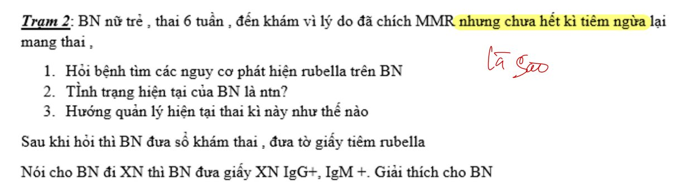

- Qua những thông tin đã có, tôi có thể kết luận là mũi tiêm MMR được thực hiện **cách xa thời điểm thụ thai, cụ thể là hơn 1 tháng trước thời điểm thụ thai**
- Rất có khả năng là chị đã được **bảo vệ khỏi Rubella bởi vaccine (hiệu quả tiêm MMR 1 mũi là 97%, 2 mũi là 99%),** để khẳng định lại điều này thì tôi đề nghị cho chị **xét nghiệm kháng thể trong máu của mình→ đề nghị Rubella IgG,** IgM→Chị đã được bảo vệ bởi kháng thể tạo ra từ vaccine
- Vậy con của tôi có bị ảnh hưởng gì không bác sĩ? → có phải chị đang lo lắng về thai có khả năng bị hội chứng Rubella bẩm sinh, mặc dù vaccine MMR là **vaccine sống giảm độc lực, chống chỉ định trong thai** kỳ, tuy nhiên hiện tại **chưa ghi nhận trường hợp nào chích vaccine MMR trực tiếp gây ra hội chứng Rubella bẩm sinh,** nên chị có thể yên tâm, **thai không có nguy cơ mắc CRS**
- **Trong thai kì này và những lần mang thai sau** thì chị **không cần xét nghiệm lại xét nghiệm** kháng thể rubella do **khả năng bảo vệ của vaccine là dài hạn** ha chị ha.

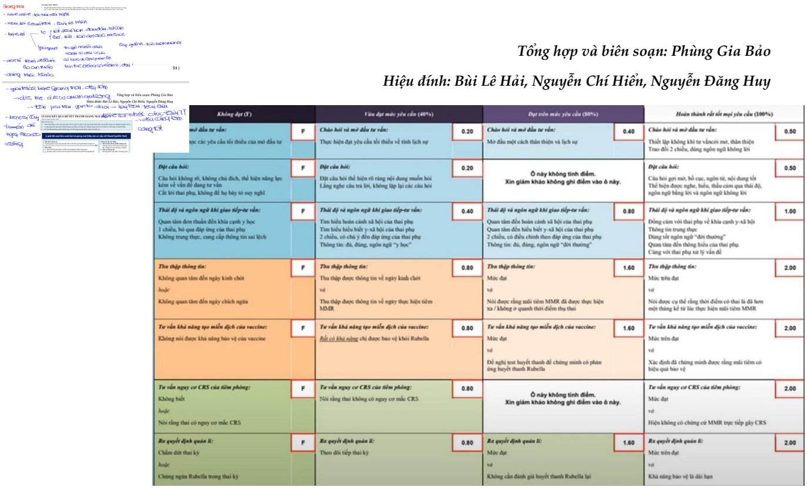

- **Tình huống: Một thai phụ đến khám vì kết quả huyết thanh tầm soát Rubella đầu thai kỳ bất thường, cần có kế hoạch chẩn đoán hoặc theo dõi suốt thai kỳ.**
- **Lý do đến khám:**

- Kết quả tầm soát Rubella: 4 trường hợp
- Vừa tiếp xúc với người bị nhiễm Rubella
- Có triệu chứng lâm sàng giống nhiễm Rubella : Sốt, phát ban, đau khớp
- Khám thai và SA phát hiện bất thường hình thái thai nhi nghi ngờ do Rubella/IUGR sớm
- **Lý giải kết quả-đề xuất giải pháp chẩn đoán:**

###### 3.3.1 TH1: IgM(-), IgG(-):

- Với kết quả xét nghiệm này, hiện tại tình trạng của **chị chưa có miễn dịch với rubella,** có **2 khả năng** xảy ra với chị:
    + **Khả năng 1:** Có thể hiện tại chị không có nhiễm Rubella, tuy nhiên vì chưa có kháng thể nên chị có khả năng sẽ bị nhiễm rubella trong thời gian sắp tới.
    + **Khả năng 2:** Tuy không có triệu chứng lâm sàng hay dịch tễ liên quan nhưng không loại trừ nguy cơ chị đã nhiễm mới Rubella gần đây nhưng do thời gian chưa đủ để có thể xét nghiệm ra kết quả dương tính.
- Do đó, cần theo dõi thai kỳ và **lặp lại bộ xét nghiệm này sau mỗi lần khám thai 4 tuần** đến khi **thai đủ 16 tuần.** Kể từ sau 16 tuần là thời gian **biến chứng lên thai nhi thấp** nếu thai bị nhiễm rubella, nên chị có thể **ngưng xét nghiệm và khám thai bình thường.**
- Vì chị chưa có miễn dịch với Rubella nên chị nên đeo khẩu trang, tránh tiếp xúc với người có triệu chứng sốt, ho, phát ban và nếu có triệu chứng như trên thì đến khám bác sĩ ngay.

###### 3.3.2 TH2: IgM (+), IgG (+)

- Với kết quả xét nghiệm này, có **3 khả năng** xảy ra với chị:
- **Khả năng 1:** Xét nghiệm **IgM dương giả,** có nghĩa là chị không bị nhiễm rubella nhưng kết quả
- IgM dương tính. IgG dương tính là do chị đã mắc rubella từ trước hoặc đã từng được chích vaccine.

- **Khả năng 2:** Tái nhiễm, trước đây chị bị nhiễm nhưng không biết, nay nhiễm lại
- Nếu rơi vào 2 khả năng này thì thai sẽ được quản lý như bình thường.

- **Khả năng 3:** Chị có thể bị nhiễm rubella cấp trong thai kì này, và ở thai mình đang ở tuần …, nên …
- (Nếu **6 < thai < 12 tuần:** nguy cơ thai bị **hội chứng Rubella bẩm sinh** rất cao, có thể phải cân nhắc đến khả năng chấm dứt thai kỳ. Bây giờ mình sẽ tiến hành chọc ối vào tuần 20 để chẩn đoán bé có nhiễm Rubella hay không và siêu âm hình thái học tầm soát các bất thường cấu trúc của CRS.
- Nếu **12 < thai < 16 tuần:** nguy cơ thai bị **hội chứng Rubella bẩm sinh** khoảng **45%,** Bây giờ mình sẽ tiến hành siêu âm 4D mỗi 2 tuần để sớm nhận diện các dấu hiệu của hội chứng Rubella bẩm sinh đồng thời chọc ối vào tuần 20 để chẩn đoán bé có mắc Rubella hay không và phải cân nhắc đến **khả năng phải chấm dứt thai kỳ.**
- Nếu **thai >=16 tuần:** nguy cơ thai bị hội chứng Rubella bẩm sinh là **thấp đến không bị,** và đứa bé sẽ được **theo dõi trên siêu âm hình thái học như thường quy.)**
- *Có thể bị âm tính giả nếu thời gian nhiễm đến lúc chọc ối < 6 tuần
- Trước tiên, để phân biệt chị rơi vào khả năng nào, thì tôi sẽ đề nghị **xét nghiệm lại IgM và IgG vào 2 tuần nữa, nếu IgG tăng gấp 4 lần** thì xác nhận **chị có nhiễm rubella cấp.** Còn nếu **không tăng cao quá 4 lần** thì xác nhận **IgM dương giả hoặc tái nhiễm,** thai sẽ được **quản lý bình thường.**

###### 3.3.3 TH3: IgM(+), IgG(-)

- Với kết quả xét nghiệm này, có **2 khả năng** xảy ra với chị:
- **Khả năng 1:** Xét nghiệm IgM dương giả, có nghĩa là chị không bị nhiễm rubella nhưng kết quả
- IgM dương tính.

- **Khả năng 2:** Chị bị nhiễm rubella cấp trong thai kì này, và ở thai mình đang ở tuần …, nên …
- Trước tiên, để phân biệt chị rơi vào khả năng nào, thì tôi sẽ đề nghị xét nghiệm lại **IgM và IgG** vào **2 tuần nữa,** nếu **IgG (-), IgM (+)** thì xác nhận chị rơi vào khả năng đầu, chị không bị nhiễm rubella cấp. Còn nếu **IgG (+)** thì chị **mắc rubella trong thai kì.**
- Khoảng thời gian IgM (+) rồi IgG (-) chuyển sang IgG(+) khoảng 1-2 tuần

###### 3.3.4 TH4: Igm (-), Igg (+)

- Với kết quả xét nghiệm này, có **2 khả năng** xảy ra với chị:

- **Khả năng 1:** chị **đã có miễn dịch trước đó.** Có thể chị đã được tiêm vaccin Rubella trước đó mà chị quên hoặc cũng có thể chị đã từng mắc Rubella trước đây nhưng chị không biết và nếu có nhiễm thì cũng đã trước lần có thai này. (25% số bệnh nhân nhiễm không triệu chứng. Và do chị đã có miễn dịch nên miễn dịch sẽ bảo vệ chị và con trong suốt thai kỳ nên là chị yên tâm nha, chị không cần phải lặp lại xét nghiệm huyết thanh ở thai kì này và cả thai kì sau do sự bảo vệ của kháng thể là dài hạn. Chị sẽ được khám thai thường quy, hiện tại chị đang ở … tuần, lần khám tiếp theo là … khi có ra huyết, đau bụng, có bất kỳ lo lắng nào khác ảnh hưởng đến mình thì chị đến khám liền.)
- **Khả năng 2:** Chị đã bị nhiễm rubella cấp trong thai kì này, thời điểm nhiễm đã hơn 6 tuần thì kết quả kháng thể Igm trở về âm tính (nếu thai kì =< 8 tuần thì không tư vấn khả năng này)
- Khả năng thứ hai xảy ra rất thấp vì chị không có triệu chứng và yếu tố nguy cơ nhiễm rubella trước đó 6 tuần, thường kết quả này chúng tôi sẽ nghĩ đến chị đã được miễn dịch trước đó.
- Vì vậy, chị sẽ được khám thai thường quy, chị sẽ được làm siêu âm hình thái học vào tuần thứ 20 đến 24 để khảo sát hình thái học thai nhi nếu phát hiện bất thường, sẽ cân nhắc chọc ối cho chị. TH chị có sốt ho, đau khớp phát ban vào trước đó 6 tuần nên có thể chị đã bị nhiễm rubella cấp vào thời điểm đó nhưng hiện tại đã >6 tuần nên có thể Igm đã âm tính.

#### 4. CÁC TƯ VẤN BỔ SUNG

- **Tư vấn theo dõi sức khỏe**

- Vì kết quả Igg (-) nên xác nhận chị chưa chích vaccine và chưa bị nhiễm rubella trước đó, chị nên tiêm ngừa Rubella sau sinh.
- Chị nhớ ăn uống đẩy đủ, nghỉ ngơi nhiều, giảm vận động nặng.
- Trong thời gian tới, nếu có các triệu chứng như đau bụng, ra huyết, ra nước, sốt thì chị nhớ đi khám liền. Chị đừng quá lo lắng, chúng tôi sẽ cố gắng hết sức và đồng hành cùng chị trong mọi hoàn cảnh.
- Igm (-) Igg(+)
- TH1: Thai phụ đã có miễn dịch từ trước
- TH2: Thai phụ mới mắc trong thai kỳ này và đã qua 6 tuần Igm(+)

- Nếu thai phụ có giấy tiêm ngừa / giấy điều trị trước đó —> TH1
- Phân định trường hợp 1 và 2: không dùng biến thiên nồng độ để xác định nhiễm cấp hay muộn mà dùng Igg aividity.
- Nếu Igg avidity yếu —> TH2 + xem xét triệu chứng lâm sàng để ủng hộ
- Nếu Igg avidity mạnh —> TH1
- TH1: Thai phụ đã có miễn dịch bảo vệ từ trước, theo dõi thai kỳ thường quy.
- TH2:
- Thai =< 8 tuần: thời gian nhiễm không liên quan đến thai kỳ, theo dõi thai kỳ thường quy. **39 |**
- Thai > 8 tuần: trừ 6 tuần để ra tuần nghi ngờ nhiễm, tư vấn nguy cơ rubella bẩm sinh, theo dõi bất thường trên siêu âm hình thái học + test xâm lấn để chẩn đoán.

### TIẾP CẬN THIẾU MÁU

#### 1. LÝ THUYẾT CẦN NHỚ

- Thiếu máu trong thai kỳ khi Hb < 11g/dl ở TCN1 và 3, <10,5 ở TCN2
- Thiếu máu nặng nếu Hb < 7g/dl máu.
- HC nhỏ nhược sắc nếu MCV < 80fL, MCH < 27pg
- Thiếu máu trong thai nghén chia thành các loại sau:
- Thiếu máu do thiếu sắt (ferritin <10-50ng/ml)
- Thiếu máu do thiếu acid folic
- Thiếu máu do tán huyết (di truyền hoặc mắc phải)
- Một thai phụ đến khám vì kết quả tầm soát thiếu máu cho kết quả thiếu máu nhược sắc hồng cầu nhỏ, cần được thực hiện thêm các biện pháp khảo sát thích hợp ở vợ và chồng. Tình huống chính: Thalassemia

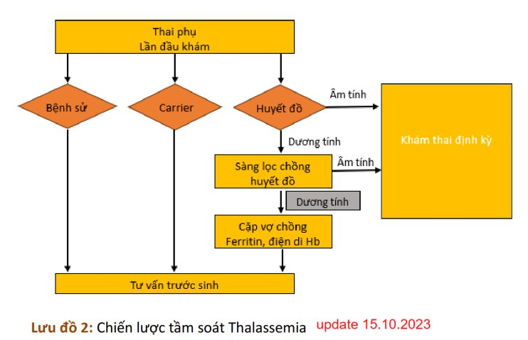

#### 2. CÁC ĐỀ

##### 2.1 Y19 – đợt 1: Thiếu máu + Lệch bội bình thường

- Thai 13 0/7. Kết quả khám thai bình thường -> Đến khám định kỳ
- Công thức máu

- Hb 10.6 g/dL
- MCH 23
- MCV 70
- Bạch cầu 23k
- Tiểu cầu 335k
- => CTM: Thiếu máu HC nhỏ nhược sắc -> Giải thích: MCH < 27 & MCV < 80 & Hb < 11 -> Hướng xử trí: Thực hiện Ferritin huyết thanh hỏi chị có làm chưa? Nếu rồi -> xin đọc kết quả là thiếu sắt // thalassemia -> thì hỏi huyết đồ ck -> nói chung là cứ hỏi tới khi chưa làm thì tư vấn cho làm rồi the end)
- Lệch bội

- Combined test: T21 = 1:403, T18 & T13 < 1:20.000. NT = 1,8 mm
- Đánh giá tình trạng lệch bội -> Giải thích: T21 vùng xám + T13, T18 nguy cơ thấp ->
    + Hướng xử trí: Ưu tiên NIPT -> 2nd: Siêu âm hình thái sớm 16-18w

##### 2.2 Y18: Thalassemia đã có chẩn đoán. Kế hoạch quản lý tiếp theo?

##### 2.3 Y16: Thiếu máu thiếu sắt do ăn chay

- Đề: Sản phụ tái khám ở 12w, tư vấn kết quả huyết đồ và đưa ra hướng quản lý, giải quyết các thác mắc của thai phụ.

- Thiếu máu hồng cầu nhỏ nhược sắc, ferritin giảm, gia đình và chồng bình thường, bé trước bình thường. Hỏi triệu chứng.
- Kết luận thiếu máu thiếu sắt. Tìm nguyên nhân.
    + Ăn chay trường
    + Kinh bà này có dài nhưng ko đến nổi
    + Bà này sổ giun đều mỗi 6 tháng
- Nhưng ăn chay chỉ rau và nấm – đây là nguyên nhân. Tư vấn ăn thịt là sẽ ko có điểm đồng cảm.
- Điều trị bổ sung sắt và chế độ ăn.
- Chưa thể loại trừ Thalassemia, yêu cầu làm huyết đồ chồng (theo đúng lưu đồ).
- Hẹn tái khám 4 tuần, làm gì vào bữa đó.

##### 2.4 Y17 đợt 4

- Đề: Bạn là bác sĩ phòng khám. Thai phụ từng có con bị phù thai do Hb Bart đến gặp bạn.
- Yêu cầu:

1. Nhận định tình trạng thai hiện tại và hướng quản lý
2. Trả lời những thắc mắc của thai phụ

- (Không yêu cầu hỏi bệnh sử, bạn có thể hỏi nếu cần thêm thông tin nhưng chú ý quỹ thời gian)
- Thai phụ 30 tuổi, PARA 0010
- 2019 : Thai bị phù thai, đã làm genotype vợ-chồng dị hợp tử SEA.
- 2021: Lấy chồng lần 2
- Lần này thai 8 tuần đến tư vấn.

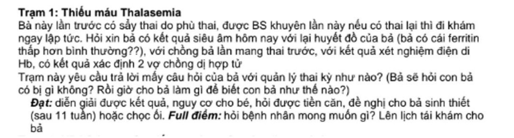

##### 2.5 Tình huống chị Mai Phương :

- B1: Nhận định bệnh nhân có thiếu máu nhỏ nhược sắt
- B2: Phân định nguyên nhân thường gặp qua Ferritin
- => Ferrtin thấp nghi do: Thiếu máu thiếu sắt phần nhiều
- B3: Hỏi bệnh để loại bớt và củng cổ nguyên nhân thiếu máu hồng cầu nhỏ nhược sắt
- Tán huyết: Vàng da (Vàng mắt), tiểu đậm màu – Tiểu xá xị, đau hông lưng.
- Xuất huyết: Đi tiêu phân đen
- Dinh dưỡng: chế độ ăn kiêng cử gì không? (đặc biệt là thịt đỏ và rau xanh có trong thực đơn của thai phụ không?)
- Xử trí:
- Chấn đoán ra bệnh trước: TM mức độ TB, hồng cầu nhỏ nhược sắt nghi do thiếu sắt => Xử trí: Chỉ cần nói Bổ sung Fe nguyên tố đường uống là đủ điểm rồi (nhưng muốn chắc hơn thì nói cả liều):

- Nhẹ - trung bình: 100-200 mg Fe nguyên tố/ngày đường uống
- Theo dõi: quay lại sau 4 tuần để kiểm tra:
- (1) Ferritin
- (2) Hgb, MCV, MCH
- => Các chỉ số không nhất thiết phải về bình thường mà chỉ cần cải thiện cũng được kết luận là có đáp ứng và duy trì liều Fe cho đến khi tất cả về bình thường thì đổi liều qua 30 mg Fe nguyên tố/ngày
- => Nếu chỉ có mỗi Ferritin tăng trong khi các chí số khác không về bình thường
- => Nghi ngờ Thalassemia đi kèm với TMTS
- => Xin làm CTM và ferritin của chồng
- => Ra bất thường thì làm genotype của vợ trước:
- Bình thường, giải thích nguy cơ bị bệnh thai nặng sẽ không cao và cho về khám thai thường quy
- Bất thường, làm luôn genotype chồng và giải thích nguy cơ có thể mất bệnh thai nặng (phù thai) có thể gây tử vong cho bé và nguy hiểm cho mẹ

#### 3. CÁC BƯỚC TIẾP CẬN

##### 3.1 Bước 1: Yếu tố nguy cơ thiếu máu (5 câu hỏi)

- Chị có đi khám thai ở đâu trước đó chưa? Cho xin sổ khám thai?
- PARA
1. Gần đây chị có thấy chóng mặt, mệt mỏi không? Có chảy máu chân răng không? Có đi cầu ra máu không?
2. Chị có bao giờ được chẩn đoán thiếu máu chưa? Thai kì trước có được chẩn đoán thiếu máu không? Em bé có bị thiếu máu không?
3. Gia đình và chồng chị có ai bị thiếu máu không?
4. Chế độ ăn của mình như thế nào? Có ăn đủ chất không?

- **Khám: da xanh niêm nhạt**

##### 3.2 Bước 2: Tư vấn

###### 3.2.1 Huyết đồ: (điển hình: Hb < 11 g/dL, MCV < 80 fL, MCH < 27 pg)

- Đây là kết quả xét nghiệm máu của chị, dựa theo kết quả này thì chị đang bị thiếu máu/chưa bị thiếu máu, nhưng MCV <80, nên có nguy cơ phát triển thành thiếu máu hồng cầu nhỏ nhược sắt.
- Trong thai kỳ thiếu máu thường gặp là thiếu máu do thiếu sắt hoặc thiếu acid folic hoặc thiếu máu do di truyền, trong khi thiếu máu thiếu sắt và thiếu acid folic là do ăn uống không đủ chất, có thể giải quyết bằng cách bổ sung qua ăn uống. Còn thiếu máu di truyền thì có nguy cơ phải truyền máu. Do đó chị sẽ được thực hiện một xét nghiệm khác để phân biệt 2 tình trạng này.

###### 3.2.2 Ferritin (<30ng/ml là thiếu máu thiếu sắt, bình thường hoặc >200 là Thalassemia)

- **Th1: Thiếu máu thiếu sắt**
- Kết quả xét nghiệm cho thấy chị không phải bị thiếu máu di truyền mà là bị bệnh thiếu máu thiếu sắt do ferritin < 30 ng/ml.

- **B1: Chị có biết gì về thiếu máu thiếu máu thiếu sắt chưa?**
- Thiếu máu thiếu sắt là tình trạng thiếu máu do giảm nguyên liệu cung cấp để tạo máu mà ở đây là chất sắt, nguyên nhân thường là do chế độ ăn uống. Các ảnh hưởng lên mẹ và thai nhi là:

- Đối với mẹ: làm tăng tỉ lệ tử vong khi sinh, tăng nguy cơ băng huyết sau sinh, nhiễm trùng hậu sản….
- Đối với thai nhi: làm tăng nguy cơ sẩy thai, thai giới hạn tăng trưởng trong tử cung, tăng tỉ lệ chết chu sinh
- Tuy nhiên chị cũng đừng quá lo lắng, nếu tình trạng thiếu máu thiếu sắt được phát hiện và điều trị tốt thì các nguy cơ sẽ giảm đáng kể.

- **B2: Điều trị và theo dõi:**
    + Chị sẽ được bổ sung sắt hàng ngày, sau đó mình sẽ tái khám để xem có đáp ứng với thuốc không nha. Nếu sắt lên cao mà vẫn còn thiếu máu, tôi sẽ làm các xét nghiệm chuyên sâu hơn để khảo sát thiếu máu di truyền.
    + Uống thuốc sắt thì nên uống với nước lọc **không được uống chung với sữa, nên uống trước bữa ăn tầm 30 phút.**
    + Chị nhớ ăn uống đầy đủ, nghỉ ngơi nhiều, tránh vận động nặng, khi có các triệu chứng đau bụng, ra huyết, ra nước, chóng mặt, ngất, xanh xao thì mình đi khám liền.

- **Th2: Thalassemia**

- Kết quả xét nghiệm cho thấy chị không phải bị thiếu máu thiếu sắt mà là bị bệnh thiếu máu di truyền do ferritin > 30 ng/ml.
- Chị đã biết được thông tin gì về bệnh thiếu máu di truyền này chưa? **Đây là bệnh thiếu máu do gen quy định và có** nhiều thể từ nặng tới nhẹ.
    + Trong thể bệnh nặng thì có thể gây **phù thai, thai chết lưu hoặc chết sau sinh** vài giờ hoặc nếu sống được thì phải điều trị **truyền máu cả đời;**
    + trong khi đó thể nhẹ có thể không triệu chứng và có thể sống như một người bình thường.
- Tuy nhiên chị cũng đừng quá lo lắng vì thai nhi chỉ có nguy cơ bị thiếu máu nặng khi cả chị và chồng đều mang gen bệnh, còn nếu chỉ có chị hoặc chồng mang gen bệnh thì con chị vẫn được mang 1 gen lành nên không bị thiếu máu. Trước tiên tôi sẽ xét nghiệm máu của chồng chị để đánh giá tình trạng thiếu máu của chồng chị.
- Trong trường hợp chồng chị không thiếu máu, chị có thể yên tâm về vấn đề thiếu máu của thai nhi trong thai kì này thai kì của chị sẽ được theo dõi như bình thường mặc dù sẽ chấp nhận bỏ sót TH chồng mình mang Thalassemia thể nhẹ dẫn đến không có biểu hiện trên huyết đồ.
- Nếu xét nghiệm máu của chồng chị cho thấy thiếu máu, chồng chị và chị sẽ được điện di Hb và xét nghiệm gene để có kết quả chính xác về kiểu gen bệnh mà 2 anh chị đang mang.
    + Sau đó nếu theo kết quả này thai nhi không có nguy cơ cao bị thiếu máu nặng, chị sẽ tiếp tục được khám thai và theo dõi định kỳ.
    + Tuy nhiên nếu thai nhi có nguy cơ cao bị thiếu máu nặng thì chúng ta cần làm test xâm lấn như chọc ối để chẩn đoán.
    + Tôi đã tư vấn cho mình xong, chị có không rõ ý nào không? Chị có thắc mắc gì không?

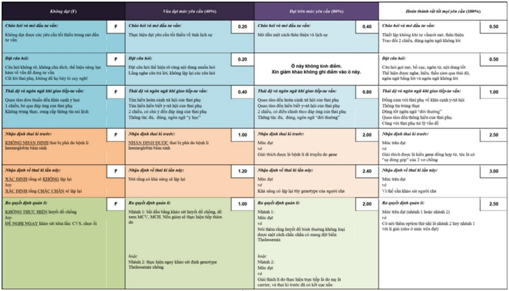

- **Kết thúc buổi tư vấn**

### TIẾP CẬN VIÊM GAN B

#### 1. LÝ THUYẾT CẦN NHỚ

- **Huyết đồ:** /- giảm tiểu cầu, thời gian đông máu kéo dài
- **Huyết thanh miễn dịch:** HBsAg (+) và IgM (+), nếu nhiễm mạn IgG(+) HBeAg (+): viêm gan cấp PCR (HBV DNA): thực hiện sau HBeAg(+) hoặc vào tuần 26-28 với HBeAg(-)
- **Chức năng gan::** AST, ALT tăng cao (thường tăng trên 5 lần so với giá trị bình thường khi có vàng da).
- **Bilirubin:** Bilirubin tăng cao, chủ yếu là Bilirubin trực tiếp.

- Nguồn lực đủ: TCN1 nên tiếp cận với men gan + HBV luôn, nhưng theo step thì nên làm
    + HbeAg trước rồi sau đó làm HBV do có khi HbeAg (-) nhưng tải lượng vẫn trên ngưỡng, nếu không làm HBV mình sẽ bỏ sót trường hợp cần điều trị
- HbsAg (+) → trẻ phải được dự phòng sau sinh
- Đang tiêm VGB mà có thai → sau sinh tiêm tiếp, tuy nhiên vẫn có thể tiêm lúc mang thai (TCN2) đối với những người có YTNC

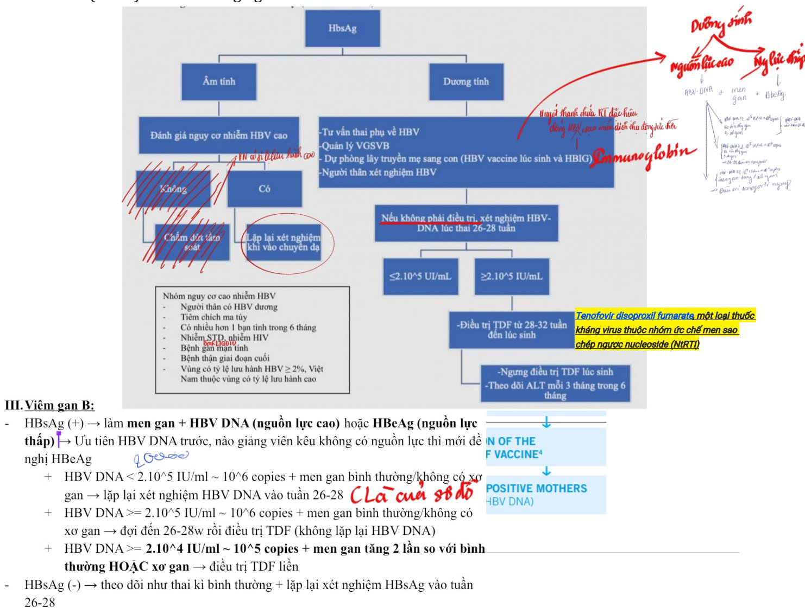

#### 2. CÁC ĐỀ

##### 2.1 Y19 – đợt 2 – trạm 2: HbsAg (+) – tư vấn viêm gan B

- YÊU CẦU: giải thích và tư vấn kết quả vi sinh
- Vô hỏi lý do tới khám, bả quăng cho 1 sấp giấy tờ đã được làm ở tuần thứ 8, xong bả hỏi có kết quả có gì bất thường ko
- Quét qua hết 1 lượt thì thấy bả đã tiêm MMR, ko thiếu máu, nhóm máu O+, RPR (-), HIV (-), chỉ duy nhất là HbsAg (+)
- mình chỉ việc tư vấn ảnh hưởng của VGB lên thai kỳ
- xong bả thắc mắc là tại sao phải làm thêm xét nghiệm nữa vậy?
- Vì HbsAG chỉ là 1 xét nghiệm tầm soát, cho biết chị có đang nhiễm VGB ko, còn muốn biết con virus nó có đang hoạt động ko hay gan của chị đang hoạt động như thế nào ...
- xong xin thêm HBeAg, HBV DNA, men gan, ... --> thấy âm tính hết nên có thể an tâm về kết quả này
- Hẹn 4 tuần tái khám làm combined test (mà t quên nói ….)
- hẹn 26w tới làm tầm soát VGB tiếp
- nếu có triệu chứng vàng da, đau bụng, thì tái khám ngay
- nói chung 2 trạm trên quá dễ, chỉ việc bình tĩnh mà tư vấn, nhưng mà 1 phần t run do quá trình xếp trại chạy bị lỗi, nên cái phần hẹn tái khám t chưa làm tốt nên điểm thấp hơn dự kiến cũng ko phải khó hiểu.

##### 2.2 Y19 - đợt 5: Sau tiêm vaccine viêm gan B.

- Bạn là BS phòng khám. Thai phụ đến để tư vấn vì phát hiện có thai sau khi tiêm ngừa VGB
- Tác vụ:
1. Hỏi bệnh sử, tiền sử
2. Tư vấn cho thai phụ
    + Lưu ý: Các thông tin hỏi được: thai phụ đã tiêm VGB 2 mũi, mũi 2 cách hôm nay 2 tháng (giấy tiêm ngừa), xin giấy XN VGB trước khi tiêm và giấy siêu âm hôm nay. Kết quả siêu âm hôm nay ghi nhận thai 6 tuần, sinh trắc và sinh tồn bình thường
    + Thầy Luân: “Vaccin này là DNA, không phải vaccin sống giảm độc lực nên ko ảnh hưởng đến thai kỳ, hẹn bả sau sinh tiêm tiếp”

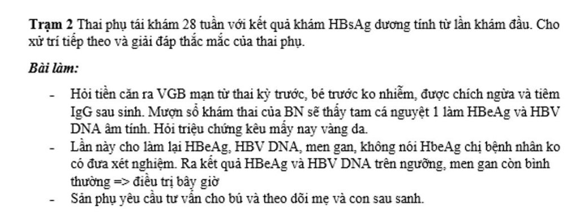

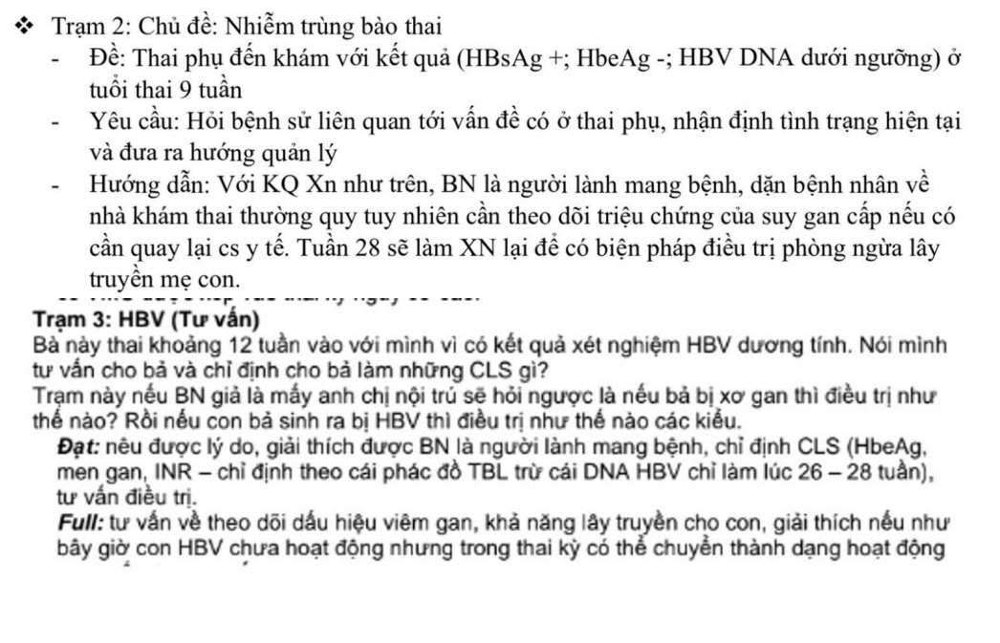

#### 3. CÁC BƯỚC TIẾP CẬN

##### 3.1 Có yếu tố dịch tễ VGB?

- Thai của mình bao nhiêu tuần rồi? Cho tôi xin sổ khám thai.

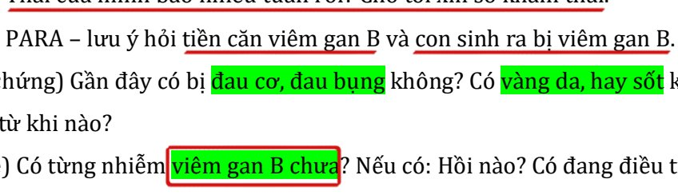

1. (Triệu chứng) Gần đây có bị đau cơ, đau bụng không? Có vàng da, hay sốt không? Triệu chứng xuất hiện từ khi nào?
2. (Dịch tễ) Có từng nhiễm viêm gan B chưa? Nếu có: Hồi nào? Có đang điều trị không? Nếu chưa: chích ngừa viêm gan B chưa?
3. (Nguy cơ) Gia đình có ai từng bị viêm gan B không? Gần đây có truyền máu, xăm mình, quan hệ tình dục không an toàn không?

##### 3.2 Khái niệm viêm gan B

- **Chị đã biết gì về viêm gan B chưa, đặc biệt là VGB trong thai kỳ?**

- VGB là bệnh do virus viêm gan B gây ra có thể lây truyền qua 3 đường là đường máu, đường tình dục và từ mẹ sang con.
- Khi chị mang virus VGB thì có khả năng lây truyền cho con trong thời kỳ mang thai, trong chuyển dạ và trong quá trình cho con bú.
- Mẹ nhiễm có thể bị viêm gan B cấp, có thể dẫn đến tổn thương gan, xơ gan, ung thư gan
- Con bị nhiễm virus VGB có thể bị sẩy, thai lưu, thai giới hạn tăng trưởng, sanh non, mắc VGB

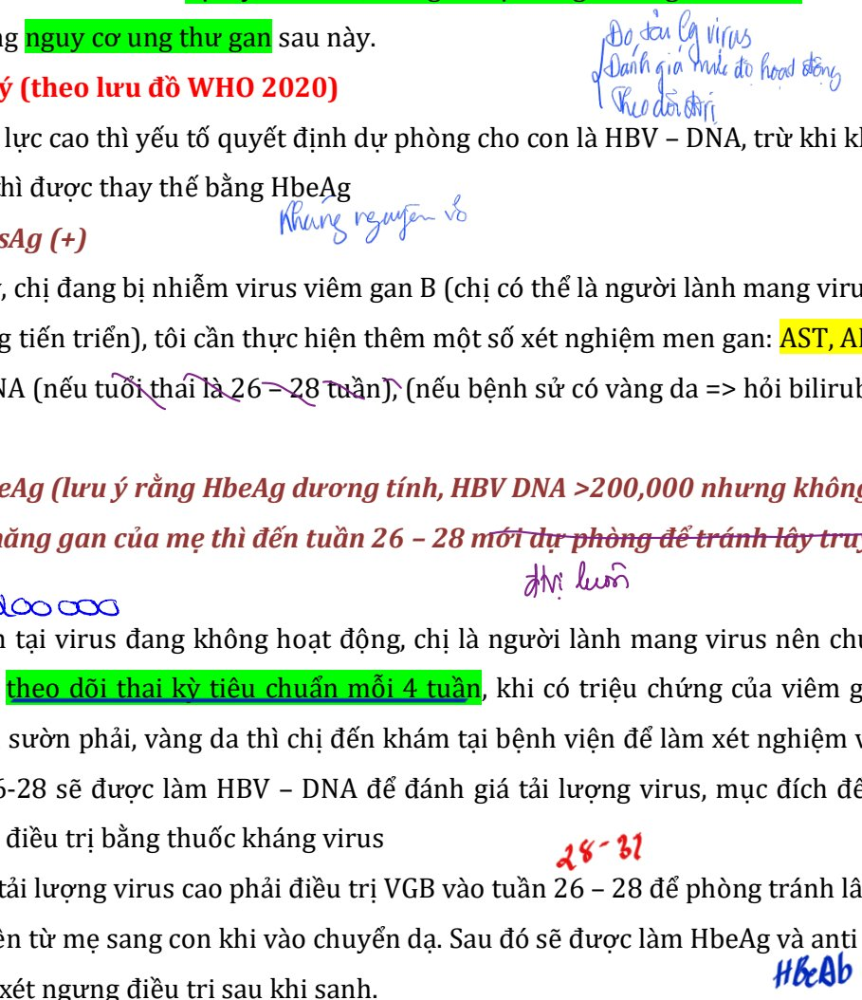

- bẩm sinh và tăng nguy cơ ung thư gan sau này.

##### 3.3 Tư vấn quản lý (theo lưu đồ WHO 2020)

- Ở nơi có nguồn lực cao thì yếu tố quyết định dự phòng cho con là HBV – DNA, trừ khi không có HBV – DNA thì được thay thế bằng HbeAg

###### 3.3.1 Diễn giải HbsAg (+)

- Với kết quả này, chị đang bị nhiễm virus viêm gan B (chị có thể là người lành mang virus hoặc viêm gan B đang tiến triển), tôi cần thực hiện thêm một số xét nghiệm men gan: AST, ALT, HbeAg, HBV-DNA (nếu tuổi thai là 26 – 28 tuần), (nếu bệnh sử có vàng da => hỏi bilirubin) để xác định.

###### 3.3.2 Diễn giải HbeAg (lưu ý rằng HbeAg dương tính, HBV DNA >200,000 nhưng không ảnh hưởng đến chức năng gan của mẹ thì đến tuần 26 – 28 mới dự phòng để tránh lây truyền

- **dọc cho con)**

- HBeAg (-): Hiện tại virus đang không hoạt động, chị là người lành mang virus nên chúng tôi quyết định cho theo dõi thai kỳ tiêu chuẩn mỗi 4 tuần, khi có triệu chứng của viêm gan cấp như sốt, đau hạ sườn phải, vàng da thì chị đến khám tại bệnh viện để làm xét nghiệm và điều trị. Vào tuần 26-28 sẽ được làm HBV – DNA để đánh giá tải lượng virus, mục đích để quyết định có bắt đầu điều trị bằng thuốc kháng virus
    + Nếu tải lượng virus cao phải điều trị VGB vào tuần 26 – 28 để phòng tránh lây truyền từ mẹ sang con khi vào chuyển dạ. Sau đó sẽ được làm HbeAg và anti HBe xem xét ngưng điều trị sau khi sanh.
    + Nếu tải lượng virus thấp thì có thể yên tâm theo dõi thai kỳ. Mẹ sẽ được xét nghiệm hậu sản bằng chức năng gan và HBV DNA vào tháng 1 3 6 sau khi sinh.
    + Sau khi sinh bé sẽ được tiêm kháng thể trong vòng 12h sau sanh, tiêm vaccine vào ngày 1, 30 và 60 để phòng bệnh và thực hiện các XN tìm virus viêm gan B trên bé để xác định bé có bị viêm gan B không. (HbsAg, anti -Hbs, anti - Hbc).
- HbeAg (+): Không may kết quả này cho thấy virus VGB của chị đang hoạt động và với men gan hiện tại bình thường cho thấy không có tổn thương tế bào gan. Chị sẽ tái lại vào mỗi 4 tuần, hoặc sớm hơn nếu có triệu chứng sốt, vàng da, đau cơ đau khớp đau bụng. Vào tuần 26- 28 sẽ được làm HBV – DNA để đánh giá tải lượng virus, mục đích để quyết định có bắt đầu điều trị bằng thuốc kháng virus Tenofovir hoặc điều trị sớm hơn khi có triệu chứng viêm gan B cấp như sốt, đau hạ sườn phải, vàng da.
    + Sau khi sinh bé sẽ được tiêm kháng thể trong vòng 12h sau sanh, tiêm vaccine vào ngày 1, 30 và 60 để phòng bệnh và thực hiện các XN tìm virus viêm gan B trên bé để xác định bé có bị viêm gan B không (HbsAg, anti -Hbs, anti - Hbc). Và mẹ sẽ được theo dõi hậu sản bằng chức năng gan và HBV DNA vào 1 3 6 tháng sau sinh

###### 3.3.3 Bất thường men gan + HBV DNA > 20,000 IU hoặc xơ gan (điều trị lập tức)

- Không may cho kết quả này cho thấy virus viêm gan B của chị đang hoạt động, đang gây tổn thương tế bào gan và nguy cơ ảnh hưởng đến sức khỏe của chị nên chị sẽ được chỉ định điều trị để làm giảm tải lượng virus bằng thuốc kháng virus Tenofovir ngay tại thời điểm này. Và xem xét ngưng điều trị vào giai đoạn hậu sản bằng xem xét HBeAg, HBeAb
- Sau khi sinh bé sẽ được tiêm kháng thể trong vòng 12h sau sanh, tiêm vaccine vào ngày 1, 30 và 60 để phòng bệnh và thực hiện các XN tìm virus viêm gan B trên bé để xác định bé có bị viêm gan B không.

###### 3.3.4 Về vấn đề nuôi con bằng sữa mẹ

- Nuôi con bằng sữa mẹ có thể làm lây nhiễm virus VGB nhưng nếu đã áp dụng đầy đủ các biện pháp phòng bệnh như kiểm soát tải lượng virus trong thai kỳ, tiêm phòng sau sanh đúng chỉ định thì chị vẫn có thể nuôi con bằng sữa mẹ. Nhưng chị cần lưu ý, nguy cơ lây bệnh cho trẻ sau sanh có thể qua nhiều đường chứ không chỉ duy nhất qua sữa mẹ. Tuy nhiên, để đảm bảo tâm lý chị vẫn có thể lựa chọn sữa công thức phù hợp cho bé, nhưng theo chứng minh thì không có sự khác biệt về việc lây truyền mẹ con giữa nhóm có nuôi con bằng sữa mẹ và bằng sữa công thức và sữa mẹ vẫn là sữa tốt nhất. Về vấn đề quyết định, chị có thể cân nhắc. Chúng tôi tôn trọng và sẽ đồng hành cùng chị trong mọi trường hợp.
- Ở TCN 1 một thai phụ đến với chúng ta, xét nghiệm viêm gan B HbsAg(+), chúng ta quan trọng điều gì? Xem xét thể viêm gan có đang hoạt động hay không.

- Điều kiện lý tưởng, khả năng kinh tế ổn:
- Xét nghiệm chức năng gan: xem tổn thương gan
- Tải lượng HBV DNA: xem xét tải lượng điều trị.
- Thai phụ chỉ muốn đến khám thai, không có điều kiện kinh tế, khả năng tiếp cận nguồn lực y tế thấp:
- Xét nghiệm chức năng gan: xem tổn thương gan.
- HbeAg, nếu HbeAg (+) thì sao? (1) điều trị ngay nếu khả năng tiếp cận nguồn lực y tế thấp, mất dấu cao (2) có thể chưa điều trị, tư vấn thai phụ về bệnh, nguy cơ có thể xảy ra, tiếp tục theo dõi nếu có triệu chứng viêm gan, xơ gan (đau hạ sườn phải, vàng da, phù,…) thì lúc đó đến khám, điều trị nếu thai phụ có khả năng tiếp cận y tế.

### TIẾP CẬN GIANG MAI

#### 1. LÝ THUYẾT CẦN NHỚ

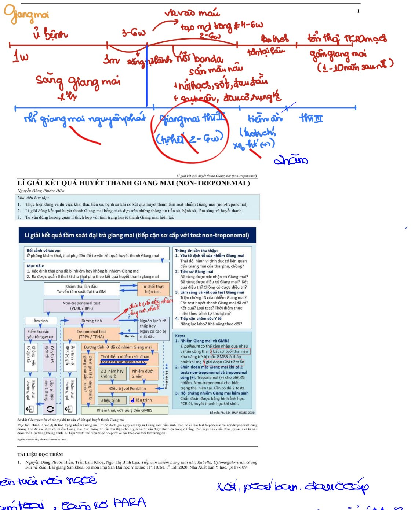

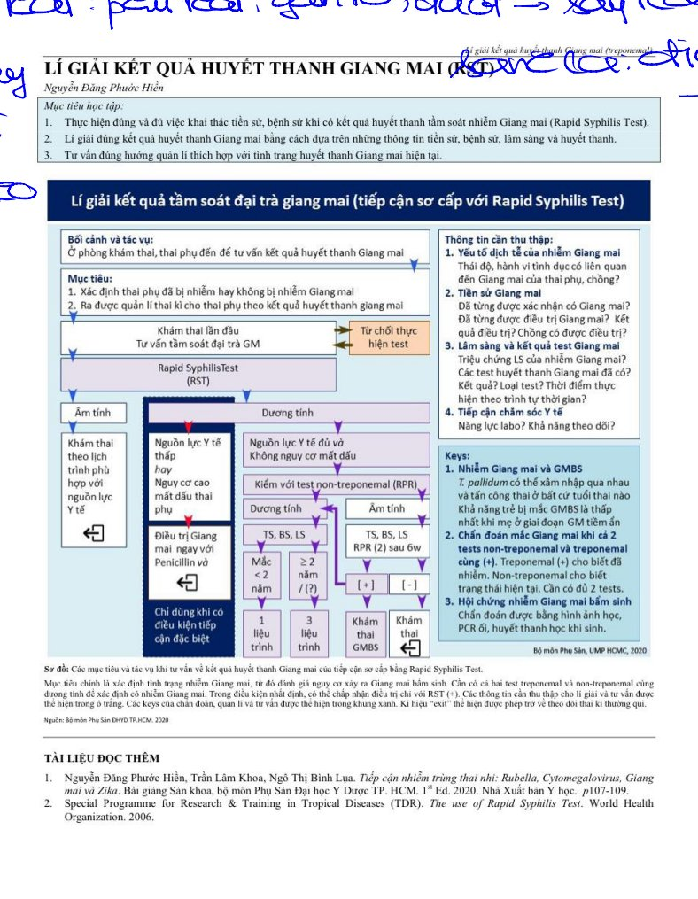

#### 2. CÁC ĐỀ

##### 2.1 Y18 – đợt 4

- Đề: BN đến khám vì có test RPR (+)

##### 2.2 Y17 đợt 1

- Đề: Thai phụ 30 tuổi hiện ở một xã xa xôi của tỉnh Cà Mau. Trong đợt xét nghiệm sàng lọc giang mai của một nhóm tình nguyện, bà ta có kết quả test dương tính: Rapid syphilis test.
    + Hiện tại bà ta rất nghèo cũng như không có điều kiện đi xa vì phải chăm hai con nhỏ. Không có từng được chẩn đoán nhiễm giang mai cũng như không có triệu chứng nhiễm trước đây.
    + Tiền căn sinh con bình thường, 2 con, mang thai gần nhất cách 2 năm, giấy tờ khám thai chính xác.

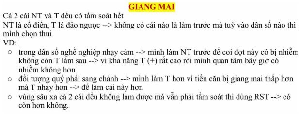

- Tư vấn về kết quả xét nghiệm giang mai này và những nguy cơ có thể xảy ra.
- Trả lời thắc mắc của bà ta và đưa ra hướng xử trí hiện tại.

#### 3. CÁC BƯỚC TIẾP CẬN

##### 3.1 Yếu tố dịch tễ của giang mai (3 câu hỏi)

- Thai của mình bao nhiêu tuần rồi? Cho tôi xin sổ khám thai.
1. **Triệu chứng lâm sàng:** Gần đây có săng, sẩn, phát ban? Có sốt, sưng hạch không? Có đau đầu, sụt cân, đau cơ? Triệu chứng xuất hiện từ khi nào?
2. Có từng nhiễm giang mai chưa? Xét nghiệm gì chưa? Hồi nào? Có đang được điều trị không? Đã từng được chẩn đoán các bệnh lây truyền qua đường tình dục khác

- Từng xét nghiệm giang mai rồi, Treponemal. Để phục vụ cho chẩn đoán, tôi xin phép hỏi chị thêm một số câu hỏi nữa.

3. Biện pháp bảo vệ khi quan hệ của mình sử dụng là gì? Một bạn tình hay nhiều bạn tình? Chồng hay bạn tình của chị có nhiễm giang mai không? Có được điều trị không?

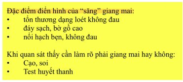

4. Nhà chị có gần cơ sở y tế không? Chị có đi khám thai thường xuyên không?
- **Khám: đặt mỏ vịt tìm săng giang mai (đặc biệt là thai phụ có YTNC cao)**

##### 3.2 Kiến thức về giang mai

- **Chị đã biết gì về bệnh giang mai chưa và đặc biệt là tình trạng nhiễm giang mai trong thai kỳ?**

- Bệnh giang mai là bệnh do vi khuẩn giang mai gây ra, lây truyền qua đường tình dục.
- Trong thai kì, giang mai có thể xâm nhập qua thai nhi vào bất kỳ thời điểm của thai kỳ và gần như chắc chắn 100% nếu mẹ trong giai đoạn giang mai sớm, 50% là kết cục xấu nếu không điều trị.
- Nguy cơ mẹ: Giang mai có thể gây tổn thương tất cả cơ quan quan trọng trong cơ thể như tim mạch, thần kinh, gan, da niêm, mắt, …
- Nguy cơ con: Nếu con bị nhiễm giang mai có thể gây giang mai bẩm sinh biểu hiện bằng phù thai, phù nhau, gan to, đa ối cùng nhiều hậu quả nghiêm trọng như sẩy thai, thai lưu, thai giới hạn tăng trưởng, sanh non và có thể sinh ra cùng các dị tật nặng như điếc, động kinh, đục thủy tinh thế với do đó mình phải điều trị càng sớm càng tốt.

##### 3.3 Tư vấn quản lý

###### 3.3.1 Tình huống 1: VDRL +

- Nếu chỉ có VDRL + thì chỉ cho biết rằng chị đang nhiễm, nhưng không rõ là giang mai hay 1 loại vi khuẩn virus khác, nên chúng tôi cần đề nghị thêm TPHA để xem có thực sự là nhiễm giang mai hay không:
    + Nếu TPHA (-) thì chị có thể yên tâm mình không mắc giang mai, đây có thể là một kết quả dương tính giả (tức là chị không mắc bệnh nhưng VDRL+) chúng tôi sẽ

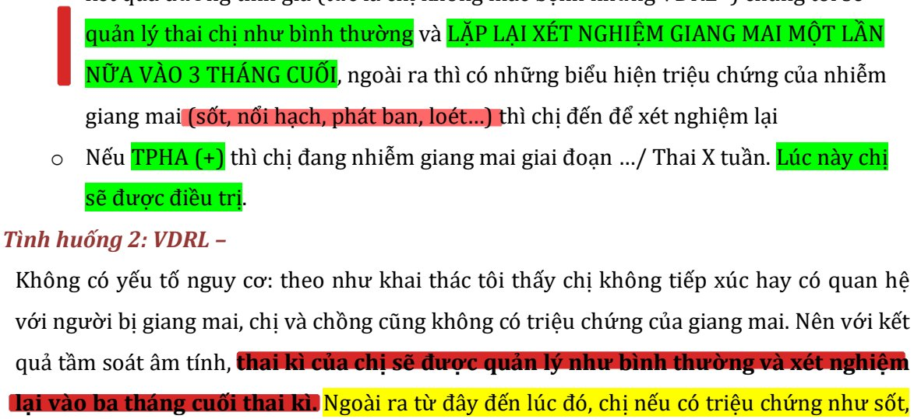

###### 3.3.2 Tình huống 2: VDRL –

- Không có yếu tố nguy cơ: theo như khai thác tôi thấy chị không tiếp xúc hay có quan hệ nổi hạch, phát ban hay loét thì đến khám ngay để làm xét nghiệm kiểm tra.
- Có yếu tố nguy cơ: theo như chị nói (chồng chị bị giang mai, chị có tiếp xúc với người bị GM) thì chị vẫn có nguy cơ mắc GM, nên XN hiện tại âm tính cũng chưa thể an tâm về thai kỳ lần này. Do đó, hẹn chị **tái khám 4 tuần sau để lặp lại XN Giang mai này cũng như siêu âm để đánh giá hình thái cấu trúc của em bé (phù nhau thai).** Nếu bình thường, mình sẽ được xét nghiệm lại đầu TCN3.

###### 3.3.3 Tình huống 3: RST

- RST (-): chị có khả năng không bị GM. Tuy ở đây điều kiện y tế hơi khó khăn, nhưng tôi mong vì sức khỏe mẹ và bé, chị nên khám thai đầy đủ theo lịch hẹn. Nếu có gì bất thường cần hỗ trợ có thể yêu cầu đến nơi có nguồn lực y tế cao hơn để theo dõi.
- RST (+): Thật sự với 1 kết quả test nhanh như này, vẫn chưa đủ để khẳng định chị thật sự nhiễm GM hay không. Tuy nhiên vì nguồn lực y tế ở đây khó tiếp cận và nguy cơ mất dấu thai phụ là rất cao (ví như việc chúng ta rất khó gặp nhau lần thứ 2) do đó tôi không thực hiện thêm XN khác để chẩn đoán chính xác tình trạng GM của chị mà sẽ tiến hành điều trị luôn ngay từ bây giờ để tránh tình trạng xấu là chị đang thật sự nhiễm GM và có thể gây ra những biến chứng như tôi đã kể trên

###### 3.3.4 Tình huống 4: TPPA (+)

- Kết quả cho thấy chị đã từng phơi nhiễm với giang mai nhưng không thể xác định được tình trạng hiện tại của chị, nên tôi đề nghị thêm xét nghiệm VDRL để kiểm tra.

- Nếu VDRL (-) thì không khẳng định được chị đang mắc nên tôi sẽ cho chị tái khám lại sau khoảng 4 tuần và kiểm tra triệu chứng, lặp lại xét nghiệm VDRL một lần nữa để chắc chắn chẩn đoán
- Nếu VDRL (+) thì tôi rất tiếc chị đang nhiễm giang mai giai đoạn … /thai … tuần. Lúc này chị sẽ được điều trị.

##### 3.4 Điều trị nếu có giang mai

1. Trước giờ chị có dị ứng với kháng sinh hay thuốc nào không? (Nếu có dị ứng penicilin thì phải bảo là giải mẫn cảm và tiếp tục điều trị penicilin – KHÔNG THAY THẾ BẰNG THUỐC KHÁC)
2. Tôi sẽ chị điều trị với pencillin
    + Theo như khai thác có thể chị đã nhiễm GM hơn 2 năm nay -> Điều trị kháng sinh đủ 3 liệu trình bằng cách tiêm bắp, tiêm 3 mũi, mỗi tuần 1 mũi. Chị chịu khó đến bệnh viện để tiêm thuốc trong 3 tuần này.
    + Theo như khai thác có thể chị đã nhiễm GM trong vòng 2 năm nay trở lại đây -> Điều trị kháng sinh 2 liệu trình bằng cách tiêm bắp, tiêm 2 mũi, mỗi tuần 1 mũi. Chị chịu khó đến bệnh viện để tiêm thuốc 2 tuần này.
3. **Sau đó sẽ xét nghiệm lại để kiểm tra vào 3 tháng cuối thai kì.**
4. Đối với thai: Theo dõi các nguy cơ bị giang mai bẩm sinh trên thai bằng **siêu âm hình thái học.** Nếu phát hiện có bất thường, chị sẽ được thực hiện chọc ối để kiểm tra. Chọc ối là một xét nghiệm xâm lấn có nguy cơ là ối vỡ non, sảy thai. Tuy nhiên nguy cơ này là rất thấp, 1000 ca thì có 1 – 2 ca bị.
5. Giang mai là bệnh lây qua đường tình dục, do đó tôi nghĩ bạn tình của chị nên đi khám để phát hiện và điều trị kịp thời.

### TIẾP CẬN LỆCH BỘI

#### 1. LÝ THUYẾT CẦN NHỚ

#### 2. CÁC ĐỀ

##### 2.1 Y20 – đợt 2: NT dày – tư vấn

- Đề: một thai phụ 1x tuần đến khám vì kết quả SIÊU ÂM HÌNH THÁI BẤT THƯỜNG. Em hãy tư vấn và đưa ra hướng quản lý. Có thể hỏi thêm bệnh sử nếu cần
- Làm: Bắt đầu thi thì mình hỏi thông tin rồi xin sổ khám thai và giấy siêu âm
- Xong rùi bả đưa 1 cái siêu âm NT > 3.5 mm, tiền căn hay bệnh sử không có gì bất thường.
- Thai phụ hỏi kĩ “Giải thích NT là gì và NT dày có ý nghĩa gì?”. Hướng quản lý thì tư vấn xâm lấn và tư vấn thêm nếu xâm lấn không có bất thường thì có thể liên quan bệnh tim không do lệch bội, nhiễm trùng bào thai, …
- Giải đáp:

- Kết quả NT 3.5mm -> cần phải giải thích NT là gì, bình thường là <3mm, bất thường có ý nghĩa gì (lệch bội, các bất thường cấu trúc không liên quan đến gen, nhiễm trùng,…). Rồi chỉ định test xâm lấn (không cần tư vấn rõ là sinh thiết gai nhau, chọc ối). Và quản lí sau test xâm lấn, làm siêu âm hình thái học tuần 20-24.

##### 2.2 Y19 – đợt 1: Thiếu máu + Lệch bội bình thường

##### 2.3 Y19 – đợt 5: Tầm soát lệch bội

- Bạn là BS phòng khám. Thai phụ mang thai 8 tuần đến để tư vấn về tầm soát lệch bội.
- Tác vụ:
    1. Hỏi bệnh sử, tiền sử
    2. Tư vấn tầm soát lệch bội (bả có hỏi thêm là con bả có nguy cơ bị bệnh Down giống cậu của nó ko, ngoài XN mình tư vấn cho bả thì còn XN nào khác ko?)
- Lưu ý: thai phụ 30 tuổi, có em trai bị bệnh Down năm nay 16 tuổi. Thầy Luân: “phải hỏi được mẹ bả sinh em bả lúc bao nhiêu tuổi (44 tuổi) -> từ đó nhận định được là em trai bả bị Down không liên quan đến nguy cơ bệnh Down của thai kỳ này và tư vấn tầm soát lệch bội như người bình thường (dân số chung)”

##### 2.4 Y18 – đợt 1: Tư vấn tầm soát lệch bội

- Đề: Một thai phụ đến khám ở TCN 1 xin tư vấn về tầm soát lệch bội. Đề có 01 yêu cầu duy nhất là giải đáp thắc mắc của bệnh nhân, không yêu cầu hỏi bệnh sử có thể hỏi bệnh sử hoặc không cân nhắc quỹ thời gian

- **BN hỏi tại sao trẻ mà tầm soát lệch bội vì theo BN biết thì lớn tuổi mới có nguy cơ:** lệch bội có thể xảy ra ở bất kì thai kì nào vì sai sót trong quá trình hình thành phôi, tuổi không phải là yếu tố duy nhất mà còn phụ thuộc vào tiền căn sinh con lệch bội, gene của chồng và nhiều yếu tố khác.
- **BN hỏi bây giờ làm xét nghiệm gì để tầm soát** >>> hỏi ra nguy cơ thấp nên làm combined test. (tuổi, chồng Robertson, tiền căn sinh con lệch bội)
    + Theo như tôi đã nói thì hiện tại TH của chị là nguy cơ thấp với lệch bội nên phương án tôi đưa ra cho chị là combine test (NT + double test) để tầm soát bất thường nST 13 18 21 là 3 loại NST thường gặp. khả năng phát hiện của test này là 85 - 90 % tức là cứ 10 người thì sẽ có 9 ng dc phát hiện bằng test này
- **BN hỏi giá trị của NIPT như thế nào có thể chọn không** >>> giá trị cao hơn, nhưng chưa cần thiết trong tình huống này

##### 2.5 Y18 – đợt 2: NT dày kèm NIPS nguy cơ thấp

##### 2.6 Y18: Tư vấn thai phụ 12w tiền căn con có Down, NT 2.6mm. Đề nghị NIPS, trả kết quả nguy cơ cao NIPS => xâm lấn

##### 2.7 Y18: thi giấy

- Siêu âm TCN2 có nốt sáng ở tim, nghĩ gì. Làm gì tiếp theo

##### 2.8 Y21 – đợt 1

- Thai phụ đến tái khám thai thường quy, nhờ tư vấn tầm soát lệch bội. Tác vụ yêu cầu:

1. Hỏi bệnh sử, tiền sử liên quan đến **vấn đề** của bệnh nhân
2. Giải đáp **thắc mắc** của bệnh nhân
3. **Đưa ra hướng quản lí**

- Mới vô, khi bắt đầu hỏi “Tại sao chị lại đến buổi tư vấn ngày hôm nay” thì chị thai phụ đưa sổ khám thai có đủ các thông tin “PARA, kinh chót, ngày dự sanh tính theo kinh chót, tiền căn Em trai ruột bị bệnh Down” và hỏi “Vậy con của tui có bị bệnh Down không bác sĩ” → phải hỏi tiếp các thông lquan đến tiền căn (phải hỏi làm sao biết em trai bị Down – hỏi kĩ các đặc điểm phù hợp với bệnh Down không (khuôn mặt…), hỏi tiền căn gia đình nội ngoại, sanh con lúc bao nhiêu tuổi (mẹ sinh lúc 40 tuổi: khả năng cao là do hình thành giao tử thôi) → ko tăng nguy cơ so với dân số chung (nói nguy cơ cao là liệm)

- Khẳng định tuổi thai → chị Nhi bảo không cần nhưng trong phòng có vòng quay tuổi thai
- Nếu sổ khám thai có ngày kinh chót → không hỏi lại → hỏi chu kỳ kinh đều, 28 ngày → kinh chót tin cậy → hiệu chỉnh với siêu âm thoả CRL từ 30mm nếu có -> khẳng định tuổi thai

- Hỏi tiền sử, bệnh sử:
- Tư vấn (NHỚ hỏi kiến thức lệch bội trước khi tư vấn)
- Tư vấn combined test và NIPT → định nghĩa, ưu nhược điểm
- → lựa chọn NIPs hay Combined test đều được vì nguy cơ ko tăng
- Hẹn tái khám tại 11 tuần để thực hiện combined test hoặc NIPT
- Chị bảo đây là 1 trong 2 trạm có điểm thấp nhất đợt này. Vì đề có 2 câu hỏi, thì đa số sv chỉ tư vấn là nên làm gì tiếp theo. Nhưng câu đầu tiên trong đề hay bệnh nhân hỏi là: “Em trai tôi bị Down, vậy lần này bé trong bụng có khả năng bị Down không?”. Khai thác bệnh sử thì mẹ thai phụ đẻ người con trai năm 40 tuổi. Nên buộc phải trả lời đc câu hỏi này thì mới có điểm, có thể trả lời là nguy cơ của bé bằng với mặt bằng dân só chung, hoặc là nguy cơ bé mắc Down không tăng.

#### 3. CÁC BƯỚC TIẾP CẬN

##### 3.1 Yếu tố nguy cơ lệch bội (5 câu hỏi)

- Mình bao nhiêu tuổi rồi? (>40 NIPS luôn)
- Mang thai bao nhiêu tuần? Mượn sổ khám thai (chú ý đa thai làm giảm giá trị của NIPS)
- PARA (sẩy), số thai, tuổi thai
1. Thai kì này là tự nhiên hay hỗ trợ sinh sản? (lưu ý về giá trị của NIPS: noãn hiến tặng)
2. Có từng sinh con bị dị tật không?
3. Gia đình có ai bị Down không? Chồng mình từng xn là đột biến gene gì không?
4. Chị cho tôi hỏi nếu như mà mang thai bị Down hay các bất thường khác thì chị sẽ chọn giữ thai hay bỏ thai. **Tôn giáo có ảnh hưởng đến quyết định của mình?**

##### 3.2 Kiến thức về bệnh Down

- **Chị đã biết thông tin gì về tình trạng lệch bội NST, phổ biến nhất là bệnh Down chưa?**

- Bình thường con người có 46 NST có vai trò quan trọng để đảm bảo các chức năng bình thường. Kết quả của chị cho thấy nguy cơ lệch bội cao nghĩa là bé có thể bị thừa hoặc thiếu 1 hay một vài NST gây ra những biến đổi về thể chất và trí tuệ của em bé. Thường gặp nhất như chị đã biết là bệnh Down – có 3 NST 21. Với bất thường này thì thai vẫn có thể được sinh ra nhưng em bé với hội chứng Down sẽ bị chậm phát triển về thể chất và trí tuệ từ nhẹ đến nặng và khuôn mặt điển hình như mắt xếch, mũi bị tẹt, tai nhỏ. Những bất thường này là do NST nên không thể chữa được sau khi sinh.
- Do đó, chúng tôi thực hiện các test tầm soát sớm trong TCNI để phát hiện những thai kỳ có nguy cơ cao và đưa ra hướng xử trí thích hợp. Không biết là chị có đồng ý làm XN tầm soát ko?
    + Các XN tầm soát lệch bội trong TCN I gồm double test, khảo sát NT, 2 loại XN này thường kết hợp chung vs nhau gọi là combine và XN tầm soát bằng NIPT.
- Chị cho tôi hỏi nếu như mà mang thai bị Down hay các bất thường khác thì chị sẽ chọn giữ thai hay bỏ thai. **Tôn giáo có ảnh hưởng đến quyết định của mình?**

##### 3.3 Tư vấn quản lý

###### 3.3.1 TH1: COMBINED TEST

- Combined test là một xét nghiệm cho biết nguy cơ mắc các bất thường số lượng nhiễm sắc thể thường gặp, dựa trên xét nghiệm máu (double test), siêu âm NT (đo độ dày khoảng thấu âm sau gáy) và nguy cơ nền tảng của mình (tuổi, cân nặng, chủng tộc,..).
    + Khả năng phát hiện của test này là 85 - 90 % tức là cứ 10 người thì sẽ có 9 người dc phát hiện bằng test này và bỏ sót 1 người
- Kết quả của chị ghi 1/X đối với bệnh Down, nghĩa là cứ X thai phụ có kết quả giống mình ở cùng tuổi thai, tình trạng thai, đặc điểm sinh lý và nguy cơ giống mình thì sẽ có 1 người sinh ra 1 đứa trẻ mắc bệnh. Tuy nhiên XN này chỉ là XN tầm soát, chỉ là con số chỉ báo nguy cơ nên tôi không thể chắc chắn biết đc con mình 100% có bị không
- **Nhỏ hơn 1:1000:** Kết quả cho thấy thai có nguy cơ thấp với những bất thường NST thường gặp. Chị có thể theo dõi thai kỳ và tái khám theo lịch hẹn.
- **Trên 1:10:** Kết quả cho thấy con chị có nguy cơ cao mang bất thường NST và mắc HC
    + Down.
- Phương án hiện tại là làm test xâm lấn để biết con chị có bị bệnh down hay không. Nếu kết quả xâm lấn cho thấy con chị không có bất thường thì thai của chị sẽ được quản lý như bình thường, còn nếu kết quả cho thấy con mình có bất thường (ví dụ như bị bệnh down) thì quyết định sẽ thuộc về chị và gia đình. Nếu chị muốn chấm dứt thai kì thì mình sẽ nhập viện để chấm dứt thai kì, còn nếu muốn giữ thai thì tôi sẽ khám thai cho chị và cho siêu âm khảo sát hình thái học ở mỗi 3 tháng để phát hiện thêm các bất thường khác nếu có.
- (Nếu thai phụ hỏi về NIPS hoặc không đồng ý làm xâm lấn): NIPT là xét nghiệm lấy máu mẹ phân tích các mảnh ADN tự do của con, độ chính xác của xét nghiệm này lên đến 99% đối với bệnh Down. Tuy nhiên, cũng giống như combined test, đây chỉ là 1 xét nghiệm tầm soát, chỉ cho kết quả nguy cơ thấp hay cao đối với bệnh Down, không cho biết con chị có thực sự bị bệnh down hay không. **Vì thế, tôi khuyến khích chị chọn test xâm lấn vì test xâm lấn là test chẩn đoán, còn NIPS chỉ là test tầm soát nên không khẳng định được.**
- **Từ 1: 250 đến 1:10:** Kết quả cho thấy con chị có nguy cơ khá cao (vùng xám đen) mang bất thường NST và mắc HC Down. Nên vào thời điểm hiện tại, chị có hai phương án là làm NIPT hoặc test xâm lấn.
- Phương án 1 là làm NIPT: là xét nghiệm lấy máu mẹ phân tích các mảnh ADN tự do của con, độ chính xác của xét nghiệm này lên đến 99% đối với bệnh Down. Tuy nhiên, cũng giống như combined test, đây chỉ là 1 xét nghiệm tầm soát, chỉ cho kết quả nguy cơ thấp hay cao đối với bệnh Down, không cho biết con chị có thực sự bị bệnh down hay không. Nếu NIPT cho kết quả nguy cơ thấp thì thai kì của chị sẽ được quản lý bình thường, còn nếu cho kết quả nguy cơ cao thì chị phải làm test xâm lấn để biết con chị có bị bệnh down hay không
- Phương án thứ 2 là làm luôn test xâm lấn để biết con chị có bị bệnh down hay không.
    + Tuy nhiên mình nên làm NIPT trước vì test xâm lấn sẽ có những biến chứng riêng của nó. (biến chứng: sẩy thai, nhiễm trùng)
- **Từ 1:251 – 1:1000:** Kết quả chị cho thấy thai kì đang ở mức nguy cơ ngưỡng (vùng xám trắng), nghĩa là chưa đủ yên tâm để chẩn đoán đây là là thai kì bình thường không bị Down nhưng cũng không chắc chắn khẳng định thai có bất thường về NST. Do đó với một kết quả khó khăn này, chị có thể:
- Phương án ưu tiên là làm NIPT: là xét nghiệm lấy máu mẹ phân tích các mảnh ADN tự do của con, độ chính xác của xét nghiệm này lên đến 99% đối với bệnh Down. Tuy nhiên, cũng giống như combined test, đây chỉ là 1 xét nghiệm tầm soát, chỉ cho kết quả nguy cơ thấp hay cao đối với bệnh Down, không cho biết con chị có thực sự bị bệnh down hay không. Nếu NIPT cho kết quả nguy cơ thấp thì thai kì của chị sẽ được quản lý bình thường, còn nếu cho kết quả nguy cơ cao thì chị phải làm test xâm lấn để biết con chị có bị bệnh down hay không
- Phương án thứ hai là mình làm siêu âm soft marker, là siêu âm khảo sát những chỉ báo lệch bội thường gặp như xương mũi ngắn, xương đùi ngắn,... Tuy nhiên thì tôi không khuyến khích chị làm vì độ chính xác không cao do có thể bỏ sót đến 50% đói với trường hợp T21.

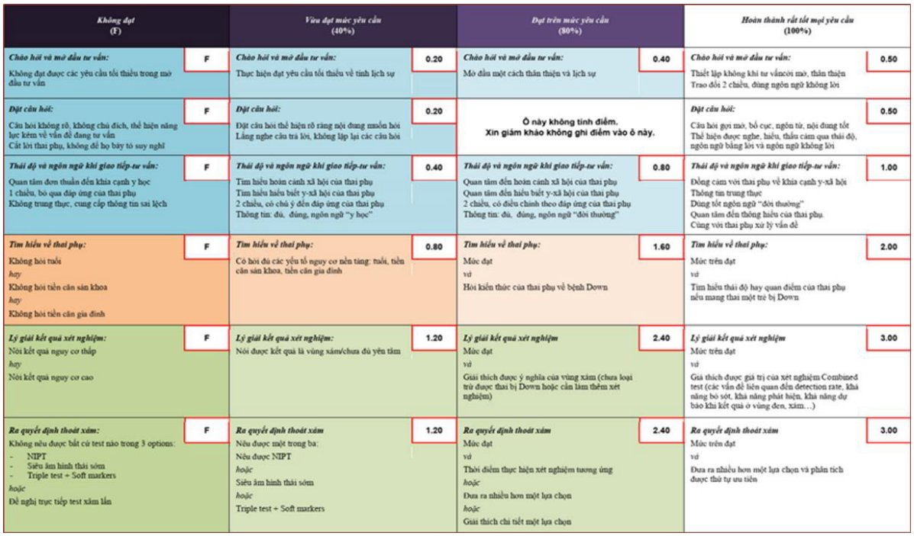

###### 3.3.2 TH2: NT DÀY

- NT là độ dày khoảng thấu âm sau gáy, đo được trên siêu âm. NT dày là 1 dấu hiệu tầm soát bất thường thai kỳ. Dấu hiệu này liên quan mạnh đến bất thường **cấu trúc do di truyền,** bất thường cấu trúc **không do di truyền** như bệnh tim không do lệch bội, bệnh lý gene, nhiễm trùng bào thai
- Xét nghiệm của chị cho thấy NT dày, tức là thai kì này em bé có nguy cơ cao sẽ bất thường, nhưng không khẳng định em bé có bất thường thực sự. Để biết chính xác hướng quản lý tiếp

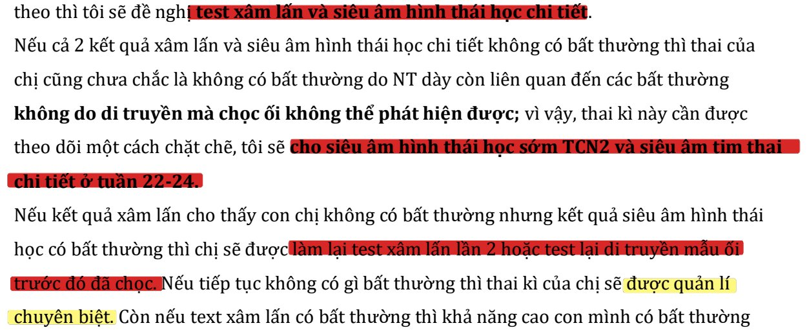

- Nếu cả 2 kết quả xâm lấn và siêu âm hình thái học chi tiết không có bất thường thì thai của
- Nếu kết quả xâm lấn cho thấy con chị không có bất thường nhưng kết quả siêu âm hình thái nặng, đa dị tật thì quyết định sẽ thuộc về chị và gia đình. Nếu chị muốn chấm dứt thai kì thì mình sẽ nhập viện để chấm dứt thai kì, còn nếu muốn giữ thai thì tôi sẽ khám thai cho chị và cho siêu âm khảo sát hình thái học ở mỗi 3 tháng để chắc chắn rằng con chị không có những bất thường hình thái kèm theo nữa.

###### 3.3.3 TH3: NIPT nguy cơ cao T21

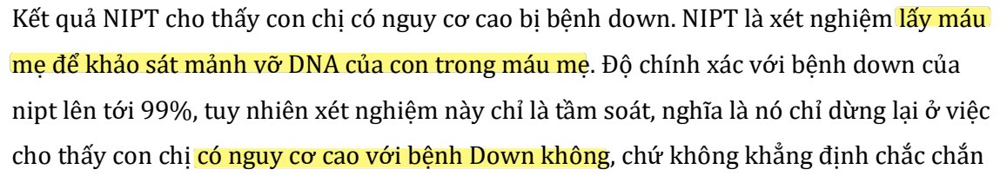

- Kết quả NIPT cho thấy con chị có nguy cơ cao bị bệnh down. NIPT là xét nghiệm lấy máu con chị bị bệnh Down. Vậy thì muốn chính xác con chị có hay không bị bệnh down thì phải làm **xét nghiệm xâm lấn.**
- Nếu kết quả xâm lấn cho thấy con chị không bị bệnh down thì thai của chị sẽ được quản lý như bình thường, còn nếu kết quả cho thấy con mình bị bệnh down thì mình quyết định sẽ thuộc về chị và gia đình. Nếu chị muốn chấm dứt thai kì thì mình sẽ nhập viện để chấm dứt thai kì, còn nếu muốn giữ thai thì tôi sẽ khám thai cho chị và cho siêu âm khảo sát hình thái học ở mỗi 3 tháng để chắc chắn rằng con chị không có những bất thường hình thái kèm theo nữa.
- (Ví dụ nếu về sau con chị có dị tật tim nặng không thể sữa chữa thì mình phải chấm dứt thai kì, lúc này không phải là vì bệnh down nữa mà là vì bệnh tim nặng)
- **Kết thúc buổi tư vấn**

### TIẾP CẬN HIV

- Thai phụ thắc mắc tại sao phải xét nghiệm HIV?
- Cần nhớ: lý do làm mấy cái XN nhiễm trùng là để giảm lây truyền từ mẹ → con (chứ như VGC mình không làm do mình không làm giảm được sự lây truyền). Làm XN ở thời điểm 9wk là vì đây là thời điểm bắt đầu áp dụng phác đồ điều trị dự phòng lây nhiễm từ mẹ sang con ở người HIV.

- Thai kì của chị là thai kì nguy cơ cao/thấp
- Chị thuộc nhóm nguy cơ thấp nhưng HIV có thể không có biểu hiện lâm sàng và theo khuyến cáo thì việc làm XN và điều trị có thể làm giảm lây truyền từ mẹ sang con
- Thời điểm sớm nhất, hiệu quả nhất để bắt đầu dùng thuốc để có thể làm giảm lây truyền mẹ con là 9wk
- HIV trong 1 xác suất nào đó mình có thể bị lây nhiễm mà mình không biết được → cần XN mới biết chính xác
- Nếu thai phụ không đồng ý → tôn trọng

### LÊN LỊCH KHÁM THAI

- **TCN: I**
    + Tuổi thai: Sau trễ kinh
        * **Lần khám:** 1 lần
        * **Nội dung khám:**
            1. Xác định tình trạng thai qua siêu âm:
                - Sống còn.
                - Vị trí thai.
                - Số lượng thai.
                - Thai trứng, thai lưu, dọa sảy.
                - Bất thường kèm theo khác.
            2. Tính tuổi thai, ngày dự sanh.
            3. Đánh giá sức khỏe mẹ: nội khoa, ngoại khoa.
                - Khám tổng trạng: Chiều cao, cân nặng, huyết áp, tim phổi.
                - Huyết học: huyết đồ, nhóm máu ABO, Rhesus.
                - Nhiễm trùng: Rubella IgG, IgM, Giang mai, HbsAg, HIV.
                - Đường huyết.
                - Tổng phân tích nước tiểu.
                - AST, ALT, BUN, Creatinine.
            4. Khám phụ khoa.
    + Tuổi thai: 11w0 – 13w6
        * **Lần khám:** 1 lần
        * **Nội dung khám:**
            - Khám:
            - Mạch, huyết áp, phù
            - Tuyến giáp
            - Tim, phổi, bụng
            - Kích thước âm đạo, tử cung → dựa vô để đề nghị CLS cho hợp lý
            1. Định tuổi thai: qua siêu âm đo chiều dài đầu mông.
            2. Tầm soát lệch bội – tùy kết quả có chỉ định xét nghiệm.
                - Combined test: NT, PAPP-A, free – beta HCG.
                - NIPT.
                - Sinh thiết gai nhau.
            3. Siêu âm hình thái học TCN1.
            4. Tầm soát bệnh lý huyết học mẹ.
                - Huyết đồ: Thiếu máu hồng cầu nhỏ nhược sắc, Thalassemia.
            5. Tầm soát nhiễm trùng.

        * Rubella IgG, IgM, Giang mai, HbsAg, HIV.
        * TORCH: CMV, Toxoplasma nếu có tiền căn sảy thai liên tiếp.
        * 6. Tầm soát nguy cơ tiền sản giật: PlGF, SA đo kháng trở ĐM tử cung, tính HA trung bình
        * 7. Tổng phân tích nước tiểu
        * OGTT nếu thai kỳ nguy cơ cao ĐTĐ.
        * Tái khám ngay khi thấy: đau bụng dưới, ra huyết âm đạo, nhức đầu, nhìn mờ, chóng mặt.
- **TCN: II**
    + Tuổi thai: 14w0 – 28w6
        * **Lần khám:** 1 lần/tháng (4 lần)
        * **Nội dung khám:**
            1. Siêu âm hình thái học 3D/4D: 20w0 – 25w0
            2. Tầm soát lệch bội.
                - Soft-markers (15w0 – 18w6)
                - Triple test: AFF, uE3, beta HCG (16w0 – 18w0)
                - NIPT.
                - Chọc ối (từ 15w).
            3. Đái tháo đường thai kỳ
                - OGTT (24 – 28)
            4. Khảo sát chiều dài CTC qua siêu âm. (19w0 – nếu có nguy cơ cao thì khâu eo 20w0)
            5. Mỗi lần khám:
                - Mạch, HA (chú ý TSG từ 20w0).
                - TPTNT.
                - Phù, đo BCTC, tim thai.
                - Siêu âm gray-scale + Doppler – theo dõi biểu đồ tăng trưởng, đo AFI, SDP, khảo sát bánh nhau
            6. HBV-DNA (26w0 – 28w0) - ở thai phụ viêm gan B.
                - VAT1 đầu TCN2 – VAT2 sau đó ít nhất 1 tháng, trước sinh ít nhất 1 tháng.
            - Tái khám ngay khi thấy: đau bụng dưới, ra huyết âm đạo, nhức đầu, nhìn mờ, chóng mặt, thai máy ít.

- **TCN: III**
    + Tuổi thai: 29w0 – 36w6
        * **Lần khám:** 1 lần/2 tuần (3 lần)
        * **Nội dung khám:**
            1. Hướng dẫn đếm cử động thai.
            2. Tầm soát nhiễm trùng: HIV, Giang mai
            3. Mỗi lần khám:
                - Mạch, HA.
                - TPTNT.
                - Phù, đo BCTC, tim thai.
                - Siêu âm gray-scale + Doppler – theo dõi biểu đồ tăng trưởng, đo AFI, SDP, khảo sát bánh nhau, xác định ngôi thai.
                - NST (từ 34w0)
                - ĐH đói, ĐH 2h sau ăn, tăng cân mẹ, sinh trắc thai – nếu có ĐTĐ thai kỳ.
                - Khảo sát khung chậu – tiên lượng cách CDTK.
            3. Tầm soát GBS (36w – 38w)
            6. MRI khi có nhau cài răng lược trong nhau tiền đạo.
            - Tái khám ngay khi thấy: đau bụng dưới, ra huyết, ra nước âm đạo, nhức đầu, nhìn mờ, chóng mặt, thai máy yếu.
    + Tuổi thai: 37w0 – 39w6
        * **Lần khám:** 1 lần/1 tuần (4 lần)
        * **Nội dung khám:**
            1. Hướng dẫn đếm cử động thai.
            3. Công thức máu.
            4. Mỗi lần khám:
                - Mạch, HA.
                - TPTNT.
                - Phù, đo BCTC, tim thai.
                - Siêu âm gray-scale + Doppler – theo dõi biểu đồ tăng trưởng, đo AFI, SDP, khảo sát bánh nhau, xác định ngôi thai.
                - NST (từ 34w0)
                - ĐH đói, ĐH 2h sau ăn – nếu có ĐTĐ thai kỳ.
                - Khảo sát khung chậu – tiên lượng cách CDTK.
            5. Quang kích chậu nếu có bất thường khung chậu.
            - Tái khám ngay khi thấy: đau bụng dưới, ra huyết, ra nước âm đạo, nhức đầu, nhìn mờ, chóng mặt, thai máy yếu.

    + Tuổi thai: 40w0 – 40w6
        * **Lần khám:** 1 lần/3 ngày (2 lần)
        * **Nội dung khám:** (trống)
    + Tuổi thai: Từ 41w0
        * **Lần khám:** Nhập viện
        * **Nội dung khám:** (trống)

- Nếu không đủ điều kiện tái khám thường xuyên, cần khám tối thiểu 3 lần: 12w, 22w, 32w,
- nhập viện khi chuyển dạ.

- Mỗi lần tái khám sẽ có thể thêm vài khảo sát cho bệnh lý chuyên biệt của từng thai phụ.

## CHƯƠNG 3: LƯỢNG GIÁ SỨC KHOẺ THAI

### TIẾP CẬN FGR

#### 1. LÝ THUYẾT CẦN NHỚ

- FGR khi AC/ EFW dưới 3th percentile hoặc EFW, AC dưới bách phân vị 10th + chỉ số não nhau (CPR) <5th/ PI động mạch rốn > 95th/ đường biểu diễn AC< EFW giảm 2 tứ phân vị
- FGR sớm (các thông tin TCN1): Trong thai kì có **bất thường di truyền, thiếu máu, nhiễm trùng bào thai, bất thường hình thái siêu âm 4D**
- FGR muộn (các thông tin TCN2) : Trong thai kì **có tiền sản giật, tăng huyết áp** (nếu BN có tăng huyết áp check thử có làm đạm niệu không + bộ triệu chứng nghi TSG nặng - này không có khỏi hỏi hoặc sổ có thì khỏi), **đái tháo đường** (OGTT, nếu BN quá 28 tuần thì hỏi đường huyết sau ăn 2h/ HbA1c để coi kiểm soát đường)
- Nếu cần CDTK

- Có 2 phương pháp CDTK: khởi phát chuyển dạ hoặc MLT. Cố gắng sinh đường âm đạo.
    + Tuy nhiên, khi việc khởi phát chuyển dạ hay sinh chỉ huy không thuận tiến triển tốt hoặc tình trạng mẹ/thai trở nên nguy kịch thì phải mổ lấy thai (tư vấn biến chứng mổ lấy thai).
- Khởi phát chuyển dạ dựa theo:
    + Nếu cổ TC đã mở sẵn sàng cho cuộc sanh, tăng co với Oxytocin.
    + Nếu cổ TC chưa mở sẵn sàng cho cuộc sanh, thúc đẩy quá trình này bằng PGE1, PGE2 trước khi dùng Oxytocin. (Chú ý sau khi dùng PGE1, PGE2, tử cung rất nhạy với
        * Oxytocin và dễ gây cơn gò cường tính, dọa vỡ - vỡ TC, thai suy nên cần theo dõi chặt chẽ CD với monitor sản khoa. Chỉ sử dụng Oxytocin sau 4 tiếng sử dụng PGE1 hay 6 tiếng sử dụng PGE2.)

#### 2. CÁC BƯỚC TIẾP CẬN

##### 2.1 Bước 1: Các thông tin cơ bản

- Chị khám thai bao nhiêu lần rồi? Xin sổ khám thai
    + Xem mẹ (thiếu máu, cân nặng, tsg, đtđ, nhau tiền đạo) và xem con (lệch bội, NT)

##### 2.2 Bước 2: Định tuổi thai

- Thai kì này là mang thai tự nhiên hay hỗ trợ sinh sản => xin giấy tờ làm IVF
- Kinh chót của mình là khi nào? (không nhớ thì khỏi hỏi tiếp về kinh)
    + Kinh nguyệt của mình có đều không? CK kinh bao nhiêu ngày?
    + Có sử dụng biện pháp tránh thai không?
    + Kinh chót có tính chất **giống những lần hành kinh trước không**
    + **Kinh áp chót là ngày nào ?**
        * **=> Xem kết quả siêu âm lần đầu qua sổ khám thai và hiệu chỉnh theo kinh chót** => Xác định đúng tuổi thai ở các lần siêu âm sau và vẽ biểu đồ tăng trưởng

##### 2.3 Bước 4 : Tác vụ mình cần làm

- Đo bề cao tử cung
- Vẽ biểu đồ tăng trưởng

##### 2.4 Bước 3: Tư vấn

###### 2.4.1 TH1: Biểu đồ tăng trưởng bình thường

- Những chứng cứ mà tôi thu thập được nãy giờ cho phép kết luận thai kì của chị là một thai kì bình thường vì những lý do sau:
    + Dựa vào biểu đồ tăng trưởng:
        * Đây là biểu đồ đánh giá biểu đồ tăng trưởng của chị. Biểu đồ bình thường do đường biểu diễn trên biểu đồ tăng trưởng của thai đi lên, không gập góc, không đứt gãy, không chạm vào các đường bách phân vị 97th và 3rd
        * Con của chị hiện tại có mức sinh trắc ở BPV 50. Chị có biết BPV 50 là gì không ? Là khi con chị so sánh với 100 thai nhi bình thường trong cùng tuần tuổi thai, thì thai của chị lớn hơn 50 thai nhi và nhỏ hơn 50 thai nhi.
    + Dựa vào lâm sàng: tăng cân của thai phụ hợp lý, bề cao tử cung.
        * Chị có cân nặng và chiều cao trước sinh nằm trong giới hạn bình thường, nên mức tăng cân của chị là 2kg/tháng, chị đã tăng đúng mức này
        * Bề cao tử cung phù hợp so với tuổi thai của con chị
    + Dựa vào các cận lâm sàng như siêu âm thể tích nước ối bình thường, không ghi nhận đa ối hay thiểu ối, tổng soát thường quy đầu thai kì (thiếu máu nhiễm trùng lệch bội) chưa ghi nhận bất thường trên siêu âm hình thái học

###### 2.4.2 TH2 : FGR

- Tôi rất tiếc phải thông báo với chị rằng con chị đã được chẩn đoán là thai giới hạn tăng trưởng trong tử cung, khởi phát sớm/muộn
    + Giới hạn tăng trưởng vì thai đã có chỉ số (AC/EFW) chạm bách phân vị thứ 3/ thứ 10 kèm Doppler bất thường. (PI-ĐMR >95th, CPR <1 PI-ĐMNG <5th)
    + Sớm là do được chẩn đoán <32 tuần/Muộn là do được chẩn đoán >32 tuần.
- Giải thích bách phân vị thứ 3th (10th) : nghĩa là có 100 em bé có cùng tuổi thai với con chị, con chị chỉ lớn hơn 3 đứa thôi nhưng lại nhỏ hơn tới 97 đứa.
- Thai chậm tăng trưởng trong tử cung là khi thai không đạt được **tiềm năng phát triển** của nó và làm tăng nguy cơ **bệnh suất và tử suất chu sinh.** Việc này có nhiều nguyên nhân gây ra: thường gặp nhất là rối loạn chức năng bánh nhau, nhiễm trùng bào thai, bất thường di truyền, dị tật nghiệm trọng, bệnh lý của mẹ và đôi khi không xác định được nguyên nhân
- Với thai chậm tăng trưởng trong tử cung, nếu không được kiểm soát, con sẽ có nguy cơ cao bị chết lưu, sinh non-do chỉ định chấm dứt thai kì sớm và hệ quả là thai non tháng, tăng tỉ lệ mắc suy hô hấp sơ sinh, tổn thương não, phải nhập hồi sức tích cực nhi.
- Trường hợp thuộc nhóm tăng trưởng bình thường mà đầu nhỏ, chi ngắn (HC, FL): nhắn BN có thể bất thường đơn độc, cần xem/làm lại coi lệch bội, nhiễm trùng bào thai, siêu âm coi dị tật khác.

##### 2.5 Hướng quản lý thai kì

###### 2.5.1 TH1 : FGR khởi phát sớm

- Trước tiên tôi sẽ phải loại trừ khả năng có các bất thường **di truyền, dị tật nghiêm trọng hay nhiễm trùng** bào thai của chị thông qua sổ khám thai hoặc tiến hành chọc ối + siêu âm hình thái học chi tiết nếu chưa phát hiện bất thường.
    + Có thể hỏi thêm chị có từng được chẩn đoán là ĐTĐ/THA chưa, có biến chứng gì không ? (nếu ra thi tới mức này thì khó lắm)
    + Nếu phát hiện bất thường thì tư vấn theo cái bất thường phát hiện (Nhiễm trùng bào thai, lệch bội, thiếu máu di truyền, NT dày, bất thường cấu trúc)
    + Nếu không phát hiện bất thường, nghĩ nhiều do nguyên nhân bánh nhau → tiếp.
- Hiện tại thì chưa có phương pháp điều trị nào hiệu quả trong việc đảo ngược hay ngăn chặn diễn tiến của FGR nên hướng quản lý cả mình sẽ đánh giá sức khoẻ thai, theo dõi chặt chẽ và quyết định thời điểm sinh. Do mình là FGR sớm nên tôi đề nghị cho chị siêu âm Doppler để đánh giá tuần hoàn của thai.
- **SGA (BPV 3 – 9 không có bất thường Doppler)**

- Nguy cơ thai chết lưu trong bụng mẹ trong trường hợp của chị là thấp. Nên chị sẽ được về nhà tái khám mỗi 1 tuần. Ở mỗi lần tái khám, chị sẽ được siêu âm lại Doppler mỗi 1-2 tuần/lần, đánh giá tăng trưởng mỗi 2 tuần/lần và khi thai trên 37 tuần chị được thực hiện BPP/NST 1-2 lần/tuần. Vào lúc 37 – 39 tuần, chị sẽ được nhập viện và chấm dứt thai kì bằng khởi phát chuyển dạ.
- **FGR không biến chứng (<BPV 3 và không có bất thường Doppler)**

- Nguy cơ thai chết lưu trong bụng mẹ trong trường hợp của chị là thấp. Nên chị sẽ được cho về nhà và tái khám 2 lần mỗi tuần. Ở mỗi lần tái khám, chị sẽ được siêu âm lại Doppler, mỗi 1- 2 lần/tuần, đánh giá lại tăng trưởng mỗi 2 tuần/lần, và khi thai 37 tuần trở lên, chị sẽ được làm BPP/NST mỗi 1 – 2 lần/tuần. Vào lúc 36 – 38 tuần, chị sẽ được nhập viện và chấm dứt thai kì bằng khởi phát chuyển dạ
- **FGR với bất thường nhẹ (Doppler sớm (95 95 5 5), thiểu ối, nghi ngờ tiền sản giật)**

- Nguy cơ thai chết lưu trong bụng mẹ trong trường hợp của chị là thấp nhưng thai của mình lại có những bất thường nhẹ nên tôi khuyên chị nhập viện để theo dõi nội trú. Lúc này chị sẽ được làm BPP/NST 1-2 lần/tuần, siêu âm Doppler mỗi 1-2 lần/tuần, đánh giá tăng trưởng thai nhi mỗi 2 tuần. Vào lúc 34 – 37 tuần, chị sẽ được chấm dứt thai kì bằng mổ lấy thai hay để thường tuỳ vào tình trạng đứa bé vào lúc đó.
- **FGR với bất thường nặng trên ĐMR (AEDV, REDV)**

- Nguy cơ thai chết lưu trong bụng mẹ trong trường hợp của chị là cao nên cần thai kì của mình phải được nhập viện để chúng tôi giám sát chặt chẽ với một mạng lưới an toàn. Chị sẽ được sửu dụng steroid để hỗ trợ phổi phòng ngừa thai non tháng do chỉ định chấm dứt sớm với những hậu quả như suy hô hấp sơ sinh, nằm hồi sức tích cực nhi. Lúc này, chị sẽ được đo BPP/NST 1-2 lần/ngày, Doppler ĐMR 1-2 ngày/lần và đánh giá tăng trưởng 2 tuần/lần. Vào tuần 32 – 34 (AEDV) hoặc 30 – 32 (REDV), chị sẽ được chấm dứt thai kì bằng mổ lấy thai **FGR với bất thường OTM**
- Nguy cơ thai chết lưu trong bụng mẹ trong trường hợp của chị là cao nên cần thai kì của mình phải được nhập viện để chúng tôi giám sát chặt chẽ với một mạng lưới an toàn. Chị sẽ được sửu dụng steroid để hỗ trợ phổi phòng ngừa thai non tháng do chỉ định chấm dứt sớm với những hậu quả như suy hô hấp sơ sinh, nằm hồi sức tích cực nhi. Lúc này, chị sẽ được đo BPP/NST 2 lần/ngày, Doppler 1 lần/ngày và đánh giá tăng trưởng 2 tuần/lần. Vào tuần 26 – 30, chị sẽ được chấm dứt thai kì bằng mổ lấy thai

###### 2.5.2 FGR muộn

- Hiện tại thì chưa có phương pháp điều trị nào hiệu quả trong việc đảo ngược hay ngăn chặn diễn tiến của FGR nên hướng quản lý cả mình sẽ đánh giá sức khoẻ thai, theo dõi chặt chẽ thông qua các xét nghiệm như NST, đánh giá thể tích nước ối, siêu âm Doppler để quyết định thời điểm sinh.
    + Nếu không có gì bất thường (3 – 10th và Doppler ĐMTC bình thường) mình có thể CDTK lúc 38 - 39 tuần
    + Nếu chỉ có bất thường giảm dòng tâm trương ĐMTC (PI/RI UA > BPV95, không có AEDV, REDV) lúc 37wk
    + Nếu có bất thường về Doppler ĐMNG CDTK (<5th or <1) lúc 38 – 39 tuần
    + Nếu có bất thường về Doppler PI ĐMR CDTK (>95th) lúc 36 – 38 tuần hoặc bất thường nặng AC/EFW < BPV3
    + Nếu có bất thường thì chấm dứt thai kì ngay.
        * NST : nhịp giảm liên tục, kéo dài
        * BPP < 4 điểm
        * Doppler AEDV/REDV
        * CĐ sản khoa do mẹ : TSG nặng, HELLP, nhau bong non, sa dây rốn
- Nếu chị không có chống chỉ định, chúng tôi có thể khởi phát chuyển dạ cho chị và trong quá trình chuyển dạ sẽ theo dõi tim thai liên tục nhằm phát hiện bất thường và xử trí kịp thời.

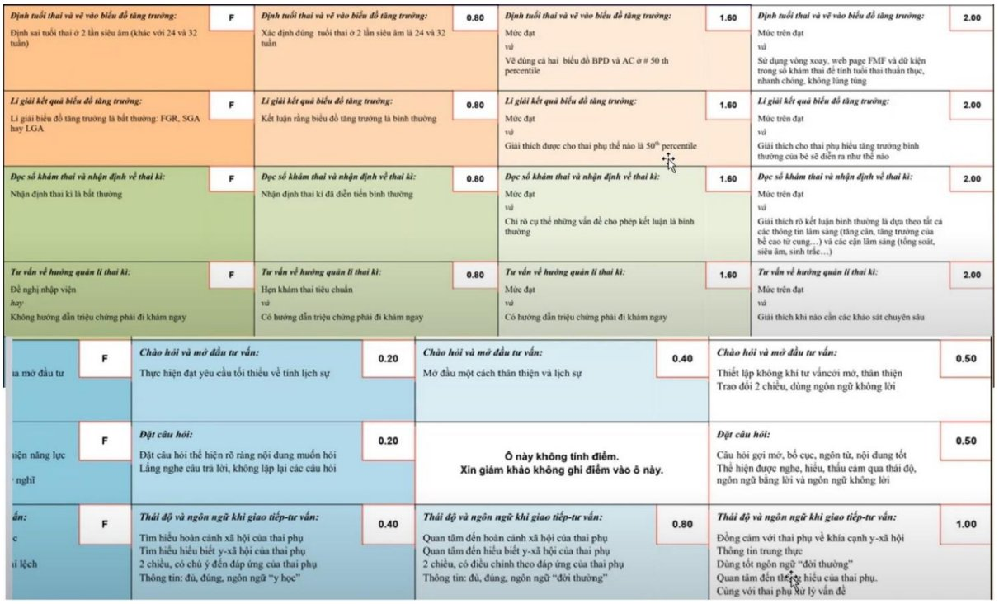

- **Vẽ biểu đồ tăng trưởng 2 chỉ số:**

1. **Thai bị gì? – chẩn đoán: thai to**
2. **Vì sao chẩn đoán như vậy? 2 vế. Thai giới hạn tăng trưởng sớm, vì sao giới hạn tăng trưởng vì sao sớm**
3. **Những nguyên nhân gì: Đái tháo đường, bất thường ống tiêu hoá, phù thai**
4. **Đề nghị CLS gì: Thai to, đái tháo đường, siêu âm hình thai học chi tiết 22-24 (xem lại)**

#### 3. CÁC ĐỀ

##### 3.1 Y20 – đợt 2: FGR sớm do Rubella

- Đề: Một thai phụ 26 tuần đến khám vì THAI TĂNG TRƯỞNG BẤT THƯỜNG. Em hãy tư vấn và đưa ra hướng quản lí. Có thể hỏi thêm bệnh sử nếu cần
- Cần ĐỊNH TUỔI THAI đầu tiên, xoay vòng thấy chênh lệch kinh chót với siêu âm <7 ngày nên chót là tính theo kinh chót, kinh chót tin cậy
- Thai phụ đưa sổ khám thai và giấy siêu âm. Giấy siêu âm khá nhiều số, EFW 3th BPD 1th.
- Sổ khám thai cũng nhiều nhưng chỗ Rubella thì bộ môn tô đậm. check sổ khám thai thì thấy có chuyển đổi huyết thanh Rubella, bả được test 2 lần huyết thanh: TCN1 thì IgM (–)
    + IgG (–) gần đây làm lại thì IgG (+). Tiếp cận FGR khởi phát sớm + hỏi các tiền căn Rubella rồi đưa ra hướng quản lý. Thai phụ hỏi “con tui bị gì và nguyên nhân bị vậy?”

- Giải đáp:

- Sản phụ đưa ra kết quả siêu âm tuần 26 là EFW dưới bách phân vị 3. Đầu tiên check xem tuổi thai đúng chưa, sau đó xin sổ khám thai xem thì thấy TCN tầm soát rubella âm tính hết mà tuần 20 có IgG Rubella (+) → cần phải hỏi bệnh như trường hợp tư vấn rubella (có triệu chứng sốt/phát ban/đau khớp; gần đây có được chẩn đoán không, gia đình có ai bị rubella không,…) rồi hỏi thêm những cái trong checklist hỏi bệnh về FGR.
- Từ KQ siêu âm phải nhận định được: FGR ở tuần 26 vì có EFW < bách phân vị 3 và đầu dưới bách phân vị 1 & cái bánh nhau dày.
- Chẩn đoán đưa ra là FGR nghĩ nhiều do rubella -> cho đi chọc ối. Không được khẳng định luôn vì sản phụ có hỏi có chắc chắn là do rubella không thì phải nói nghĩ nhiều chứ chưa loại trừ các nguyên nhân khác như lệch bội.
- Đăng Huy giải:

- Sau khi định tuổi thai, hỏi bệnh
- Kết luận: Thai của chị đang có tình trạng thai chậm tăng trưởng trong tử cung khởi phát sớm vì EFW < BPV3, AC < BPV1
- IUGR này thường do …, nhiễm trùng, theo kết quả từ sổ khám thai, tôi ghi nhận chị đã có nhiễm rubella trong thai kì này (vì …) → giải thích về rubella và khả năng gây ra IUGR → để biết chính xác con chị có nhiễm rubella bẩm sinh hay không, tôi đề nghị chọc ối

##### 3.2 Y20 đợt 1

- Cho sổ khám thai, có 3 lần siêu âm sinh trắc trong TCN II. Trang đầu cho biết ngày dự sinh theo siêu âm và kinh cuối trùng nhau. Trên biểu đồ có sẵn các điểm của lần siêu âm sinh trắc đầu tiên
- Yêu cầu:

1. Vẽ biểu đồ tăng trưởng dựa trên các thông số BPD, AC, FL trong 2 lần siêu âm cuối cùng.
2. Nhận định về tình trạng tăng trưởng của thai.
3. Giải thích cho nhận định trên

- Lưu ý: không giống các đợt trước, đợt này cho tuổi thai đúng nên không cho siêu âm TCN I để coi lại tính chính xác tuổi thai, thấy dự sinh siêu âm với kinh cuối thì nhảy vô chấm luôn chứ đừng bị ám thị là phải xem lại tuổi thai nữa. Nên mang theo vòng tránh thai của mình do vòng của bộ môn design hơi khác của mình, dùng ko quen. Tính ra tuổi thai thì phải làm tròn xuống (vd 28w6d thì chấm tại điểm 28w). Chấm xong thấy cả 2 điểm đều đang giảm dần tại 28w và 30w, cắt đường 10th tại 28w -> thai chậm tăng trưởng khởi phát sớm. Giải thích phải nêu rõ là do tuổi thai đúng, cắt đường 10th tại 28w trước tuần 32,…

##### 3.3 Y17 – Đợt 2 – trạm 3

- Vẽ biểu đồ tăng trưởng, đọc sổ khám thai. Nhận diện chẩn đoán, nguyên nhân. Đề nghị CLS **(làm trên giấy, ko BN chuẩn ko giải thích gì với giám thị)**

- Có 4 siêu âm, 1 siêu âm sớm, 1 siêu âm định tuổi thai và 2 siêu âm vẽ biểu đồ tăng trưởng.
    + Đọc sổ khám thai sẽ thấy kinh dài, ko đều, bỏ lỡ OGTT do ối và tăng cân rất nhanh. Dùng vòng xoay tuổi thai tính ra tuổi thai của 2 siêu âm sinh trắc cần dùng rồi vẽ.
- Thai hôm nay 32w. BPD trong giới hạn bình thường (có người vẽ BPD > 90th), AC lớn hơn BPV 95 nghi ngờ thai to so với tuổi thai do GDM.
- Cho làm thêm đường huyết đói/bất kỳ/HbA1C cái nào cũng được vì hiện tại 32 tuần rồi, quá 28 tuần không làm ogtt nữa. Nhưng cũng có bạn cho BPP biến đổi/NST đánh giá sức khỏe thai hiện tại.

##### 3.4 Y nào đó

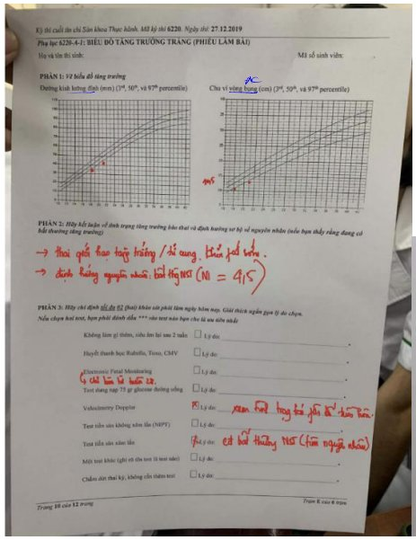

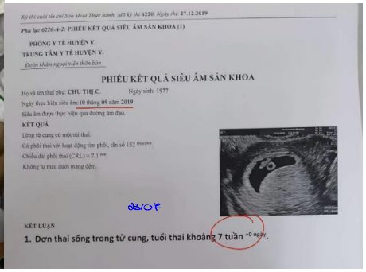

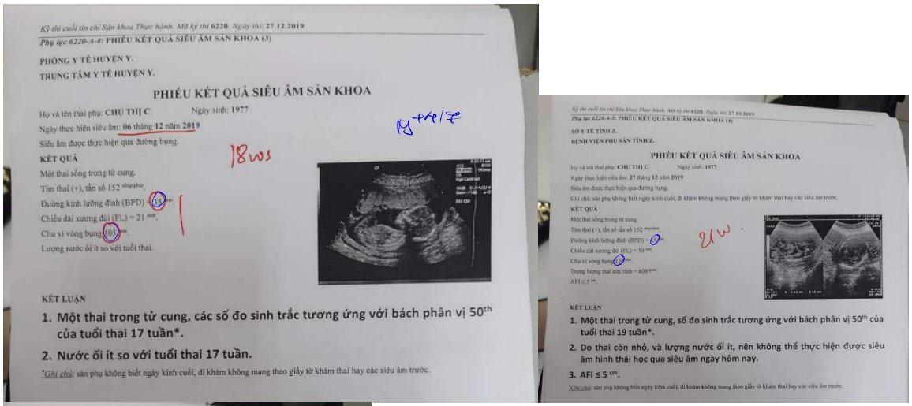

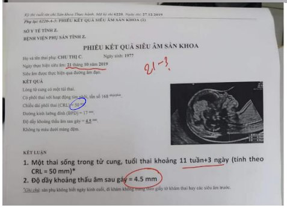

- Chưa biết nên chọn Velo hay Xâm lấn ưu tiên hơn, mà nghĩ nhiều là xâm lấn vì text nói

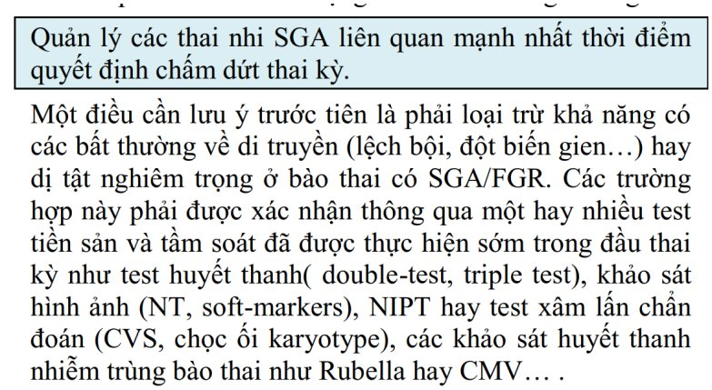

##### 3.5 Y19 – Đợt 2 – Trạm 3

- Cho sổ khám thai, biểu đồ tăng trưởng
- Quét 1 lượt thấy khám thai đầy đủ, thai kỳ nguy cơ thấp, thai 36w
- Thấy biểu đồ tăng trưởng có xu hướng đi xuống, có 3 kết quả xuống theo thứ tự
- BPV 26 – BPV 7 – BPV 5
- YÊU CẦU:
- Câu 1: cần làm thêm CLS gì? Lý do tại sao → mình ghi được 2 cái trên rồi anh nội trú mới đưa kết quả cho mình
- Đưa xong, mình đọc kết quả CLS + ý nghĩa của CLS

1. NST: NST đáp ứng
2. Siêu âm: AFI = 8, EFW ở BPV 3 → đủ tiêu chuẩn
3. Siêu âm Doppler: ko bất thường

- Câu 2: Xử trí case trên như thế nào? FGR muộn chưa có bất thường Doppler à

##### 3.6 Đề Y19 đợt 2:

- TRẠM 3: LƯỢNG GIÁ SỨC KHỎE THAI (giấy) – Kèm nhau tiền đạo trung tâm
- Cho sẵn: số khám thai, 1 tờ biểu đồ tăng trưởng có đánh dấu sẵn (giảm từ BPV 50 về BPV 8 rồi chạm BPV3)
- Các xét nghiệm khác cần thực hiện thêm thì ghi vào giấy làm bài, giải thích vì sao lại đề nghị -> được đưa cho tờ kết quả -> đọc kết quả và nêu ý nghĩa
- Có 3 tờ giấy: EFM, Velocimetry Doppler và SA grey-scale

- mBPP (NST có đáp ứng+AFI): Tiên lượng sớm cho tình trạng tái phân bố tuần hoàn, tiên lượng xa hơn một chút về chức năng bánh nhau.
- NST: Tiên lượng trước mắt về thăng bằng kiềm toan của thai nhi
- Doppler: CPR 2,54,…Tái phân phối tuần hoàn do thiếu o2 trường diễn, nhằm tiên lượng rằng liệu thai trụ lại được bao lâu, khi nào cần chấm dứt thai kì.
- SA grey – scale:

##### 3.7 Đề Y19 – đợt 5 :

- Biểu đồ tăng trưởng. Cho kinh chót nhưng kinh không đều (30 – 45 ngày). Cho nhiều kết quả siêu âm ở nhiều thời điểm
- Tác vụ:

- Vẽ các chỉ số sinh trắc thai (AC, BPD, FL, EFW) trên siêu âm ngày hôm nay (28/06/2023) vào biểu đồ tăng trưởng
- Trả lời các câu hỏi:
- Câu 1a: Kết luận về tình trạng thai
- Câu 1b: Thông tin nào trong sổ khám thai và biểu đồ tăng trưởng giúp kết luận về tình trạng thai ở trên
- Câu 2a: Đề nghị 1 XN tại thời điểm này (chỉ được đề nghị 1 lần)
- Câu 2b: Kết luận về tình trạng của thai phụ và thai kỳ sau khi có kết quả XN ở trên
- Lưu ý:

- Dùng CRL 55mm (trong khoảng 30 – 84mm), tương ứng với tuổi thai 12 tuần để tính tuổi thai ở thời điểm hiện tại (28/06/23, ra 28 tuần). Không dùng kinh chót vì ko đều, và nếu dùng kinh chót thì lúc CRL 55mm ra tới hơn 13 tuần (lệch hơn 7 ngày). Sau đó lấy các chỉ số sinh trắc ở siêu âm ngày hôm nay (28/06/23) để vẽ lên biểu đồ ở tuần tuổi thai đã tính ở trên (28 tuần). phải làm nhanh, nếu ko là ko kịp trả lời câu hỏi.
- Câu 2a: Chị Quy: đề nghị XN nào liên quan đến đường là có điểm (nếu đề nghị thêm “đánh giá lại chế độ ăn” thì full, mà câu này chỉ kêu đề nghị 1 XN thôi nên cũng lạ)
- Câu 2b: Kết luận (chị Quy) Thai to so với tuổi thai, liên quan đến rối loạn dung nạp đường

##### 3.8 Đề Y18 Đợt 1:

- Trạm 3: Có 1 SÂ chuẩn làm mốc tính tuổi thai với 1 SÂ đo sinh trắc hôm nay, lấy cái mốc rồi xoay vòng tính tuổi thai xong vẽ thôi, trạm này hình như chỉ theo dõi IUGR thui
- Vẽ biểu đồ tăng trưởng ra thai tật đầu nhỏ, tầm soát nhiễm trùng
- Thì cho một đống tờ siêu âm, vẽ biểu đồ tăng trưởng, kết luận thai đầu nhỏ, cần tầm soát nhiễm trùng => chọc ối

##### 3.9 Đề Y18 Đợt 2:

- Trạm 3 đưa một cái siêu âm vẽ biểu đồ tăng trưởng (thấy HC 230mm nên tính ra 25t1ngày) mà nghe nói phải hỏi trước đó có siêu âm nào ko ko hỏi trừ 2 điểm hỏi có cái siêu âm đầu rồi tính tuổi thai dựa vào cái siêu âm đầu) trả lời 2 câu hỏi thai tăng trưởng có bình thường không có cần làm cls nào ko giải thích tai sao

- Hỏi siêu âm thì đưa tờ sinh trắc hôm nay, không tuổi thai. Hỏi tiếp thì đưa tờ có MSD, phải hỏi là đưa tờ siêu âm có CRL sớm nhất thì mới đưa ra tờ CRL để tính tuổi thai
- Không làm thêm gì cả vì thai ở BPV 50, ối bình thường (AFI 8cm)

##### 3.10 Đề Y18 Đợt 3:

- Thai phụ đến khám vì giảm cử động thai. Yêu cầu khám, giải thích cho thai phụ, đưa ra hướng quản lí. Đầu tiên vô hỏi sổ khám thai, hỏi mấy triệu chứng: đau bụng, ra huyết…, yêu cầu khám đánh giá tổng trạng, sinh hiệu, nghe tim thai, đo bề cao tử cung, khám trong… thì được cho tờ kết quả khám, xong đề nghị NST, siêu âm thai thì được cho tiếp 2 tờ nữa (lưu ý phải nói là non stress test thì mới đưa nha, nói CTG hông đưa), rồi lấy hết đóng giấy tờ đó đọc toàn là bình thường hết => giải thích thai hoàn toàn bình thường, có thể do chị thấy giảm cử động trong lúc bé ngủ, hướng dẫn cách đếm cử động thai (đến 6 cử động trong 2 tiếng), hẹn tái khám sau 1 tuần, hướng dẫn các triệu chứng cần nhập viện ngay: đau bụng, ra huyết âm đạo, ra dịch âm đạo…

##### 3.11 Đề Y18 đợt 4:

- Vẽ biểu đồ tăng trưởng. Hướng dẫn: Thai IVF

##### 3.12 Đề Y18 đợt 5:

- Tăng trưởng bào thai

- Đề: Vẽ biểu đồ tăng trưởng và trả lời câu hỏi
- Yêu cầu: Vẽ biểu đồ tăng trưởng và trả lời câu hỏi
- Hướng dẫn: Tụi em có 1 tờ làm bài thi, 3 tờ siêu âm, 1 vòng xoay tuổi thai, 1 ipad sử app của FMF. Key của trạm này là định chính xác tuổi thai và vẽ biểu đồ tăng trưởng. Đợt 5 là thai kỳ ở TCN 1 bình thường do có CRL phù hợp vs tuổi thai, TCN 2 bình thường là chỉ số sinh trắc ở 50th. TCN 3 có AC và EFW ở 97th -> thai to -> Nghĩ liên quan đến HIP -> đề nghị test đường huyết đói, 2 giờ sau ăn, HbA1C (lưu ý, lúc này ở TCN 3 rồi không có làm OGTT 75g).

##### 3.13 Đề Y17 đợt 1: IUGR muộn – thai 38 tuần => CDTK

- TRẠM 6:

- Đọc băng EFM, đọc sổ khám thai, biểu đồ tăng trưởng, doppler động mạch rốn đưa ra chẩn đoán, xác nhận tình trạng thai hiện tại và đưa ra xử trí.
- EFM dao động nội tại tối thiểu, không nhịp tăng, có 2 nhịp giảm bất định, trương lực cơ bản 20, có một vài cơn gò sinh lí dưới 35 mmHg
- Doppler động mạch rốn BPV thứ 97.
- Biểu đồ tăng trưởng bắt đầu đi ngang xuống dưới BPV 3th từ tuần 32-33.
- Giải :

- Tình trạng thai hiện tại: với trạm này chỉ cần tìm ra những điểm quan trọng là thai chậm tăng trưởng trong tử cung khởi phát muộn (sau 32 tuần), doppler động mạch rốn S/D ở BPV thứ 97, thai 38 tuần, băng EFM hiện dao động nội tại tối thiểu, không nhịp tăng, có nhịp giảm bất định ( 2 nhịp) Băng EFM loại II, tình trạng thai đang rất nguy kịch. Kèm theo tình trạng thiểu ối (AFI =3cm)
- Xem lại giấy tờ tính tuổi thai có chính xác không.
- Chẩn đoán cần phải xác lập: Con lần 2, thai 38 tuần, ngôi đầu, chưa chuyển dạ, thai chậm tăng trưởng trong tử cung khởi phát muộn, thiểu ối.
- Xử trí hiện tại: Nhập viện, chấm dứt thai kỳ bằng khởi phát chuyển dạ ngay lập tức do thai đã 38 tuần, IUGR khởi phát muộn, thiểu ối và 1 băng ghi EFM loại 2 chứng tỏ môi trường sống trong tử cung là hoàn toàn không còn có lợi cho thai nữa. Liệu pháp corticoid là không cần thiết vì không có lợi ích ở tuổi thai này. Nếu khởi phát chuyển dạ thất bại, có thể sẽ phải mổ lấy thai.

##### 3.14 Đề Y17 Đợt 2:

- Trạm 3 (làm trên giấy, ko BN chuẩn ko giải thích gì với giám thị) Vẽ biểu đồ tăng trưởng, đọc sổ khám thai. Nhận diện chẩn đoán, nguyên nhân. Đề nghị CLS
- Bài làm

- Có 4 siêu âm, 1 siêu âm sớm, 1 siêu âm định tuổi thai và 2 siêu âm vẽ biểu đồ tăng trưởng. Đọc sổ khám thai sẽ thấy kinh dài, ko đều, bỏ lỡ OGTT do ói và tăng cân rất nhanh. Dùng vòng xoay tuổi thai tính ra tuổi thai của 2 siêu âm sinh trắc cần dùng rồi vẽ.
- Thai hôm nay 32w. BPD trong giới hạn bình thường (có người vẽ BPD > 90th), AC lớn hơn BPV 95 nghi ngờ thai to so với tuổi thai do GDM.
- Cho làm thêm đường huyết đói/bất kỳ/HbA1C cái nào cũng được vì hiện tại 32 tuần rồi, quá 28 tuần không làm ogtt nữa. Nhưng cũng có bạn cho BPP biến đổi/NST đánh giá sức khỏe thai hiện tại.
- Nếu đã loại trừ đtđ thì cần xem có những bệnh lí di truyền ko=> siêu âm hình thái học

##### 3.15 Đề Y17 đợt 3:

- Trạm 4 : thai đang trong chuyển dạ cho CTG có 4-5 cơn gò không đều gò đủ mạnh , baseline 160, còn dao động nội tại , có nhịp giảm kéo dài , đã tăng co, cho thông tin khám thai , cho Sản đồ chuyển phải , chưa chạm đường hành động , đường mở CTC không song song đường báo động, ngôi thai tiến triển chậm , cơn gò 2 cơn, sau tăng co thì 3 cơn, điểm cuối vẫn chưa mở trọn ctc mở 6 , ngôi thai 2/5.

1. Đọc và nhận định bất thường trên CTG
2. Hiện tại vấn đề của thai là gì
3. Xử trí gì trên ca này

- Trạm 5 : cho sổ khám thai , mô hình , thai hiện tại 4O tuần

1. Thăm khám trên BN này ?
2. BN hỏi thai hiện tại của tôi có khỏe hay không .

##### 3.16 Đề Y17 đợt 4: làm bài trên giấy

- Sổ khám thai: IVF chuyển phôi ngày 5; ngày KC; Xác nhận có thai sau chuyển IVF 5 ngày; SÂ đo CRL 8w. SÂ: cho bảng liệt kê ngày làm SÂ và các chỉ số sinh trắc; cần xoay vòng tính tuổi thai để biết được bao nhiêu tuần

1. Các thông tin trên sổ khám thai: Trùng khớp với nhau/Không trùng khớp với nhau
2. Vẽ biểu đồ tăng trưởng: gồm có 2 biểu đồ BPD và AC theo Sinozuka
3. Nhận định của bạn về tình trạng thai: Bình thường FGR khởi phát sớm FGR khởi phát muộn

- Thai to so với tuổi thai!

4. Nếu bạn nhận định thai kỳ này là bất thường, thì hôm nay bạn sẽ chỉ định làm gì cho thai phụ?

- Nhìn chung các đề của các năm có xu hướng cho như sau:

1. **VẤN ĐỀ FGR: Sẽ cho thi giấy, có sẵn biểu đồ, kèm theo các câu hỏi. Cần làm theo các bước sau:**

- **Bước 1. Định tuổi thai:**
- TH1: Định tuổi thai dựa vào siêu âm và kinh chót:
- Đề sẽ cho tầm 4 cái siêu âm, trong đó có 1 cái siêu âm đạt chuẩn vào cuối TCN1. Nếu chỉ thấy 1 siêu âm hiện tại, thì phải hỏi thêm siêu âm trước đó, không hỏi là cút lun. Từ cái siêu âm đạt chuẩn, phải hiệu chỉnh với kinh chót nếu như có, không hiệu chỉnh là cút. Sau khi hiệu chỉnh đủ rồi, thì việc tiếp theo là dùng vòng tuổi thai, xoay 1 lần xài cho cả bài, rất lẹ.
- TH2: Định tuổi thai dựa vào IVF:
- Tìm kiếm IVF dựa vào thông tin sổ khám thai, lưu ý nên quan tâm trường hợp này đầu tiên trước khi làm trường hợp 1. Nếu đã biết là IVF thì quá đơn giản.
- TH3 (Tự chế - chưa từng ra thi): Định tuổi thai dựa vào BPD/HC
- Có thể 1 năm nào đó bộ môn sẽ có ý tưởng này nhưng mà del phải năm nay. Cảm ơn :))) khi mà CRL ko thể cứu cánh cũng như kinh cuối ko thể làm j dc.
- **Bước 2: Vẽ biểu đồ**
- Lưu ý, biểu đồ của đề sẽ nói rõ cần điền thông số nào (ví dụ, đường kính lưỡng đỉnh, chu vi vòng bụng, ….) thì phải điền đúng, bởi vì sẽ có trường hợp cứ chăm chăm dô vẽ AC vs EFW là cút.
- Phải xem biểu đồ của đề là Intergrowth 21 hay Hadlock, bởi vì nếu Hadlock thì 34 tuần 4 ngày vẫn sẽ vẽ vào đường của 34 tuần, còn intergrowth thì chi tiết từng ngày.
- Khi vẽ, nếu tuổi thai trên siêu âm phải được chỉnh lại bởi vòng xoay như bước 1, bắt buộc phải xem lại từng ngày trên mỗi siêu âm ròi xác định lại tuổi thai ròi mới vẽ.
- **Bước 3: Nhận định tình trạng thai**
- Các đề thường cho rất điển hình, nhìn dô là chạm 3rd, không nói nhiều, như z nghĩa là việc của mình là nhận định FGR sớm hay muộn. Thường thì đề rõ ràng, không cần dùng tới tiêu chuẩn phụ của đồng thuận Delphi, nhưng ai biết được, vẫn phải đề phòng lỡ đề chỉ cho 10th thay vì 3rd.
- **Bước 4.1: FGR sớm => Tìm nguyên nhân + velo + mBPP (nếu tuổi thai >= 28 tuần)**
- Nếu là FGR sớm thì nguyên nhân nghĩ tới bất thường cấu trúc, sâu xa hơn là do nhiễm trùng, lệch bội. Phải lập tức truy cứu lại các siêu âm (chủ yếu coi phần kết luận) coi có bị gì không, ví dụ có 1 đề cho NT 4.5, biết đâu lần này có thể cho nhiễm trùng. Nếu nghĩ lệch bội => Chọc ối là ưu tiên.
- Nếu nhiễm trùng thì cũng chọc ối
- Giải thích:

- Làm velo để đánh giá sự tái phân bố tuần hoàn có xảy ra chưa để tiên lượng khả năng thai còn chịu được bao lâu, khi nào chấm dứt thai kì
- Làm NST để đánh giá thăng bằng kiềm toan tại lúc đó. Có 1 cái là nếu nói làm mBPP thì người ta ko đưa kết quả, phải nói được là non stress test và siêu âm 2D khảo sát thể tích ối.
- Làm AFI để đánh giá thiểu ối, coi có tái phân bố tuần hoàn không
- **Bước 4.2: FGR muộn => Tìm nguyên nhân + mBPP + velo**
- Về tìm nguyên nhân, có rất nhiều nguyên nhân gây nên FGR muộn, tạm chia thành 2 nhóm:

- Rối loạn trao đổi tử cung – nhau (theo thứ tự ưu tiên khi thi): gồm THA hoặc ĐTĐ đã có tổn thương cơ quan đích => thai quá ngày (vì gây thoái hóa lông nhau) => Lupus => hội chứng kháng phospholipid
- Thiếu O 2 trường diễn ở mẹ: bệnh lý thiếu máu, bệnh hô hấp mạn
- Diễn tiến bệnh học của FGR muộn là như vầy: Thiếu O 2 do các nguyên nhân kể trên => Thai nhỏ (thể hiện qua biểu đồ tăng trưởng) => Giảm hệ đệm (biểu hiện qua NST/CTG) => Tái phân bố tuần hoàn (Thể hiện qua thiểu ối và rối loạn trở kháng trong velo như: giảm kháng trở ĐMNG, tăng kháng trở ĐMR, tỉ số não nhau < 1)
- Làm velo để đánh giá có tái phân bố tuần hoàn
- Làm AFI để đánh giá coi có tái phân bố tuần hoàn chưa
- **Bước 5: Đọc kết quả và định hướng đi xử trí**

##### 5.1. NST

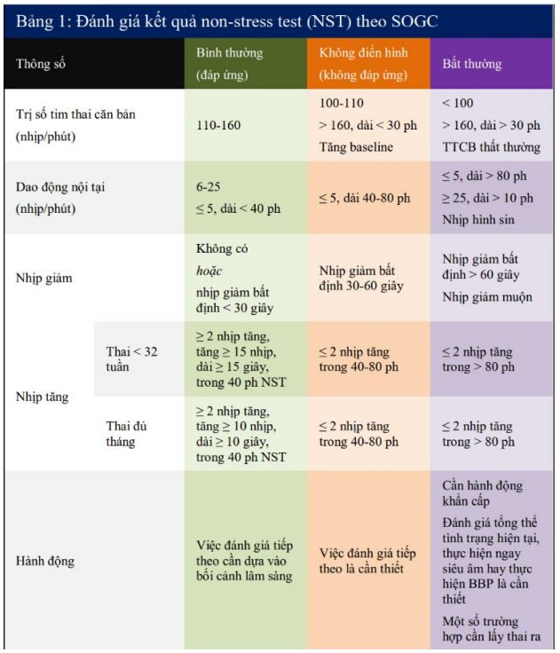

##### 5.2. Velo

- Tăng PI ĐMR: thiếu oxy trường diễn đã tác động xấu lên thai. Tăng PI ĐMR lâu dài sẽ có thể kéo theo mất hoặc đảo ngược sóng tâm trương => Châm dứt thai kì.
- Tăng PI ĐMTC: nguy cơ cao sẽ có tsg, fgr
- Giảm PI ĐMNG: đã có tái phân bố tuần hoàn
- Giảm tỉ số não nhau: Nghiêng hẳn về cdtk

##### 5.3. AFI

- Thiểu ối khi AFI < 5 cm hoặc SDP < 2cm: cho thấy có tình trạng tái phân bố tuần hoàn, gặp trong fgr, tsg, thai quá ngày
- Đa ối khi AFI > 25 cm hoặc SDP > 8cm: cho thấy 2 khả năng, thường gặp nhất là GDM, ít hơn là bất thường cấu trúc hệ tiêu hóa, dị tật ống thần kinh trên siêu âm
2. **VẤN ĐỀ thai to: Sẽ cho thi giấy, có sẵn biểu đồ, kèm theo các câu hỏi. Cần làm theo các bước sau:**

- Bước 1 và 2 giống y chang trên.
- **Bước 3: Nhận định tình trạng thai**
- Các đề thường cho rất điển hình, nhìn dô là chạm 90th hoặc hơn, không nói nhiều, như z nghĩa là việc của mình là nhận định “thai to so với tuổi thai”.
- Phản xạ ngay lập tức là xem lại chỉ số ối liền. Nếu chỉ số ối AFI > 24cm hoặc SDP > 8cm hoặc ngay ngưỡng thì cũng đúng bài và đi tới bước 4. Nếu chưa có AFI đợt này thì có lẽ đề sẽ có câu hỏi cần làm j tiếp theo. Mà thường siêu âm đi sinh trắc sẽ đi kèm với AFI.
- **Bước 4: Tìm nguyên nhân**
- Đa phần sẽ hướng về GDM nhưng muốn điểm cao phải cần lưu ý về bất thường cấu trúc và lệch bội. Chỉ cần xem qua siêu âm và nói bệnh nhân “hiện không thấy bất thường cấu trúc trên hệ tiêu hóa, không có bất thường di truyền nên nghĩ nhiều do đái tháo đường thai kì”.
- **Bước 5: Đề nghị CLS – Giải thích – Xử trí**
- Các CLS của đợt này gồm:

- Nếu ở TCN 3 thì không xài OGTT mà xài Glucose đói/ Glucose bất kì/ Glucose sau ăn 2h/ HbA1c: tất cả này đều được. Lưu ý phải thuộc ngưỡng. Nếu bất thường => MNT 1st

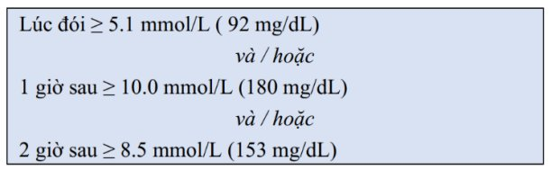

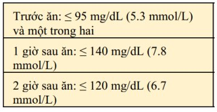

- Ngưỡng chẩn đoán Mục tiêu cần đạt
- mBPP là chắc chắn phải có. NST được khuyến cáo là làm 2 lần 1 tuần => Mục đích để đánh giá biến động tim thai => NST có bất thường thì xem xét kéo dài hoặc cdtk (có hay ko kèm corticoid + MgSO 4 ).

### TIẾP CẬN GIẢM CỬ ĐỘNG THAI

#### 1. ĐỀ

##### 1.1 Y18 – đợt 3

- Đề: Thai kỳ 37 tuần, đến khám vì giảm cử động thai. Có sổ khám thai trước đó.

- Hỏi bệnh sử => nhận diện hoàn cảnh thai phụ phát hiện giảm cử động thai + mượn sổ khám thai nhận định đây là “thai kỳ nguy cơ thấp”.
- Lên kế hoạch quản lý thai kỳ => khám lâm sàng (nghe tim thai bằng máy Doppler cầm tay, cho đo NST, siêu âm) => kết luận được: tim thai hiện tại bình thường, NST có đáp ứng, siêu âm sinh trắc thai trong giới hạn bình thường (“không to không nhỏ”) => hướng dẫn BN theo dõi như một thai kỳ bình thường, theo dõi các dấu hiệu chuyển dạ.

##### 1.2 Y20 đợt 3

- Thai phụ đến khám vì giảm cử động thai. Cho NST
- Yêu cầu:

1. Đọc NST đầy đủ. Phân loại NST, giải thích.
2. Phân tích kết quả NST. Giải thích
3. Hướng quản lý tiếp theo là gì?

- **Lưu ý:**

- Đọc NST phải có đầy đủ từ hành chính, kỹ thuật đến các bước.
- NST này đọc là có đáp ứng (bình thường).
- Khi ghi hướng xử trí thì phải ngoài các bước dặn dò, hướng dẫn thai phụ đếm cử động thai thì phải có bước tái khám, phải ghi được hẹn tái khám sau bao lâu và tái khám để làm gì.

#### 2. CÁC BƯỚC TIẾP CẬN

##### 2.1 Bước 1 : Nghe tim thai bằng máy Doppler cầm tay

##### 2.2 Bước 2 : Có thực sự giảm cử động thai ?

- PARA
- Chị khám thai bao nhiêu lần rồi ? Mượn sổ khám thai
    + Xem bất thường di truyền thiếu máu nhiễm trùng bào thai
    + Xem TSG, ĐTĐ, nguy cơ sinh non, nhau tiền đạo, thai giới hạn tăng trưởng
- Sao chị biết giảm cử động thai?
- Bình thường mình đếm được bao nhiêu cử động thai trong 1 tiếng ?
- Bé giảm cử động cụ thể là giảm so với hằng ngày hay không có cử động nào trong 1 giờ luôn ?
- Cách chị đếm cử động thai ?

##### 2.3 Bước 2: Khám

- Khám ngoài: Đo bề cao tử cung, cơn gò, khám Leopold
- Khám trong
- Sinh hiệu mẹ

##### 2.4 Bước 3: Đề nghị xét nghiệm

- Cử động thai giảm thường cho thấy có một bất thường gì đó trong thai kì, bây giờ tôi sẽ đề nghị thêm test lượng giá sức khoẻ thai là NST (có thể làm thêm AFI, siêu âm
    + Doppler tuỳ theo yếu tố nguy cơ)
- Kết luận: Bình thường hay bất thường: dựa trên các dữ kiện (kết hợp với nguy cơ)
3. **Các vấn đề khác về cử động thai**
    + Hướng dẫn đếm cử động thai
        * Chọn 1 thời điểm thích hợp trong ngày (thường là buổi tối, tốt hơn là sau khi ăn và tắm rửa sạch sẽ) ở nơi yên tĩnh.
        * Đặt tay lên bụng và đếm số cử động thai, một cử động thai là một chuỗi hành động của thai mà người mẹ cảm nhận như có gì đó đập vào bụng mình
        * **Mình sẽ đếm cử động thai trong vòng 1 tiếng, nếu không đạt 4 cử động thai thì mình sẽ đếm thêm trong 1 tiếng nữa.** Cử động thai được coi như làm giảm nếu có ít hơn 6 cử động thai trong 2h, lúc đó mình sẽ đi khám liền.
    + Một số điểm chỉ cần lưu ý
        * Cử động thai sẽ giảm khi bé ngủ, chu kì ngủ của bé là 20-40 phút và không quá 90 phút
        * Test có độ đặc hiệu thấp, có nghĩa là nếu cử động thai giảm thì thai có thể không bị gì cả, nên chị đừng quá lo lắng nhé
        * Tuy nhiên đây lại là một test tầm soát tốt, giúp chị biết được khi nào cần đi khám để phát hiện sớm tình trạng không còn bình thường của em bé.

### TIẾP CẬN QUÁ NGÀY DỰ SINH

#### 1. CÁC ĐỀ

##### 1.1 Y19 – Đợt 1:

- Thai 40 3/7 tuần, đến khám vì quá ngày dự sanh
- KQ siêu âm (BN giấu) Có AFI = 4cm (Cân nhắc nitrazine test), sinh trắc bình thường, thai 3300g, EFW 55th percentile
- KQ NST (BN giấu): phân loại nhóm I (Có đáp ứng), ko có cơn gò tử cung
    1. Làm thêm xét nghiệm gì
    2. Nhận định kết quả xét nghiệm
    3. Đưa Hướng quản lý
        * Câu hỏi: BN sẽ hỏi sao làm xn đó z bs, tiếp theo phải làm gì hỏi được: cử động thai bình thường, lần trước sinh thường rồi, không có triệu chứng bất thường ra máu ra huyết âm đạo, Sổ khám thai trong các TCN bình thường hết (này t nhìn lướt qua thấy ổn) (t cũng thấy bình thường)

##### 1.2 Y19 – Đợt 1: (1 đề khác)

- Thai 40w4d, đến khám vì quá ngày dự sanh
    1. Nhận định vấn đề cho BN này
    2. Hướng quản lý tiếp theo
- BN có sổ khám thai, 1 siêu âm, 1 NST: thiểu ối (AFI = 5), lúc thai 28w AFI = 10, sinh trắc và các vấn đề khác đều bình thường.
- Hướng quản lý phải nói được là cho BN nhập viện theo dõi (khởi phát chuyển dạ cho BN nếu…), nếu đề nghị thêm CLS gì sẽ rớt.

##### 1.3 Y17 đợt 3

- Cho sổ khám thai , mô hình , thai hiện tại 4O tuần

- 1. Thăm khám trên BN này ?
- 2. BN hỏi thai hiện tại của tôi có khỏe hay không .

#### 2. CÁC BƯỚC QUẢN LÝ

- **Bước 1: Có thực sự quá ngày dự sanh?**

- Khám thai có đầy đủ không? Xin sổ khám thai
- PARA
- Thai kì này là tự nhiên hay hỗ trợ sinh sản?
- **Tính tuổi thai (giống tiếp cận FGR)**

- Thai kì của mình là tự nhiên hay hỗ trợ sinh sản?
- Kinh chót của mình là khi nào? (không nhớ thì khỏi hỏi tiếp về kinh)
    + Kinh nguyệt của mình có đều không? CK kinh bao nhiêu ngày?
    + Có sử dụng biện pháp tránh thai không?
    + Có bệnh phụ khoa gì không?
    + Kinh chót có tính chất giống những lần hành kinh trước không
    + Kinh áp chót là ngày nào ?
- Đối chiếu kinh chót và siêu âm TCN 1
- TCN1: Chị có được lưu ý bất thường di truyền, thiếu máu, nhiễm trùng bào thai. TCN2: Chị có lưu ý TSG, THA, ĐTĐ (OGTT), nguy cơ sinh non, nhau tiền đạo
- **Bước 2 : Hỏi bệnh sử và tiền căn**

- Hỏi tiền căn ngắn gọn (như tiếp cận trễ kinh)
- Hỏi bệnh sử triệu chứng
- Đau bụng, ra huyết, ra nước, thai máy
- **Bước 3: Thăm khám**

- Khám ngoài: Khám BCTC, bắt cơn gò, khám leopold, nghe tim thai
- Khám trong: âm đạo, CTC, cùng đồ, phần phụ, khung chậu
- **Bước 4: Kết luận và quản lý**
- Dựa vào kết quả NST để quyết định phương pháp CDTK

- CDTK bằng khởi phát chuyển dạ: Hiện tại là thai đã hơn 40 tuần, cho thấy rằng sự cung cấp máu và dinh dưỡng của bánh nhau không còn được như trước nữa, bé hiện tại có thể sống ở môi trường bên ngoài tử cung. Việc kéo dài thai kì thêm nữa có thể mang lại hậu quả xấu cho bé như suy thai, thai chết lưu. Hậu quả cho mẹ như tăng nguy cơ sinh mổ, tăng nguy cơ BHSS, … nên chúng tôi sẽ cho chị nhập viện để khởi phát chuyển dạ để chấm dứt thai kì. Có 3 phương pháp để khởi phác chuyển dạ là đặt foley, oxytocin và prostaglandin.

## CHƯƠNG 4: NỬA SAU THAI KÌ

### TIẾP CẬN ĐÁI THÁO ĐƯỜNG THAI KÌ

#### 1. LÝ THUYẾT CẦN NHỚ

- Thai phụ không mang nhật ký ăn + không test đường tại nhà, đến khám vì đường huyết hôm nay cao → hỏi cách ăn của bả (bả không đem thì phải hỏi): ăn như thế nào, hôm nay test đường ăn như thế nào, mấy nay ăn uống như thế nào, có bữa nào ăn ngọt, ăn chè gì không, có chia nhỏ bữa ăn không, tại sao bả không theo dõi đường huyết + không theo dõi bữa ăn? → lúc này phải tư vấn nguy cơ của con và nguy cơ của mẹ cho bả để thuyết phục bả tuân thủ, rồi hướng dẫn bả lại cách tiết chế + theo dõi đường huyết và bữa ăn
- Hôm sau bả quay lại với 1 đường huyết vẫn cao → kiểm tra lại cách tiết chế + đường huyết như thế nào hằng ngày → nếu vẫn cao thì có thể cho chích
- Tại sao lúc đầu không chích luôn đi? → chích insulin
- Nếu 1 thai phụ đường huyết đói ổn, đường huyết sau ăn 1h ổn, chỉ (+) ở đường huyết sau ăn 2h thì khả năng là cổ vẫn MNT được
- Trường hợp nào xài insulin ngay từ đầu? → trường hợp nào mà MNT khả năng cao sẽ không hiệu quả? → rối loạn cả 3 số đường huyết
- Tiêu chuẩn để chuyển qua sử dụng insulin
- ĐTĐ type 2 trước khi mang thai → bắt đầu từ MNT + insulin luôn
- OGTT (-), sau đó, ở giai đoạn sau của TCN3 phát hiện thai to, đa ối → tư vấn là đã qua thời điểm chẩn đoán xác định ĐTĐ thai kì rồi và cho bả MNT luôn (theo dõi như 1 người ĐTĐ thai kì) → tái khám 1 tuần/lần. Giải thích thêm thai to đa ối thường nguyên nhân là đến từ chuyển hóa và cũng xem qua các siêu âm hình thái (không có bất thường đường tiêu hóa…)

#### 2. CÁC ĐỀ

##### 2.1 Y20 đợt 2: trạm giấy – đánh giá MNT – trạm sát thương với điễm trung bình 3.9

- Đề: Thai phụ được chẩn đoán đái tháo đường, đang thực hiện MNT và đến khám để đánh giá lại tình trạng đường huyết
- **Câu 1:** Đánh giá bệnh nhân thực hiện MNT đúng không -> chỉ có 2 đáp án có và không. Vì sao? (chọn không thì không chấm tiếp 2 câu sau)

- MNT đã thực hiện đúng vì có chia nhỏ bữa ăn, khoảng thời gian cách 3-4h, bữa sáng ăn ít tinh bột, có bữa nhẹ trước khi đi ngủ, sử dụng thực phẩm có GI thấp, ăn đầy đủ nhóm chất, có vận động 30 phút mỗi ngày. Theo dõi đường huyết đầy đủ
- **Câu 2:** MNT có hiệu quả không? Chỉ có 2 đáp án đúng và sai. Vì sao?

- MNT không hiệu quả vì đường huyết không đạt mục tiêu, cụ thể là đường huyết sau ăn 2h > 120; bách phân vị thai tăng từ 40-80, có khả năng đã bị ĐTĐ trước đó
- **Câu 3:** Đưa ra hướng quản lý tiếp theo?
- Vì MNT đã thực hiện đúng nhưng không đạt mục tiêu → tiêm insulin & duy trì chế độ ăn như cũ BM cho sổ khám thai và nhật kí trong 2 – 3 tuần qua rất rất dài. Nhưng mà nhìn chung MNT thực hiện rất tốt, bệnh nhân cũng tập thể dục. Nhưng kết quả và chỉ số đường huyết và sinh trắc thai thì tăng nên câu 1 chọn thực hiện đúng, câu 2 chọn không hiệu quả. Hướng dẫn tiếp theo là bắt đầu tiêm insulin, hẹn tái khám đánh giá (ghi thêm thời điểm CDTK: MNT + insulin không ổn thì CDTK lúc 37w – 38w 6/7, còn ổn thì 39w – 39w 6/7), duy trì ăn uống, vận động

##### 2.2 Y18 – đợt 4

- Đề: Tư vấn và hướng xử trí cho 1 BN có RL Carbonhydrate trong thai kỳ
- Hướng dẫn: XN đường huyết BN tăng, hỏi về bữa ăn thì BN đưa nhật ký bữa ăn -> Đánh giá nhật ký bữa ăn xem đã tốt chưa. Đáp án đợt này là bữa ăn rất tốt, BN tuân thủ MNT tốt nhưng đường huyết lại cao -> bắt đầu Chích Insulin cho BN.

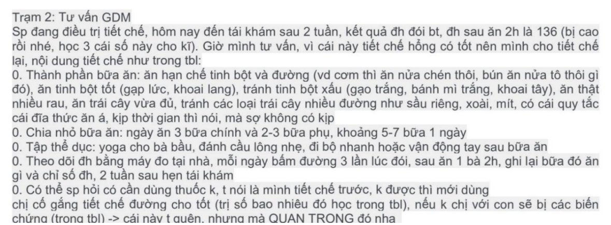

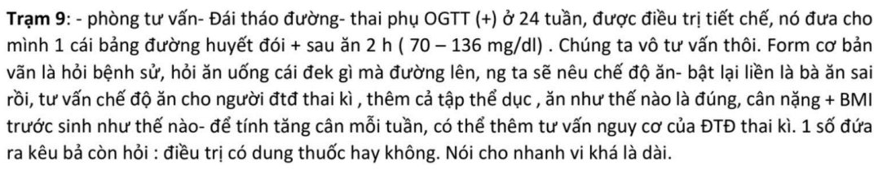

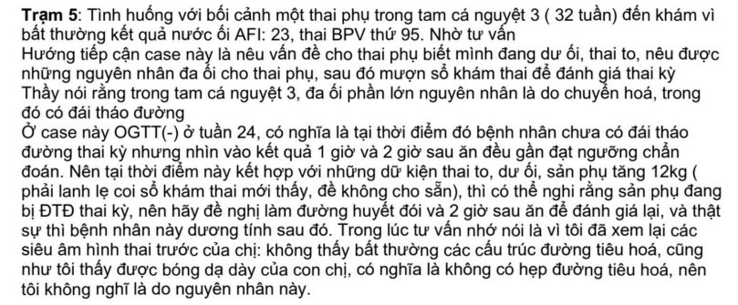

##### 2.3 Y20 đợt 1

- Thai phụ đến khám thai tuần 12 vì lần sinh trước mổ lấy thai do sanh khó.
- Yêu cầu: hãy tư vấn về hướng quản lý tiếp theo cho thai kỳ.
- Lưu ý: Lần trước phải mổ thai vì kẹt vai, có đtđ thai kỳ điều trị insulin, sau sinh thì không ghi nhận bị đtđ. Sổ khám thai lần này đã khám thai 3 lần trước đó, các test tổng soát bình thường, siêu âm không có gì bất thường, đã làm test glucose đói hôm nay, trong giới hạn bth. Lần này cần hỏi bệnh sử về thai kỳ trước, các ytnc, triệu chứng, tiền căn đtđ -> có bị PCOS. Tư vấn về đtđ thai kỳ, nguyên nhân, hậu quả,… -> thai kỳ nguy cơ cao đtđ thai kỳ -> quản lý tiếp theo là làm test OGTT ngay hôm nay (nguy cơ cao !)

#### 3. CÁC BƯỚC TIẾP CẬN

##### 3.1 Tình huống 1: OGTT (+) dương, tư vấn MNT

###### 3.1.1 Bước 1: Hỏi bệnh sử và tiền căn

- Chị có đi khám thai thường quy không? Cho tôi xin sổ khám thai.
    + Xem tuổi thai, tầm soát đường TCN 1, siêu âm 4D, ĐTĐ, TSG, BMI trước sinh và diễn tiến tăng cân, tình trạng thai (sinh trắc, AFI, NST, doppler)
- PARA
- Phụ khoa: Kinh nguyệt trước khi mang thai có đều không? Mình có bệnh phụ khoa gì như hội chứng buồng trứng đa nang không?
- Nội khoa: Mình có được chẩn đoán tiểu đường không? Có điều trị không
- Ngoại khoa: phẫu thuật, chấn thương vùng bụng
- GĐ: Ba mẹ, anh chị em ruột có ai bị ĐTĐ?

###### 3.1.2 Bước 2: Tư vấn

- Sau khi làm test đường thì tôi chẩn đoán chị có đái tháo đường thai kì
- **Chị có gì về đái tháo đường thai kì không?**
- ĐTĐ thai kì là tình trạng rối loạn chuyển hoá đường do quá trình mang thai gây ra, nó có thể gây ra những biến chứng cho mẹ và thai:
    + Ở mẹ thì tăng nguy cơ bị **tiền sản giật** là một bệnh lý về HA, đa ối, nhiễm trùng đường sinh dục, tăng nguy cơ mổ lấy thai và ĐTĐ type 2 sau mang thai
    + Ở con thì gây ra thai chết lưu do biến động đường huyết, có thể mất tim thai bất cứ lúc nào!, **thai to,** khi chuyển dạ với thai to có thể **biến chứng kẹt vai,** thai giới hạn tăng trưởng trong tử cung, hạ đường huyết sau sanh, hạ calci sau sanh, dễ mắc đái tháo đường type 2 trong tương lai.
- Những biến chứng này sẽ dễ xuất hiện nếu tình trạng đường huyết của chị không được kiểm soát, và bây giờ tôi sẽ tư vấn chế độ ăn uống để đường huyết của mình được kiểm soát ở mức mục tiêu, nếu không thành công thì mình mới dùng thuốc.
1. Chị nên chia nhỏ bữa ăn, mỗi ngày 5-7 bữa bao gồm 3 bữa chính, 3-4 bữa phụ. Mỗi bữa ăn cách nhau 2-3h, buổi sáng nên hạn chế tinh bột và buổi tối không để bụng đói đi ngủ
2. Tinh bột là một thành phần quan trọng nên mỗi bữa ăn đều phải có chứ không kiêng hoàn toàn
3. Lựa chọn tinh bột có tải đường thấp như bánh mì đen, gạo lức, hạn chế ăn nhiều cơm, bún, phở, bánh ngọt, kẹo, nước ngột
4. Ăn nhiều rau, thịt cá trứng, không nên ăn dầu mỡ
5. Các bữa phụ có thể ăn trứng luộc, uống sữa không đường, ăn trái cây.
6. Không ăn nhiều trái cây quá ngột (nhô, xoài, sầu riêng, dưa hấu…), ăn những loại như cam, ổi, mận
7. **Vận động:** vận động 30 phút mỗi ngày (đi bộ nhanh), sau các bữa ăn có thể ngồi và vận động tay trong 10 phút sau mỗi bữa ăn.
8. **Theo dõi đường huyết:** ghi nhận đường huyết 4 lần trong ngày bằng máy đo tại nhà, 1 lần đối và 3 lần sau bữa ăn chính 2h. Ghi lại thời gian ăn, ăn gì, số lượng bao nhiêu, cách chế biến vào cuón sổ để tôi theo dõi.
- Nếu đường huyết kiểm soát tốt bằng liệu pháp dinh dưỡng nội khoa này thì chị không cần thiết phải dùng thuốc hạ đường huyết.
- **Chị thấy ăn uống và tập luyện như vậy có khó khăn gì không? Công việc có ảnh hưởng không?**
-  Tôi hiểu cho sự khó khăn của chị, nhưng mà vì sức khỏe của chị và thai, mong chị thực hiện chế độ ăn, chế độ tập luyện như tôi nói. Chị có thể lựa chọn thời điểm thích hợp cho ăn bữa phụ, chọn các loại thực phẩm tiện lợi, phù hợp với tính chất và thời gian công việc
- Mình sẽ tái khám lại sau 2 tuần đánh đánh giá lại tăng cân của mẹ, sinh trắc thai, nước ối, đánh giá đường huyết đói, 2h sau ăn và nhật kí bữa ăn, nhật ký đường huyết của chị nha.
    + Bữa đi khám chị nhớ không ăn sáng để đo đường huyết

##### 3.2 Tình huống 2: Tư vấn điều chỉnh MNT

###### 3.2.1 Bước 1: Hỏi bệnh sử và tiền căn

- Chị có đi khám thai thường quy không?
    + Cho tôi xin sổ khám thai xem tuổi thai, tầm soát đường TCN 1, siêu âm 4D, ĐTĐ, TSG, BMI trước sinh và diễn tiến tăng cân, tình trạng thai (sinh trắc, AFI, NST, doppler)
- PARA
- Chị có ghi lại nhật kí bữa ăn và nhật ký đường huyết không? Cho tôi mượn
- Chị đã biết gì về cách thực hiện điều trị tiết chế?
- Công việc của chị có ảnh hưởng tới việc thực hiện không?

###### 3.2.2 Bước 2: Tư vấn

- Việc thực hiện điều trị tiết chế MNT của chị đã thất bại, do đường huyết đói của chị quá thấp (...) và đường huyết sau ăn quá cao (...), có sự chênh lệch đường huyết
- ĐH đói quá thấp không phải là tình trạng tốt mà điều này có thể dẫn đến hiện tượng hạ đường huyết cả mẹ và thai, có thể gây nguy hiểm. Đường huyết sau ăn cao làm thai tiêu thụ 1 lượng lớn đường, gây thai to, đa ối và những biến chứng nguy hiểm khác
- Nguyên nhân là do:
    + Phân bố bữa ăn không hợp lý, không có bữa ăn khuya, bữa ăn cuối cùng buổi tối cách quá xa bữa ăn sáng ngày hôm sau, dễ gây ra hạ đường huyết về đêm
    + Phân bố lượng tinh bột không cân đối (bữa ăn sáng cần ăn lượng tinh bột ít mà lại ăn nui, phở bò)
    + Chọn lựa loại tinh bột có tải lượng đường cao (nui, phở bò, cơm, pasta, bánh mì, khoai tây...)
- Bây giờ, giải pháp cho chị là thực hiện lại điều trị tiết chế để duy trì mức đường huyết đói và sau ăn ở mức mục tiêu, tôi xin hướng dẫn lại:
    1. Chị nên chia nhỏ bữa ăn, mỗi ngày 5-7 bữa bao gồm 3 bữa chính, 3-4 bữa phụ. Mỗi bữa ăn cách nhau 2-3h, buổi sáng nên hạn chế tinh bột và buổi tối không để bụng đói đi ngủ
    2. Tinh bột là một thành phần quan trọng nên mỗi bữa ăn đều phải có chứ không kiêng hoàn toàn
    3. Lựa chọn tinh bột có tải đường thấp như ngũ cốc nguyên cám, bánh mì đen, gạo lức, hạn chế ăn nhiều cơm, bún, phở, bánh ngọt, kẹo
    4. Ăn nhiều rau, thịt cá trứng, không nên ăn dầu mỡ, không uống nước ngột
    5. Các bữa phụ có thể ăn trứng luộc, uống sữa không đường, sữa cho người đái tháo đường, ăn trái cây
    6. Không ăn nhiều trái cây quá ngột (nhô, xoài, sầu riêng, dưa hấu…), ăn những loại như cam, ổi, mận
    7. Tư vấn nếu bệnh nhân có hỏi dùng thuốc: dùng thuốc chỉ thực sự nên khi đã thực hiện đúng MNT nhưng không kiểm soát được mức đường huyết
    8. **Vận động:** vận động 30 phút mỗi ngày (đi bộ nhanh); nếu đã có chế độ tập luyện thể dục trước đó như tập thể dục nhịp điệu, yoga, thì nên duy trì; sau các bữa ăn có thể ngồi và vận động tay trong 10 ph sau mỗi bữa ăn.
    9. **Theo dõi đường huyết:** ghi nhận đường huyết 4 lần trong ngày bằng máy đo tại nhà, 1 lần đối và 3 lần sau bữa ăn chính 2h. Ghi lại thời gian ăn, ăn gì, số lượng bao nhiêu, cách chế biến vào cuón sổ để tôi theo dõi.
- Nếu đường huyết kiểm soát tốt bằng liệu pháp dinh dưỡng nội khoa này thì chị không cần thiết phải dùng thuốc hạ đường huyết
- Chị thấy ăn uống và tập luyện như vậy có khó khăn gì không? Công việc có ảnh hưởng không?
-  Tôi hiểu cho sự khó khăn của chị, nhưng mà vì sức khỏe của chị và thai, mong chị thực hiện chế độ ăn, chế độ tập luyện như tôi nói. Chị có thể lựa chọn thời điểm thích hợp cho ăn bữa phụ, chọn các loại thực phẩm tiện lợi, phù hợp với tính chất và thời gian công việc  Mình sẽ tái khám lại sau 2 tuần đánh đánh giá lại tăng cân của mẹ, sinh trắc thai, nước ối, đánh giá đường huyết đói, 2h sau ăn và nhật kí bữa ăn của chị nha. Bữa đi khám chị nhớ không ăn sáng để đo đường huyết

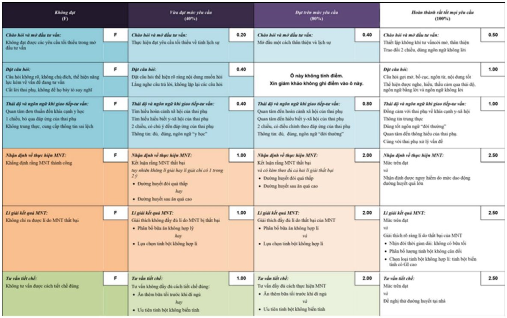

##### 3.3 Tình huống 3: OGTT (-), xem sổ khám thai thấy bất thường ở TCN 3

- Sau khi đọc sổ khám thai, tôi nhận thấy có một số vấn đề sau
- Chị tăng cân không hợp lý, với mức BMI của chị là … trước mang thai thì chị nên tăng … kg/tháng, tuy nhiên chị đang tăng … kg/tháng
    + (Nhẹ cân tăng 2.5 kg/tháng, bình thường tăng 2kg/tháng, béo phì tăng <2kg/tháng)
- Chỉ số ối AFI > 24cm cho thấy chị đang có tình trạng đa ối
- Thai nhi cũng tăng cân nhiều, cân nặng thai đang ở bách phân vị thứ 90 (có nghĩa là cứ 100 thai nhi ở cùng tuổi thai với con chị, thì có 90 thai có trọng lượng nhỏ hơn và chỉ 10 thai có trọng lượng lớn hơn)
- Đường huyết đói đo ngày hôm nay cao (… mg/dL)
- Mặc dù kết quả OGTT (-) ở tuần thứ 24-28 nhưng kết quả đó chỉ nói rằng thai kì của chị có nguy cơ thấp kết cục bất lợi do biến động đường huyết ở quanh thời điểm đó, chứ không nói rằng chị sẽ không có khả năng mắc đái tháo đường thai kì ở thời điểm hiện tại. Các vấn đề tôi đã nói ở trên cho thấy chị **có nguy cơ** mắc đái tháo đường thai kì.
- Chị có biết đái tháo đường thai kì là gì không? Là tình trạng rối loạn chuyển hoá đường do tình trạng có thai, có thể ảnh hưởng đến mẹ và con
    + Ở mẹ, tăng nguy cơ tiền sản giật là một bệnh lý về huyết áp, đa ối, nhiễm trùng đường sinh dục, tăng nguy cơ mổ lấy thai và mắc đái tháo đường type 2 sau khi sanh
    + Ở con, có thể gây thai chết lưu, thai to, khi sinh thai to có thể có biến chứng kẹt vai, thai giới hạn tăng trưởng trong tử cung, dị tật tim và chi, hạ đường huyết sau sanh và tăng nguy cơ bé bị đtđ type 2 trong tương lai
- Bây giờ để quản lý thì trước hết tôi sẽ cho chị xét nghiệm đường huyết bất kì, nếu kết quả quá cao thì tôi sẽ tư vấn cho chị chế độ ăn uống tiết chế cho người đái tháo đường thai kì hoặc dùng insulin, còn nếu bình thường thì mình sẽ tái khám thường xuyên hơn để theo dõi tăng cân của chị, tình trạng nước ối, trọng lượng thai nhi, thực hiện các test đánh giá sức khoẻ thai, nếu có bất thường quá nặng chúng tôi cũng có thể phải chấm dứt thai kì sớm ha chị ha

### TIẾP CẬN TIỀN SẢN GIẬT

#### 1. LÝ THUYẾT CẦN NHỚ

- Các vấn đề cần quản lý:

- Có cho nhập viện không? Nếu ngoại trú thì bao lâu tái khám (3 ngày), nếu nhập viện thì theo dõi sao (đo SH 2 lần/ngày, bilan tsg mỗi ngày, NST mỗi 3 ngày, siêu âm 2D đánh giá sinh trắc, chỉ số ối 2-3 tuần/lần)
- Có cho thuốc hạ áp không? MgSO4?
- Có cho corticoid không?
- Chấm dứt thai kì lúc nào?

#### 2. CÁC ĐỀ

##### 2.1 Y18 – đợt 1

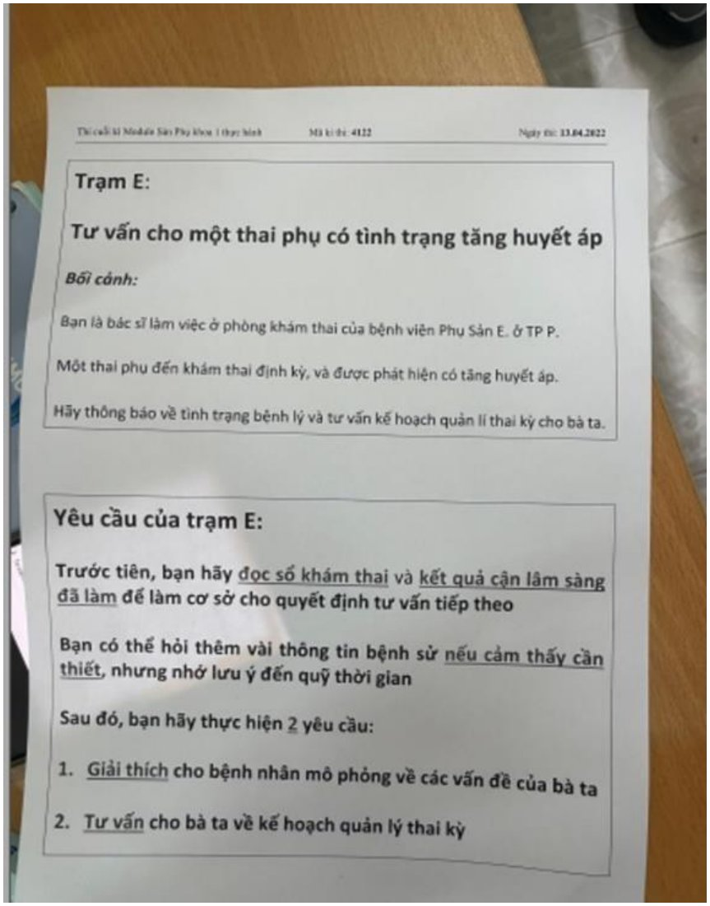

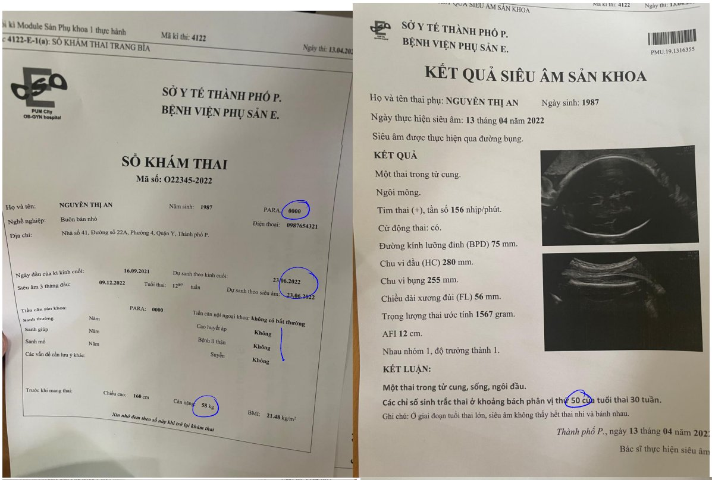

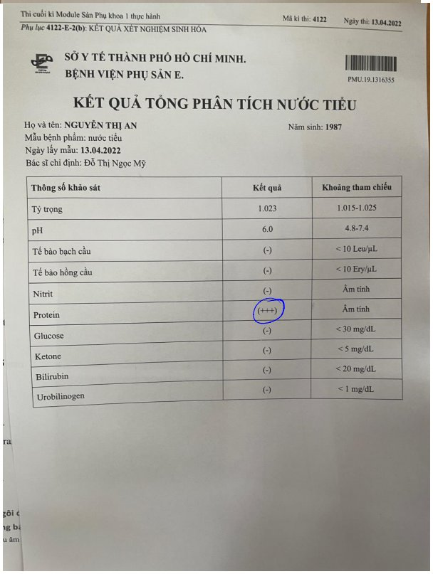

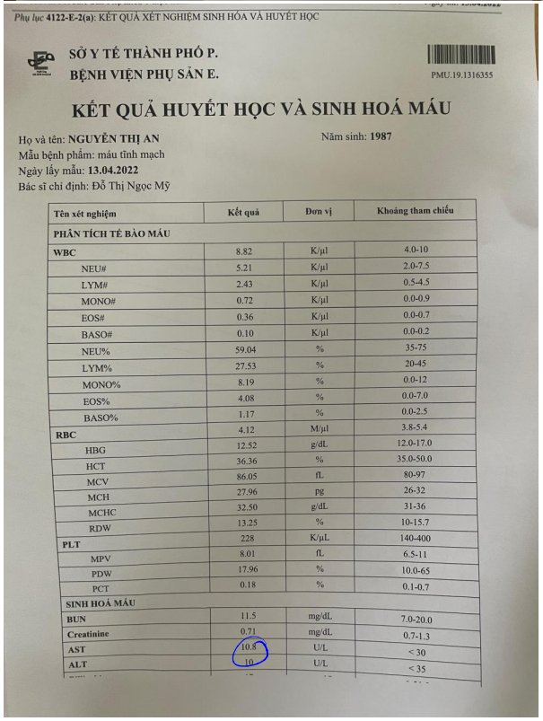

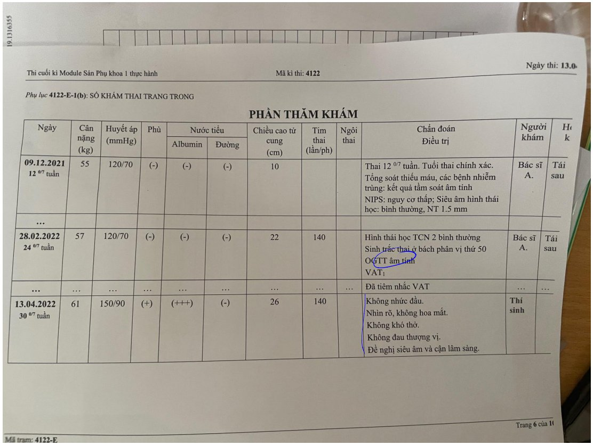

##### 2.2 Y19 – Đợt 1

- Thai phụ 28w khám thai định kì, HA đo 2 lần cách nhau 20 phút là 150/90, trước đó không có bệnh lý nền, phù 2 tuần trước. Chưa làm test gì khác
    1. Hỏi tiền sử, bệnh sử
    2. Khám (trên mô hình và BN chuẩn)
    3. Hướng quản lý
    + Trạm này có 1 sổ khám thai (bình thường hết), 1 phiếu tim thai 158 l/phút (phải cầm máy lên đo tim thai và chai gel trên mô hình mới đưa ra)
    + Dụng cụ trên mâm: ống nghe, máy nghe tim thai, búa gõ phản xạ, thước dây
    + Chủ yếu hỏi bệnh sử + khám đầy đủ, đúng kĩ thuật + giải thích cho BN. Nếu đề nghị CLS thì BN kêu 2 tiếng nữa mới có. Phải nhấn mạnh hiện tại chưa biết chắc là có TSG không, giải thích về TSG.

- Hỏi bệnh sử, tiền căn, khám:

- Hỏi các triệu chứng gợi ý tiền sản giật: đau đầu, chóng mặt, nhìn mờ, đau bụng, tiểu ít, khó thở…
- Tiền căn: all bình thường
- Gia đình ko bệnh lý tim mạch.
- Khám: chỉ có phù
    + Nhận định tình trạng hiện tại của thai phụ
        * Tiền sản giật chưa có dấu hiệu nặng

- -> Xử trí:

- Làm bilan xét nghiệm tiền sản giật
- Theo dõi tăng cường: (1) Con: Siêu âm sinh trắc mỗi 2 tuần, BPP biến đổi 2 lần/tuần, Doppler 1 lần/tuần, (2) Mẹ: Theo dõi huyết áp, các dấu hiệu gợi ý tiền sản giật

##### 2.3 Y19 – đợt 5: Thai phụ đến vì đo thấy THA

- Tác vụ:

1. Hỏi bệnh sử, tiền sử đầy đủ
2. Nhận định tình trạng của thai phụ (không đề nghị CLS và không đưa ra hướng quản lý)

- Lưu ý:

- Hỏi ra được thai phụ này bị THA mạn điều trị bằng captopril, thai kỳ trước CDTK lúc 36 tuần vì TSG nặng, vì vậy ngoài những câu hỏi liên quan đến thai thì phải hỏi thêm các câu hỏi về THA giống nội khoa (các triệu chứng của tổn thương cơ quan đích,…) thì mới điểm cao
- Nhận định: bà này bị tăng huyết áp mạn nặng lên do thai chứ ko bị tiền sản giật (sổ khám thai: HA những lần khám trước tuần 20 130/80, sau tuần 20 150/90, ko lần khám nào có đạm niệu hết, ko có các triệu chứng của TSG luôn)

##### 2.4 Y18 – đợt 3: Thi giấy – TSG dấu hiệu nặng

- “Cho hồ sơ khoảng 10 trang giấy”, đại khái thông tin là có HA 160/110 mmHg được đo 2 lần, cách VÀI phút + BN có nhức đầu/ thai 33 tuần 5 ngày.
    + Chẩn đoán? Giải thích chẩn đoán? Các vấn đề cần lưu ý trên thai kỳ này (nguy cơ mẹ, nguy cơ thai)?
    + Nguyên tắc điều trị đối với thai kỳ này? Giải thích? (Nhập viện - Hạ áp – ngừa co giật + Hỗ trợ phổi trên thai non tháng)
    + Em sẽ chấm dứt thai kỳ ở thời điểm nào? Giải thích?

##### 2.5 Y17 đợt 1: TSG dấu hiệu nặng

- Đề: Thai phụ 33 tuần 4 ngày, nhập khoa sản bệnh bệnh viện phụ sản E.

1. Hãy thực hiện đọc giấy tờ khám thai của bà ta, đưa ra nhận định.
2. Đưa ra tư vấn và hướng xử trí, tiên lượng điều trị.
- Giấy tờ khám thai: khám thai 6 lần.
- 4 lần từ lần 12 tuần đến lần 28 tuần: ghi nhận huyết áp 110/70- 120/80, albumin niệu âm tính, không phù, tim thai bình thường, tăng cân từ 53 kg lên 57 kg, cao 160cm, đã thực hiện đầy đủ tầm soát nhiễm trùng bào thai, OGTT âm tính, thiếu máu HCNNS âm tính, siêu âm hình thái không phát hiện dị tật.
- Lần khám 30 tuần 3 ngày ghi nhận huyết áp 140/80, albumin niệu - , phù nhẹ hai chân, làm bilan tiền sản giật không ghi nhận bất thường, thai hiện tại bách phân vị 25th.
- Lần khám thai 33 tuần 4 ngày ghi nhận huyết áp 160/110, albumin niệu +++, phù 2 chân, than nhức đầu, siêu âm thai BPV 25th, hiện được nhập sản bệnh, đang thực hiện xét nghiệm bilan tiền sản giật.
- Bilan tiền sản giật tiểu cầu không giảm, men gan <30.
- EFM ghi nhận dao động nội tại bình thường, ghi nhận nhịp tăng, không nhịp giảm, không cơn gò. Loại I
- (xem giấy tờ nhập viện) Tiền căn trước đây không ghi nhận đái tháo đường hay tăng huyết áp, nhau bong non…
- Giải:

- Hiện tại vấn đề của bà ta là một tiền sản giật có dấu hiệu nặng, thai 33 tuần 4 ngày còn đang non tháng, cần phải thực hiện ngay đường truyền tĩnh mạch bơm chậm MgSO4 phòng sản giật và thuốc chống tăng huyết áp Nifedipine đường uống hoặc Nicardipine truyền tĩnh mạch chậm. (không có => fail)
- Nhận định sổ khám thai cho thai phụ: khám thai định kì không ghi nhận tăng huyết áp và đạm niệu từ trước 30 tuần, đến tuần 30 3/7 ghi nhận tăng huyết áp tâm trương 140, phù nhẹ, không có triệu chứng và bi lan tiền sản giật không ghi nhận thêm, chẩn đoán tiền sản giật không dấu hiệu nặng khởi phát sớm và được theo dõi từ tuần 30. Sau đó 3 tuần bà ta mới đi khám lại và nhập sản A vì huyết áp cao 160/110, có đau đầu nhẹ, phù hai chân, đạm niệu +++ là một tiền sản giật có dấu hiệu nặng, cần tư vấn về nguy cơ cho mẹ và thai nhi. Với tiền sản giật dấu hiệu nặng kèm khởi phát sớm, tiên lượng nguy hiểm cho thai phụ rất cao. Chốt Chấm dứt thai kì (pass). Thực hiện điều trị ổn định nội khoa, hỗ trợ phổi cho thai nhi đủ liều 48 giờ sau đó chấm dứt thai kì. Cần tư vấn sử dụng liệu pháp Corticosteroid sẽ có lợi ích giảm khả năng suy hô hấp, giảm tỉ lệ xuất huyết não, giảm tỉ lệ tử vong sau sinh, tỉ lệ nhiễm trùng, nhưng đồng thời có những nguy cơ làm tổn thương tế bào não.
- Chấm dứt thai kì tùy tình trạng của thai phụ, tư vấn khởi phát chuyển dạ bằng foley hoặc prostaglandin E2 hoặc oxytocin vì nếu tình trạng mẹ chỉ có tăng huyết áp và đạm niệu thì vẫn chưa cần chỉ định mổ lấy thai cấp cứu. Nhưng nếu tình trạng nặng xuất hiện (HC HELLP, sản giật, nhau bong non) thì sẽ phải ổn định ngay và nếu không thể khởi phát chuyển dạ và sinh trong 12 tiếng, hoặc không thể ổn định nội khoa thì cần mổ lấy thai ngay.
- Hiện tại cần thực hiện theo dõi liên tục tình trạng sinh hiệu của bà ta, theo dõi nước tiểu, bilan tiền sản giật mỗi 6-12 tiếng, theo dõi tim thai bằng máy nghe doppler, chờ đủ thời gian 48 tiếng chấm dứt thai kì.
- Dặn dò trong lúc nằm viện chờ thì nếu có bất kì dấu hiệu đau đầu, hoa mắt chóng mặt, co giật thì cần gọi người tới ngay.

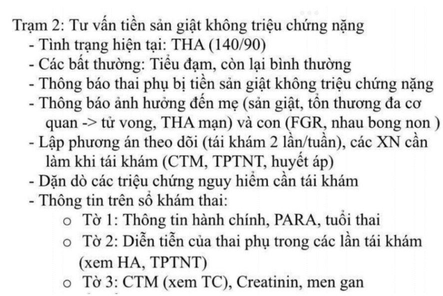

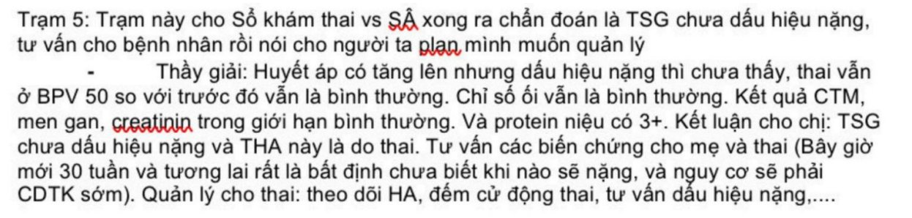

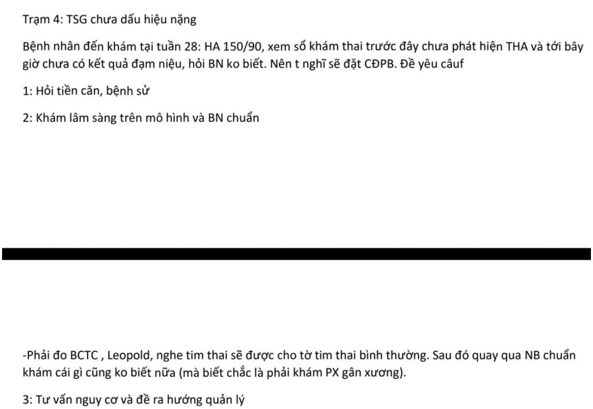

##### 2.6 Y20 đợt 3

- Thai phụ 26 tuổi, đến khám và tư vấn vì bị tăng huyết áp trong lúc khám thai định kì.
- Yêu cầu: Khai thác **bệnh sử, tiền sử, giải thích kết quả bất thường** cho thai phụ, đưa ra hướng **quản lí** tiếp theo (trạm này không yêu cầu đề nghị cận lâm sàng).
- **Lưu ý:**

- PARA 1001 (SV tự khai thác thêm), phải khai thác được thai kì trước thai phụ đã có tiền sản giật, hậu sản có bị tăng huyết áp mạn và có đang điều trị thuốc, phải hỏi được thai phụ uống thuốc gì, uống thuốc như thế nào (BN có mang theo thuốc nhưng phải hỏi đến thì bệnh nhân mới đưa ra).
- Trong SKT có ghi huyết áp mỗi lần khám và có được đo đạm niệu mỗi lần. Giải thích cho thai phụ: do thai phụ có nền tăng huyết áp mạn nên huyết áp mỗi lần khám đều cao, nhưng chưa có albumin niệu dương tính để xác định chẩn đoán. → tăng huyết áp mạn nặng lên do thai
- Thai phụ sẽ hỏi thêm về những vấn đề thắc mắc và mình phải trả lời thêm những câu hỏi đó

#### 3. CÁC BƯỚC TIẾP CẬN

##### 3.1 Tình huống 1: Tiền sản giật chưa có dấu hiệu nặng

###### 3.1.1 Bước 1: Hỏi bệnh sử và tiền căn

- Chị có khám thai thường quy không? Cho tôi xin sổ khám thai
- PARA: Lần này mang thai là đơn thai hay song thai.
    + Xem tuổi thai, xn thiếu máu nhiễm trùng lệch bội, **tầm soát tsg,** huyết áp các lần trước, xem BMI mẹ, các xét nghiệm đã làm, lượng giá sức khoẻ thai
1. **Bệnh nhân có thực sự tăng huyết áp?**
- Đo huyết áp khi nào? Đo bao nhiêu lần? Chỉ số bao nhiêu?
2. **Tăng huyết áp mạn hay tiền sản giật (xem chỉ số huyết áp trước tuần 20)**
- Mình có từng được chẩn đoán tăng huyết áp hay tiền sản giật không? Điều trị gì (có toa thuốc không)? Có điều trị đầy đủ không? Gia đình mình có ai bị tăng huyết áp không?
3. **Tổn thương cơ quan đích**
- Bây giờ tôi sẽ liệt kê một số triệu chứng, nếu chỉ có triệu chứng nào thì chị nói nha: đau đầu, chóng mặt, nhìn mờ, đau ngực, khó thở, đau bụng, vàng da, tiểu ít, tiểu đỏ, nổi ban xuất huyết
4. **Yếu tố nguy cơ tiền sản giật**
- Có từng bị tiền sản giật hay THA ở thai kì trước không?
- Có đái tháo đường, lupus hay bệnh thận không?
- Mẹ, chị, em có từng bị tiền sản giật không?

###### 3.1.2 Bước 2: Khám

- Khám tổng trạng, sinh hiệu, đo lại HA
    + Trước đó 30 phút chị có vận động mạnh, uống cà phê hay hút thuốc lá không?
- Khám ngoài: đo BCTC, bắt cơn gò, khám leopold, nghe tim thai
- **Khám tìm các biến chứng của tiền sản giật nặng: tri giác, ran phổi, vàng da, vàng mắt, các ban xuất huyết.**
- **Khám phản xạ gân xương bánh chè**
- **Đặt thông tiểu để theo dõi lượng nước tiểu nếu có xử trí MgSO 4**

###### 3.1.3 Bước 3: Đề nghị cận lâm sàng

- Mẹ: Bilan tiền sản giật

- TPTNT (Nếu protein + thì làm Đạm niệu 24h hoặc PCR)
- AST ALT
- Bilirubin, LDH để xem có tán huyết không
- Chức năng thận: BUN, Creatinin, Acid uric
- CTM để xem tiểu cầu, thiếu máu
- Sức khỏe thai:

- Đo NST để đánh giá tình trạng toan kiềm
- Siêu âm 2D đánh giá sinh trắc và chỉ số ối
- Siêu âm doppler để đánh giá tái phân bố tuần hoàn

###### 3.1.4 Bước 4: Tư vấn

- Tôi rất lấy làm tiếc khi phải thông báo rằng với kết quả hiện tại, tôi nhận định chị đang có tình trạng tiền sản giật không có dấu hiệu nặng trên thai ... tuần (là non tháng chị). Tiền sản giật là vì huyết áp là ... (và nặng lên) sau tuần 20 và xuất hiện đạm trong nước tiểu, chị chưa có dấu hiệu tổn thương các cơ quan như là não, mắt, tim, gan, thận nên tình trạng của chị là chưa có dấu hiệu nặng, nhưng hoàn toàn có thể chuyển nặng trong thai kì và diễn tiến thành THA mạn sau đó. Về con thì qua các test lượng giá sức khoẻ thai thì tình trạng thai nhi hiện ổn.
- **Chị đã biết gì về tiền sản giật rồi?**

- Tiền sản giật là tình trạng tăng huyết áp và tổn thương đa cơ quan do thai gây ra, cụ thể là bánh nhau, đây là bệnh lý xuất hiện sau tuần thứ 20 của thai kỳ và thường sẽ mất đi sau sanh.
    + Tình trạng này có thể gây ra nhiều biến chứng cho mẹ và con:
    + Đối với mẹ, có thể gây ra **sản giật** (tức là lên cơn co giật có thể dẫn đến hôn mê) (mức đạt), **băng huyết sau sinh, tổn thương đa cơ quan** (trên đạt), **và tăng huyết áp mạn sau này** (hoàn hảo)
    + Đối với con, có thể có nguy cơ **sinh non** do chấm dứt thai kì sớm (đạt), **suy thai** (trên đạt) và thai **giới hạn tăng trưởng trong tử cung** (hoàn hảo) do TSG gây co mạch toàn thân nên giảm cung cấp máu và oxi đến thai. Vì vậy nếu mẹ không ổn, hoặc con không ổn thì chúng tôi phải chấm dứt thai kỳ sớm là để giải quyết nguyên nhân của tình trạng bệnh là do bánh nhau.

- **Tư vấn hướng xử trí:**

- Hiện tại chị đang bị TSG nhưng **chưa có dấu hiệu nặng** nên chị không cần nhập viện, chưa cần dùng thuốc mà chỉ cần theo dõi ngoại trú và **nhớ tái khám 2 lần/ tuần.**
- Phía mẹ: ăn uống đầy đủ, tránh vận động nặng, đếm cử động thai mỗi ngày, **theo dõi huyết áp tại nhà (2 lần/ngày),** chị nhớ ghi lại diễn tiến huyết áp. Lưu ý **chị không được dùng thuốc lợi tiểu, an thần, thuốc hạ huyết áp.** Khi có các **triệu chứng** như huyết áp từ 160/110 trở lên, co giật, đau đầu, chóng mặt, nhìn mờ, đau ngực, khó thở, đau bụng, tiểu ít, tiểu đỏ, nổi ban xuất huyết, vàng da... thì chị lập tức **nhập viện** để kiểm tra.
- Mỗi lần tái khám chị sẽ được xét nghiệm máu, nước tiểu, thực hiện test lượng giá sức khoẻ thai như NST + siêu âm đánh giá thể tích nước ối được thực hiện ít nhất 1 lần mỗi tuần. Siêu âm 2D đánh giá sinh trắc 2 tuần/lần.
    + Nếu mọi thứ đều ổn định không chuyển sang TSG có dấu hiệu nặng **thì chấm dứt khi thai 37 tuần.** Nếu có dấu hiệu nặng như sản giật, HELLP, nhau bong non thì cần chấm dứt sớm hơn.

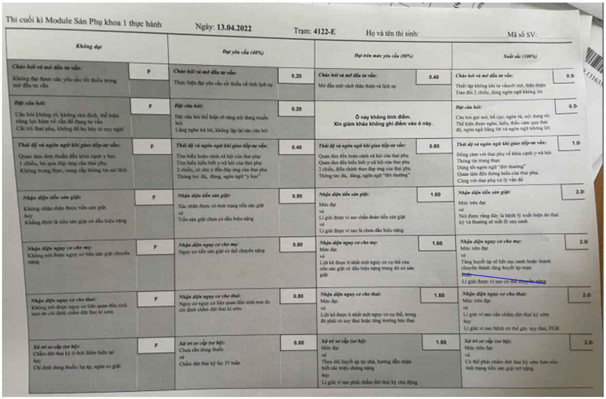

##### 3.2 Tình huống 2: Tiền sản giật có dấu hiệu nặng

###### 3.2.1 Bước 1,2,3 tương tự tình huống 1

###### 3.2.2 Bước 4: Tư vấn

- Tôi rất lấy làm tiếc khi phải thông báo rằng với kết quả hiện tại, tôi nhận định chị đang có tình trạng tiền sản giật có dấu hiệu nặng trên thai ... tuần (là non tháng). Tiền sản giật vì huyết áp là ... và xuất hiện đạm trong nước tiểu, tình trạng của chị có dấu hiệu nặng là vì … .Về con thì qua các test lượng giá sức khoẻ thai thì tình trạng thai nhi hiện ổn ha chị.
- **Chị đã biết gì về tiền sản giật rồi?**

- Tiền sản giật là tình trạng tăng huyết áp và tổn thương đa cơ quan do thai gây ra, cụ thể là do bánh nhau, đây là bệnh lý xuất hiện sau tuần thứ 20 của thai kỳ và thường sẽ mất đi sau sanh.
    + Tình trạng này có thể gây ra nhiều biến chứng cho mẹ và con:
    + Đối với mẹ, có thể gây ra **sản giật** (tức là lên cơn co giật có thể dẫn đến hôn mê) (mức đạt), **băng huyết sau sinh, tổn thương đa cơ quan** (trên đạt), **và tăng huyết áp mạn sau này** (hoàn hảo)
    + Đối với con, có thể có nguy cơ **sinh non** do chấm dứt thai kì sớm (đạt), **suy thai** (trên đạt) và thai **giới hạn tăng trưởng trong tử cung** (hoàn hảo) do TSG gây co mạch toàn thân nên giảm cung cấp máu và oxi đến thai. Vì vậy nếu mẹ không ổn, hoặc con không ổn thì chúng tôi phải chấm dứt thai kỳ sớm là để giải quyết nguyên nhân của tình trạng bệnh là do bánh nhau.

- **Tư vấn hướng xử trí:**

- Hiện tại chị đang bị TSG có dấu hiệu nặng nên tôi **đề nghị nhập viện theo dõi,** chị sẽ được theo dõi huyết áp mỗi giờ, các xét nghiệm về tiền sản giật mỗi ngày. Được thực hiện NST 2 lần/ngày, siêu âm 2D khảo sát nước ối, siêu âm doppler 2-3 lần/tuần.
- Chị sẽ được dùng thuốc chống tăng huyết áp (nếu HA >=160/110 mmHg)
- Mình cũng sẽ được **ngừa co giật bằng MgSO4,** sau khi dùng thuốc thì mình sẽ được theo dõi nước tiểu và dấu hiệu ngộ độc như phản xạ gân xương, nhịp thở.
- Dặn dò trong lúc nằm viện chờ thì nếu có bất kì dấu hiệu đau đầu, hoa mắt chóng mặt, co giật thì cần gọi người tới ngay.
- **TH1: Trước 24 tuần: CDTK bất cứ khi nào có dấu hiệu nặng nguy hiểm tính mạng thai phụ**

- Tôi cũng rất tiếc khi phải báo với chị rằng khả năng sống của con chị ở tuổi thai này hầu như là không có, thời gian chờ đợi đến khi có khả năng sống là quá dài, nếu sống thì cũng khả năng khuyết tật cao và tình trạng của chị hiện giờ không cho phép chờ đợi thêm nữa nên cần phải chấm dứt thai kì để cứu mẹ.
- Trong trường hợp là bệnh nhân không muốn chấm dứt thai, muốn giữ thai bằng mọi giá, thì có thể chấp nhận theo dõi tiếp nhưng nguy cơ rất cao của mẹ như sản giật, tổn thương đa cơ quan và thai có dự hậu rất xấu cũng như tương lai bất định của trẻ.
- **TH2: 24w – 32w 6/7: cân nhắc giữa lợi ích kéo dài thai kỳ và CDTK.**

- Trong trường hợp của chị, cần cân nhắc giữa kéo dài thai kì và chấm dứt thai kì. Nếu chị muốn kéo dài thai kì đến tuần 34, có thể cân nhắc dùng thuốc corticoid để hỗ trợ phổi để dự phòng SHH trong TH trẻ sinh non. Tuy nhiên, mẹ sẽ phải đối mặt với nhiều nguy hiểm và thậm chí có thể ảnh hưởng tính mạng như sản giật, hội chứng HELLP, phù phổi cấp hay nhau bong non. Còn nếu muốn chấm dứt thai kì thì tính mạng của mẹ có thể được đảm bảo. Tuy nhiên, trẻ sinh ra lúc này có thể có khả năng nuôi sống nhưng với tỷ lệ thấp và sẽ đối diện với những nguy cơ của tình trạng non tháng (suy hô hấp, viêm ruột hoại tử, tổn thương não). **TH3: 33w – 34w 0/7: Cân nhắc tình trạng mẹ có cho phép kéo dài thêm 48h cho Corticoid liệu pháp không?**
- Trong trường hợp của chị, do thai đã gần đạt mức trưởng thành nên dùng thuốc corticoid để hỗ trợ phổi lúc này có hiệu quả và kéo dài thai kì thêm 48h để thuốc này có hiệu lực là cần thiết. Liệu pháp corticoid nhằm giảm được tỉ lệ xảy ra suy hô hấp sơ sinh, giảm tử vong sơ sinh, giảm tần suất xuất huyết não thất. 48h sau khi dùng thuốc thì chị sẽ được chấm dứt thai kì. Tuy nhiên, trong thời gian chờ thuốc có hiệu lực, cần phải đảm bảo rằng tình trạng mẹ không tiến triển xấu đi như sản giật, hội chứng HELLP, phù phổi cấp hay nhau bong non và thai phải chịu được cuộc sống trong tử cung. Do đó, trong vòng 48h sau khi sử dụng thuốc hỗ trợ phổi, tôi sẽ theo dõi sức khỏe mẹ và thai để đưa ra hướng quản lý thích hợp. **TH4: Trên 34 tuần: Việc kéo dài thêm thai kỳ là hoàn toàn không có lợi mà chỉ dẫn đến nguy cơ cho cả mẹ và con.**
- Ở tuổi thai này, nguy cơ suy hô hấp ở thai non tháng là rất thấp nên không cần dùng hỗ trợ phổi. Trong khi đó, tình trạng của mẹ lại rất nặng và có thể xảy ra nhiều biến chứng nghiêm trọng, thai có thể không còn đủ khả năng chịu đựng thêm cuộc sống trong tử cung vì thiếu oxy kéo dài. Cho nên, việc kéo dài thêm thai kỳ tại thời điểm này không mang lại bất kỳ lợi ích nào, vì thế tôi khuyến nghị CDTK.
    +  Kết luận: Và như tôi đã giải thích, đây là bệnh lý của bánh nhau gây ra nên chấm dứt thai kì là biện pháp điều trị triệt để, có 2 phương pháp là khởi phát chuyển dạ để sanh ngã âm đạo và sanh mổ. Phương pháp chấm dứt thai kì ưu tiên là sanh ngã âm đạo, tuy nhiên cần phải đánh giá xem có thích hợp hay không.
- **Thai phụ hỏi: vậy tôi CDTK rồi thì không bị sản giật nữa đúng không BS?**
    + Khoảng 30% trường hợp có sản giật xảy ra dù đã chấm dứt thai kì nên sau khi CDTK thì chị vẫn được duy trì MgSO4 tiếp tục 24h sau sanh.
- **Vậy khi nào thì tôi hết hoàn toàn vậy BS?**
    + Sau 12 tuần thì chị hết nguy cơ bị tiền sản giật hậu sản nhưng thai kì sau chị là nguy cơ cao có TSG và nguy cơ diễn tiến thành tăng huyết áp mạn sau này.

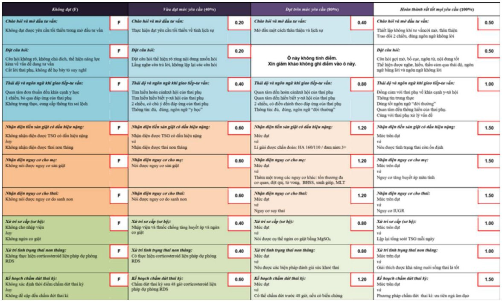

##### 3.3 Tình huống 3: Hội chứng HELLP

- Xử trí như tiền sản giật có dấu hiệu nặng

- Phía mẹ:
    + Ổn định nội khoa ít nhất 6 giờ , nếu phù phổi cấp cho furosemide
    + Thuốc chống THA, MgSO4, theo dõi nước tiểu, dấu hiệu ngộ độc
    + Theo dõi triệu chứng, lượng nước tiểu
    + Đo HA mỗi giờ, bilan TSG mỗi ngày
    + Chuẩn bị tiểu cầu truyền trong khi mổ (do HELLP là tăng tiêu thụ nên vừa truyền vừa mổ, không truyền rồi đợi 1 -2 ngày)
    + Nếu bả vô chuyển dạ 7 – 8 cm thì có thể đẻ được cho bả, còn khi không chuyển dạ thì KPCD sẽ lâu => nguy hiểm nên nếu CTC không thuận lợi thì sẽ mổ lấy thai
- Phía con
    + Theo dõi NST, siêu âm lượng ối, siêu âm doppler

##### 3.4 Tình huống 4 : Tăng huyết áp mạn

##### 3.5 Tình huống 5: Sản giật (xem cấp cứu sản khoa)

### TIẾP CẬN CHUYỂN DẠ SINH NON

#### 1. LÝ THUYẾT CẦN NHỚ

- Check lại tuổi thai → phân coi nó có phải là 1 thai non tháng hay không
- Thai phụ đã có chuyển dạ hay chưa
- Check lại xem thai phụ có yếu tố nguy cơ của sinh non: nhiễm trùng tiểu không triệu chứng, loạn khuẩn âm đạo, … → yếu tố nguy cơ sinh non này có giải quyết được không?
- Nếu không giải quyết YTNC → cổ sẽ vào sinh non
- PAMG1: giá trị tiên đoán âm cao, nhưng mắc tiền
- CL: giá trị tiên đoán dương cũng không cao nhưng mình sẽ dùng nó để xem là mình có xử trí tích cực hơn cho cô này hay không, chuyện cổ vô chuyển dạ là sớm hay muộn, dễ tiếp cận, rẻ tiền
- Dưỡng thai: phụ thuộc tuổi thai, lâm sàng (có gò không, sức khỏe em bé như thế nào (ối, tim thai?), có chờ được hay không…)
    + Có giảm gò không? → là để đợi hỗ trợ phổi có tác dụng
    + Corticoid
    + MgSO4
    + P4 đặt âm đạo: thai trên 34wk chưa vỡ ối thì có thể dưỡng. Tại sao phải dưỡng:
        * Nguy cơ cho con: 1 thai chưa đủ tháng → cơ quan chưa hoàn thiện → phổi chưa trưởng thành → suy hô hấp, hệ tiêu hóa → hoại tử ruột, **hệ miễn dịch** → tăng nguy cơ nhiễm trùng sơ sinh, thần kinh chưa phát triển → vàng da, bệnh lý não, vàng da nặng,…. Có thể phải nhập hồi sức sơ sinh
        * Nguy cơ mẹ: băng huyết sau sanh do tổn thương đường sinh dục, nguy cơ sinh non những lần tiếp theo, nguy cơ nhiễm trùng → khả năng phải cắt tử cung → tử vong
    + Vòng nâng: 28wk, không có nguy cơ cao, không có tiền căn sinh non hay tiền căn khoét chóp nhưng nếu sản phụ muốn thì sao
        * Câu hỏi là đặt không → Không
        * Khi đặt vòng thì có nguy cơ đây là 1 vật lạ → nguy cơ nhiễm trùng + tăng tiết dịch âm đạo → viêm âm đạo → lại có nguy cơ sinh non
        * Hiệu quả thường không có
        * Vậy nên làm gì? → đặt P4

#### 2. CÁC ĐỀ

##### 2.1 Y18: Chiều dài kênh cổ tử cung 24cm. Khám thêm gì? CLS gì? Nhập viện hay không?

- **Cần làm gì không?**

##### 2.2 Y16

- Đề: Sản phụ 32w đến cấp cứu vì đau trằn bụng máy tiếng vừa qua. Hãy xử trí.

- Hỏi thai 33w thai kỳ trước không ghi nhận bất thường, thai kỳ này cũng không nghi nhận bất thường, không đem theo sổ khám thai.
- Bệnh sử đau bụng âm ỉ, tống xuất nứt nhày máu, ko ra nước âm đạo.
- Yêu cầu lấy sinh hiệu, khám ngoài khám trong. Sản phụ đưa ra tờ giấy kết quả khám, cho thấy đầy đủ dấu chuyển dạ: CTC mở 2 xóa 60, gò 2 cơn/10 phút bất tay, đầu ối thành lập.
- Kết luận chuyển dạ sanh non giai đoạn tiềm thời, ăn ủi bệnh nhân các kiểu cơ hội nuôi sống cao phối hợp với nhi sơ sinh.
- Yêu cầu làm thêm BPP biến đổi, siêu âm coi ngôi, sinh trắc thai => đưa ra NST đáp ứng.
- Hướng xử trí: Nhập viện + Giảm gò+ corticoid hỗ trợ phổi đủ 48 tiếng thì cho sinh. Sản phụ hỏi chắc chắn hết 2 ngày là phải sinh hả bác sĩ?
- Vẫn còn 1 tờ giấy nhỏ ko ai lấy được, mọi người nghĩ là GBS để cho kháng sinh dự phòng/kháng sinh điều trị -> sai rồi.

##### 2.3 Y17 đợt 3

- Đề: BN nữ thai hiện tại 30 tuần, sổ khám thai không ghi nhận bất thường, sáng nay đột ngột đau bụng dữ dội, đau ở bụng dưới nên đi nhập cấp cứu, không ra dịch, không ra máu. Qua thăm khám thấy không có đề kháng thành bụng, không phản ứng thành bụng, đau nhiều vùng bụng dưới, tử cung cơ căng cứng liên tục, tim thai không đều, sinh hiệu bệnh nhân ổn, khám trong TC mở 2cm xóa 50%, ối vỡ khi khám, dịch hồng, không có dây rốn sa ra ngoài

1. Nhận định tình trạng hiện tại của BN
2. Xử trí như thế nào cho BN

#### 3. CÁC BƯỚC TIẾP CẬN

##### 3.1 Bước 1: Hỏi bệnh sử và tiền căn

- Đo sinh hiệu nếu có ra huyết, check tim thai nếu ối vỡ
- Chị có khám thai thường quy không? Cho tôi mượn sổ khám thai
    + Xem tuổi thai hiện tại (xác định đầu tiên)
    + Thai đơn thai, tự nhiên/IVF
    + Dự phòng sanh non hay không?
- PARA
- Triệu chứng của chuyển dạ sanh non: đau bụng hay trằn bụng, ra nhớt hồng, ra nước.
    + Đau bụng ở đâu, bao lâu, tăng dần theo thời gian?
    + Ra huyết/nước âm đạo bao lâu, lượng nhiêu, đỏ sẫm/nâu
    + Trch khác.
- Sản khoa:
    + Sanh non kì trước là tự nhiên hay chỉ định y khoa?
    + Mình có được phát hiện bất thường bánh nhau như nhau bong non, nhau tiền đạo không?
    + Có được chẩn đoán nhiễm trùng tiểu, nhiễm trùng ối hay loạn khuẩn âm đạo không?
    + Có được chẩn đoán thai to, đa ối không?
- Phụ khoa
    + Có được chẩn đoán dị dạng tử cung không?
    + Có u xơ tử cung không?
    + Có được chẩn đoán hở eo tử cung không? Có từng can thiệp thủ thuật gì lên TC không?
- Nội khoa: có THA ĐTĐ không, có hút thuốc lá không?

##### 3.2 Bước 2: Thăm khám

- Khám tổng trạng, đo sinh hiệu
- Khám ngoài: đo bề cao tử cung, bắt cơn gò (nếu không có gò → chưa chuyển dạ), khám leopold, nghe tim thai
- Khám trong (nếu vỡ ối rồi thì khám bằng mỏ vịt) – nếu gò nhiều gây đau thì khám luôn xem xoá mở cổ tử cung.

##### 3.3 Bước 3: CLS

- Bây giờ tôi sẽ đề nghị một số xét nghiệm để đánh giá thêm về nguy cơ sinh non của mình:
    + Siêu âm qua ngã âm đạo (sinh tồn thai, nước ối, ngôi thai, vị trí bánh nhau, hình dạng lỗ trong và ngoài CTC)
        * ↳
    + CTG xem cơn gò, tình trạng tim thai
    + CTM xem bạch cầu, xem thiếu máu, CRP, PCT
    + fFN, PAMG-1
    + GBS

##### 3.4 Bước 4: Dự phòng

- Th1: Đơn thai, không tiền căn sanh non

- CL ngắn < 25mm là yếu tố nguy cơ của sanh non như tôi đã trình bày, nên chị đã có chỉ định đặt progesterone âm đạo để dự phòng.
- Progesterone là một thuốc giúp giảm cơn co – một động lực của chuyển dạ sanh non. Mình sẽ đặt âm đạo hoặc nhét hậu môn thuốc mỗi ngày 2-3 lần cho đến khi sanh ha chị
- Giờ chị sẽ được về nhà và theo dõi, tái khám theo lịch hẹn
- Th2: Đơn thai, có tiền căn sanh non tự phát

##### 3.5 Bước 5: Xử trí

- **Chị có biết CL ngắn là gì không?**
- CL là chiều dài kênh cổ tử cung là khoảng cách đo từ lỗ trong đến lỗ ngoài kênh cổ tử cung bằng siêu âm qua ngả âm đạo và chỉ số CL bình thường khoảng 30 – 40 mm trong giai đoạn giữa của thai kỳ. Chiều dài kênh cổ ngắn khi < 25 mm. Chiều dài kênh cổ tử cung ngắn dự báo tình trạng sanh non.
- **Chị biết sanh non là gì không?** Sanh non là khi trẻ sinh ra trước 37 tuần. Trẻ sanh non tháng sẽ đối mặt với nguy cơ suy hô hấp sơ sinh, tổn thương não, hoại tử ruột, và tử vong sơ sinh. Tỉ lệ và mức độ nặng càng tăng khi tuổi thai càng non tháng.
    + Ở mẹ : có thể gây sẩy thai lớn, mất máu nhiều, chuyển dạ quá nhanh gây tổn thương đường sinh dục, tăng nguy cơ mổ lấy thai, cắt tử cung, tăng nguy cơ sinh non ở lần mang thai tiếp theo

###### 3.5.1 TH1: Ối (+), cơn gò thưa, CTC mở < 2cm, SA CL > 25mm (chưa thay đổi trên cổ tử cung)

- Khẳng định với chị đây không phải là chuyển dạ sinh non mà chỉ là những cơn gò sinh lý xuất hiện sau tuần 30 vì (cơn gò thưa, CTC mở <2cm, SA CL >25mm và có dạng chữ I) thôi nha chị và không đáng lo ngại
- Mình về ăn uống đầy đủ, ăn nhiều rau trái cây để tránh táo bón, tránh vận động mạnh, không xoa bụng, kích thích đầu vú, ăn nhiều trái cây để tránh táo bón, nếu có bất thường như đau bụng, ra huyết, ra nước, giảm cử động thai thì mình đi khám liền
- Mình sẽ tái khám sau … tuần nữa. Hôm đó mình sẽ …

###### 3.5.2 TH2 : Ối (-), SA CL< 25mm, có triệu chứng chuyển dạ, thai <34 tuần.

- Mình có nguy cơ cao sinh non trong vòng 1 tuần nữa vì tình trạng ối vỡ cũng như là CL ngắn,

- nên mình sẽ nhập viện theo dõi nha chị nha.
- Trên thai non tháng, có 5 thứ :

- Có hỗ trợ phổi không ?
- Có đang gò không ? nếu có thì có cần giảm gò để chờ hỗ trợ phổi không ?
- Có dự phòng KS không ?
- Có cho bảo vệ não không ?
- CDTK khi nào ?

### CHIỀU DÀI KÊNH CỔ TỬ CUNG NGẮN

#### 1. MỞ ĐẦU.

- Chào hỏi, tự giới thiệu: “Chào chị, tôi là ... hôm nay tôi sẽ phụ trách khám/tư vấn cho chị”
- Mời thai phụ tự giới thiệu: “Trước tiên thì mời chị tự giới thiệu tên tuối, nghề nghiệp của bản thân mình ạ.”
- Hỏi lý do đến khám: “Hôm nay sao mình đến khám/tư vấn vậy chị?”
- “Lần trước siêu âm phát hiện CL ngắn”

- ICE: “Trước đây mình có đi khám hay điều trị ở đâu trước chưa?”
- Hỏi sổ khám thai: “Chị có đem theo sổ khám thai hay giấy tờ gì không?”
    + {Nếu có rồi thì cái gì có trên sổ khám thai không hỏi lại}
- Hỏi tiền căn PARA:
    + Mang thai mấy lần?
    + Thiếu tháng? Có biết nguyên nhân tại sao sanh non không?
    + Sảy, bỏ? Có biết tại sao sảy không?
    + Thai lưu, thai trứng, thai ngoài tử cung gì không?

#### 2. THU THẬP THÔNG TIN.

##### 2.1 Hỏi bệnh sử. <Để tầm soát nguy cơ sanh non>

###### 2.1.1 CL ngắn:

- Xin kết quả siêu âm.
- Từ khi nào? Độ dài bao nhiêu?
- Đã thực hiện dự phòng sanh non chưa: Progesteron, khâu eo, đặt vòng nâng.
- Dấu hiệu chuyển dạ sinh non:
    + Đau bụng (nếu có): SOCRATES, diễn tiến, có chấn thương trước đó không.
    + Ra huyết (nếu có): từ khi nào, lượng, màu, đặc/loãng, máu cục, mô, diễn tiến.
    + Ra dịch (nếu có): từ khi nào, đột ngột hay từ từ, màu, lượng, mùi, diễn tiến.
    + Sốt, tiểu gắt, tiểu buốt.

###### 2.1.2 Thai kỳ lần này: <Cái nào trong sổ khám thai có rồi có thể không hỏi lại>

- Tuổi thai hiện tại.
- Tiền căn sanh non, chuyển dạ sanh non.
- Can thiệp lên cổ tử cung: ung thư cổ tử cung, phẫu thuật trên cổ tử cung, khoét chóp.
- Tử cung biến dạng: u xơ cơ tử cung, tử cung vách ngăn, hai sừng.
- Loạn khuẩn âm đạo, nhiễm trùng tiểu, nhiễm trùng màng ối.
- Đa ối, đa thai.
- Nhau tiền đạo.
- Hút thuốc lá.

##### 2.2 Khám.

- Tri giác, sinh hiệu.
- Khám ngoài: BCTC, cơn gò, tim thai.
- Khám trong mỏ vịt: CTC, dịch âm đạo, ối còn/vỡ.

##### 2.3 Cận lâm sàng.

- TVS: tuổi thai, phát triển, lượng ối, ngôi thai, bánh nhau, chiều dài, hình dạng cổ tử cung.
- ⑳

- NST: đánh giá cơn gò.
- Procalcitonin, CRP, TPTNT, cấy dịch âm đạo (nếu hỏi bệnh thấy có nhiễm trùng)
- fFN, PAMG-1.

#### 3. TƯ VẤN.

##### 3.1 Kết quả.

- Giải thích: CL là chiều dài kênh cổ tử cung là khoảng cách đo từ lỗ trong đến lỗ ngoài kênh cổ tử cung bằng siêu âm qua ngả âm đạo và **chỉ số CL bình thường khoảng 30 – 40 mm** trong giai đoạn giữa của thai kỳ.
- Kết quả của mình là <kết quả> là <25mm ở <tuổi thai> tuần nên gọi là chiều dài kênh cổ tử cung ngắn, đồng thời hình dạng cổ tử cung của chị là hình chữ <hình dạng>, nên nguy cơ sanh non do hở eo cổ tử cung là <cao/thấp – **hình dạng quan trọng hơn chiều dài, nhớ coi diễn tiến chiều dài nếu có>**
- Xét nghiệm fFN và PAMG-1 là các xét dự báo sinh non. fFN có giá trị dự báo âm 97% nghĩa là khi fFN âm tính trong dịch tiết âm đạo-ctc thì khả năng thai phụ sẽ sinh non trong vòng 7 ngày tiếp theo là rất thấp khoảng 1%. PAMG-1 là một protein được tìm thấy với nồng độ cao trong nước ối trong suốt thai kì, giá trị dự báo dương có chuyển dạ sinh non khi PAMG-1 (+) cao hơn fFN (+) 4 lần -> ở đây fFN/PAMG-1 <kết quả sao đó>
- Qua thăm khám thì hiện tại chị <có/chưa có> dấu hiệu chuyển dạ

##### 3.2 Quản lý.

- Nằm nghỉ ngơi, không kích thích đầu vú, tránh giao hợp.
- Ăn uống đầy đủ dinh dưỡng.
- Nếu tuổi thai 28-34 tuần và có nguy cơ sanh trong 1 tuần tới thì sẽ được điều trị Cortiosteroid 1 đợt duy nhất
- Nếu thai dưới 32 tuần thì sẽ được dùng MgSO4 để bảo vệ thần kinh cho thai.
- Nếu thai chưa đủ liều hỗ trợ phổi mà xuất hiện cơn gò chuyển dạ thì sẽ được dùng thuốc khống chế tạm thời cơn co tử cung.
    + Nifedipine.
    + Atosiban.

### TIẾP CẬN ỐI VỠ NON

#### 1. LÝ THUYẾT CẦN NHỚ

- Chị Uyên: Thai phụ ra nước nhiều vô viện thì khỏi nitrazine test, thứ duy nhất chảy ra từ âm đạo chỉ có nước ối => 100% là nước ối khỏi test. Nếu khám trong BẰNG MỎ VỊT mà khô ran, chảy có tí ra quần lót, lúc đó cần phân định rằng đó là gì thì mới nitrazine test
- Chị Mai Phương: Ối vỡ non sau 12 giờ mới bắt đầu dùng kháng sinh dự phòng GBS vì theo nghiên cứu 12 giờ sau vỡ ối, mẹ sẽ bắt đầu vào chuyển dạ. ĐÃ VÀO CHUYỂN DẠ = KHÔNG
- CẦN DÙNG DỰ PHÒNG GBS.
- Không nhiễm trùng + nước ối còn đủ → mới dưỡng nổi chứ thiểu ối rồi không thể dưỡng nữa KS dùng khi nào: dựa vào CTM (có NT không)

#### 2. CÁC ĐỀ

##### 2.1 Y19 – đợt 2

- YÊU CẦU: Khám
- Đề cho: 1 case ối vỡ non điển hình
- Khám phải thao tác, phải cầm cái dụng cụ lên khám thật thì cô mới cho kết quả
- T khám Leopold trên mô hình xong cô ko cho kết quả luôn, cô kêu em đang khám thật đó, sao ko biết kết quả L, lú luôn
- Xong đặt mỏ vịt xem → làm nitrazine test (+) → kết luận ối vỡ
- Có thể nói đây là trạm bất ổn nhất….

##### 2.2 Y18 đợt 2: vỡ ối non – GBS dương tính. Làm gì tiếp theo?

#### 3. CÁC BƯỚC TIẾP CẬN

##### 3.1 Bước 1: Cầm máy doppler lên nghe tim thai. Nếu tim thai tuột chuyển đến tác vụ SA

- **DÂY RỐN. Nếu tim thai 140 bpm thì tiếp tục bước 2**

##### 3.2 Bước 2+3: Vừa khám vừa hỏi (đo sinh hiệu, khám ngoài, khám trong bằng MỎ VỊT)

###### 3.2.1 Bệnh sử

- Chị có khám thai thường quy không? Cho tôi mượn sổ khám thai (xem tuổi thai, GBS) PARA
- Ra nước từ hồi nào? – thời gian! Quan trọng để đánh KS dự phòng cho đúng
- Lúc đó đang làm gì?
- Lượng bao nhiêu băng vệ sinh? Màu sắc như thế nào? Có mùi tanh hôi không? Có lẫn máu không? (MÀU – MÙI – LẪN – LƯỢNG)
- Diễn tiến: Tình trạng ra nước còn không?
- Có sốt không?
- Có đau bụng, trằn bụng không? (dấu hiệu chuyển dạ)
- Có tiểu buốt, tiểu lắt nhắt không?
- Thai máy như thế nào sau khi ra nước?

###### 3.2.2 Khám lâm sàng

- Đo sinh hiệu, nhiệt độ, mạch
- Nước ối chảy ra từ lỗ cổ tử cung, đọng lại cùng đồ sau âm đạo
- Nghe tim thai, bắt cơn gò, đo BCTC, leopold
- Khám trong: đặc mỏ vịt thử nitrazine test → rút mỏ vịt ra đánh giá xóa mở, khám KC coi có ổn không
- **“Không thấy dịch chảy ra từ âm đạo. Làm nitrazine test”**
- **“Không sờ chạm dây rốn”**
- Tìm dấu chuyển dạ

##### 3.3 Bước 4: Cận lâm sàng

- Nitrazine test/Test lá dương xỉ => fFN, PAMG-1
- TPTNT
- CTM, CRP, procalcitonin => đánh giá nhiễm trùng ối
- Siêu âm qua ngã âm đạo đánh giá lượng nước ối, ngôi thai, tăng trưởng thai
- NST: đánh giá tình trạng tim thai + cơn gò. (nếu có dấu chuyển dạ: đau bụng)

##### 3.4 Bước 5: Tư vấn

- Qua phần hỏi bệnh, thăm khám và kết quả xét nghiệm, tôi kết luận chị có tình trạng ối vỡ non giờ thứ ... trên thai .... tuần, ngôi…, chưa chuyển dạ, chưa có dấu hiệu nhiễm trùng trên lâm sàng. Ối vỡ non vì ghi nhận nước ối chảy từ CTC, kèm nitrazine test (+), chị chưa có triệu chứng như sốt mạch nhanh kèm CRP và CTM chưa ghi nhận bất thường nên chị chưa có nhiễm trùng ối. Ngoài ra, tình trạng bé khoẻ do test lượng giá sức khoẻ thai NST chưa ghi nhận bất thường.

###### 3.4.1 Chị có biết ối vỡ non là gì không?

- Ối vỡ non là tình trạng ối vỡ khi thai phụ chưa vào chuyển dạ, tình trạng này có thể gây nên những biến chứng cho mẹ và con
    + Ở mẹ ối vỡ non có nguy cơ dẫn **đến nhiễm trùng ối, nhiễm trùng tử cung** và có thể phải cắt tử cung, nặng hơn là **nhiễm trùng huyết** và có thể tử vong nếu không xử trí kịp thời
    + Ở con ối vỡ non có nguy cơ dẫn đến **chuyển dạ sanh non,** con sẽ có đối mặt với nguy cơ suy hô hấp, viêm ruột hoại tử, tổn thương não và nhiễm trùng sơ sinh

##### 3.5 Bước 5: Xử trí tuỳ thuộc vào tuổi thai (Theo ACOG 2020)

- Vì chị có tình trạng vỡ ối nên chúng tôi sẽ cho chị nhập viện.

###### 3.5.1 BẤT KỂ TUỔI THAI

- Khi có các tình trạng sau: suy thai, **nhiễm trùng ối,** nhau bong non.
- Khi phát hiện dấu hiệu nhiễm trùng ối như sốt, mạch nhanh, tim thai nhanh, đau bụng, dịch ối hôi, chúng tôi sẽ chấm dứt thai kì ngay để đảm bảo tính mạng cho con. CDTK có thể bằng khởi phát chuyển dạ (sanh thường) hoặc sanh mổ. Ở đây chúng tôi **ưu tiên sanh thường** nếu có nhiễm trùng ối để tránh nguy cơ có biến chứng trong cuộc mổ. Ngoài ra, chị sẽ được sử dụng **kháng sinh phổ rộng, đường tĩnh mạch và phối hợp cho đến sau sanh và ít nhất 48 giờ** liên tục hết dấu hiệu nhiễm trùng.

###### 3.5.2 Thai đủ tháng (>37 tuần)

- Vì ối đã vỡ trên thai kì đủ tháng, việc chấm dứt thai kì lúc này có lợi hơn so với kéo dài thai kì do giảm nguy cơ nhiễm trùng ối, cải thiện kết cục chu sinh. Nếu đồng ý, chúng tôi sẽ khởi phát chuyển dạ cho chị sau khi đánh giá tình trạng cổ tử cung.
- Ngoài ra do kết quả cấy GBS trước đó (+) **hoặc** chị chưa có kết quả cấy nhưng yếu tố nguy cơ trong chuyển dạ **hoặc** ối đã vỡ >12 tiếng, nên chị sẽ được dự phòng bằng kháng sinh. (Nếu GBS (-), không có yếu tố nguy cơ → không dự phòng).
- Tuy nhiên, nếu phát hiện dấu hiệu nhiễm trùng ối như sốt, mạch nhanh, đau bụng, tim thai nhanh, dịch ối hôi, chị sẽ được sử dụng kháng sinh phổ rộng, đường tĩnh mạch và phối hợp cho đến sau sanh và ít nhất 48 giờ liên tục hết dấu hiệu nhiễm trùng.

###### 3.5.3 Thai non tháng (34w0d – 36w6d)

- Vì ối đã vỡ thai kì còn non tháng, chị có thể cân nhắc giữa kéo dài thai kì hoặc chấm dứt thai kì ngay. Kéo dài thai kì sẽ làm tăng nguy cơ nhiễm trùng ối nhưng không làm tăng nhiễm trùng sơ sinh. Lúc Chị sẽ được đo sinh hiệu 2 lần ngày và xét nghiệm lại CTM CRP mỗi ngày, đo chỉ số ối mỗi 2 ngày và mỗi ngày nếu có tình trạng thiểu ối, khám đặt mỏ vịt đánh giá tính chất ối mỗi 3 ngày, kiểm tra dấu chuyển dạ, tình trạng chèn ép rốn, lượng giá sức khoẻ thai bằng EFM và siêu âm định kì để đảm bảo an toàn. Còn nếu chị muốn chấm dứt thai kì chúng tôi sẽ đánh giá tình trạng cổ tử cung và khởi phát chuyển dạ bằng oxytocin, thai nhi sẽ phải đối mặt với nguy cơ tăng tỉ lệ suy hô hấp sơ sinh, chăm sóc hồi sức tích cực, mổ lấy thai.
- Do GBS là một tác nhân gây nhiễm trùng sơ sinh và để lại nhiều hậu quả nặng nề nhất là trên thai non tháng, nên chúng tôi đề nghị phết dịch âm đạo, trực tràng cấy GBS và đồng thời khởi động kháng sinh dự phòng GBS.
- Tuy nhiên, nếu phát hiện dấu hiệu nhiễm trùng ối như sốt, mạch nhanh, đau bụng, tim thai nhanh, dịch ối hôi, chúng tôi sẽ chấm dứt thai kì ngay để đảm bảo an toàn mẹ và bé. CDTK có thể bằng khởi phát chuyển dạ (sanh thường) hoặc sanh mổ. Ở đây chúng tôi ưu tiên khởi phát chuyển dạ nếu có nhiễm trùng ối để tránh nguy cơ có biến chứng trong cuộc mổ. Ngoài ra, chị sẽ được sử dụng kháng sinh phổ rộng, đường tĩnh mạch và phối hợp cho đến sau sanh và ít nhất 48 giờ liên tục hết dấu hiệu nhiễm trùng.

###### 3.5.4 Thai rất non tháng (24w0d – 33w6d)

- Vì ối đã vỡ thai kì còn non tháng, mục tiêu là cố gắng dưỡng thai đến 34 tuần để chấm dứt thai kì nếu như không có nhiễm trùng ối. Chị sẽ được đo sinh hiệu 2 lần ngày và xét nghiệm lại CTM CRP mỗi 1 – 3 ngày, đo chỉ số ối mỗi 2 ngày, khám đặt mỏ vịt đánh giá tính chất ối mỗi 3 ngày, kiểm tra dấu chuyển dạ, tình trạng chèn ép rốn, lượng giá sức khoẻ thai bằng EFM và siêu âm định kì để đảm bảo an toàn.
- Chị sẽ được sử dụng kháng sinh dự phòng nhiễm trùng ối kéo dài nếu như không có chống chỉ định. Ngoài ra, do GBS là một tác nhân gây nhiễm trùng sơ sinh và để lại nhiều hậu quả nặng nề nhất là trên thai non tháng, nên chúng tôi đề nghị phết dịch âm đạo, trực tràng cấy GBS và đồng thời khởi động kháng sinh dự phòng GBS.
- Do thai kì là non tháng và cũng sẽ không biết chị sẽ sanh em bé vào lúc nào, nên chị sẽ được chích corticoid hỗ trợ phổi để tránh nguy cơ suy hô hấp sơ sinh cho thai non tháng. (Thai <32 tuần) Chích Magnie Sulfat để bảo vệ não
- Tuy nhiên, nếu phát hiện dấu hiệu nhiễm trùng ối như sốt, mạch nhanh, đau bụng, tim thai nhanh, dịch ối hôi, chúng tôi sẽ chấm dứt thai kì ngay để đảm bảo an toàn. CDTK có thể bằng khởi phát chuyển dạ (sanh thường) hoặc sanh mổ. Ở đây chúng tôi ưu tiên sanh thường nếu có nhiễm trùng ối để tránh nguy cơ có biến chứng trong cuộc mổ. Ngoài ra, chị sẽ được sử dụng kháng sinh phổ rộng, đường tĩnh mạch và phối hợp cho đến sau sanh và ít nhất 48 giờ liên tục hết dấu hiệu nhiễm trùng.

##### 3.6 Tư vấn chung

- Chị cố gắng ăn uống đầy đủ, tránh vận động mạnh, đếm cử động thai, vệ sinh cơ thể sạch sẽ, thay BVS thường xuyên để tránh viêm nhiễm và tiếp tục theo dõi tình trạng ra nước âm đạo diễn tiến trong những ngày tiếp theo, cũng như dấu hiệu cũng nhiễm trùng như sốt và đau bụng để điều trị kịp thời.

## CHƯƠNG 5: QUẢN LÝ MỘT CUỘC CHUYỂN DẠ SANH

#### 1. LÝ THUYẾT CẦN NHỚ

- Đầu 4/5 không phải là cao quá. BN đang 2cm thì không cần làm gì, nhưng nếu 8 cm thì phải tia ối đi. Nếu đề muốn hướng về tăng co thì đề ghi “đầu cao lọt (?)”, từ 5/5 trở lên. Còn nếu đầu “áp” thì phải tia ối do đã có gò đẩy xuống.
- Chỉ có “hội chứng vượt trở ngại”, phải đầy đủ các yếu tố từ trên xuống: chồng xương 3+, gò cường tính 5 cơn, đầu ngưng xoay ở kiểu thế ngang hoặc sau, ối có thể xấu hoặc không (thường là xấu).
- Dọa vỡ không cần có chồng xương, chỉ là một phần HCVTN (HCVTN có cả bất xứng đầu chậu, dọa vỡ), gồm gò cường tính, vòng Bandl bệnh lý, đầu không tiến triển – nói về tử cung
- Bất xứng đầu chậu: lọt bất đối xứng, sờ thấy bướu đỉnh, vành tay, thóp trước, bướu huyết thanh; **không cần gò mạnh, vòng Bandl** – nói về khung chậu
- Chồng xương thì chắc chắn là bất xứng đầu chậu.
- Đi thi:
    + Đầu -3, -2 hay 4/5, 5/5 thì vẫn tăng co trước, theo dõi 1h nếu vẫn lệch phải thì tia ối
    + Đầu -1, 0 hay 3/5, 2/5 thì tia ối trước, theo dõi 1h nếu vẫn lệch phải thì tăng co
- Những cái có khả năng gây suy thai, VTC → mổ khẩn
    + Chuyển dạ ngưng tiến triển (mẹ ổn, con ổn) → mổ cấp cứu (30p ~ 1h)
    + Ngôi bất thường/ chuyển dạ → mổ cấp cứu, còn không chuyển dạ thì mổ chủ động
    + Nhau tiền đạo ra máu nhiều → mổ cấp cứu
    + Nhau tiền đạo ra máu ít trên thai non tháng, tạm ổn → mổ chủ động xung quanh 37 tuần
    + Tiền căn VMC thì xem có sinh thường được không, nếu không thì mổ chủ động khi không có chuyển dạ, mổ cấp cứu khi có chuyển dạ/ối vỡ
    + Có cơn gò cường tính (loại trừ bất xứng đầu chậu) → cho thuốc giảm gò (atorsiban, salbutamol, nitroglycerin, nicardipine) → theo dõi 90p → nếu vẫn không giảm gò cường tính thì phải mổ khẩn vì nguy cơ suy thai + nguy cơ BHSS sau mổ (do dùng thuốc giảm gò quá nhiều)
- 1. Chuyển dạ bth: bên trái đường báo động, sức khoẻ em bé bth: theo dõi thêm
    2. Hơi qua phải: nhìn xuống coi ối còn, hay cơ đủ không. Phá ối hay tăng co, giải thích
    3. Gò nhiều + chồng xương: bất xứng, hội chứng vượt trở ngại: nguy cơ doạ vỡ tử cung. Có trì hoãn
    + Vỡ tử cung: mổ liền không chờ đợi (đe doạ nghiêm trọng)
    + Bất xứng: có thể đợi 30’ cũng được (đe doạ)
    + Doạ vỡ nghiêm trọng hơn
    + Doạ vỡ: vòng bandl, dấu frommel. Còn không thì chỉ là hội chứng vượt trở ngại

- Chị Mai Phương dạy:
- SẢN ĐỒ

- Ví dụ:
- 8h30 → Gò 2 cơn 10 phút, cường độ 60; ối còn; CTC xoá 50%, độ mở 2cm; CTG nhóm I 10h30→ 2 cơn 10p, ối còn, CTG nhóm I
- 13h → Gò 2 cơn/10 phút, cường độ 80; CTC xóa 70%, độ mở 4 cm; đầu (-3); ối còn.
- Cách vẽ:

1. Nước ối: coi-trong - Xant-kho.ry
- C: ối còn, chưa vỡ.
- T: ối đã vỡ, nước ối không lẫn phân su. (trong)
- X: ối đã vỡ, nước ối có lẫn phân su. (xanh)
- K: ối đã vỡ, không thấy nước ối, nên không xác định màu.
2. Biến dạng đầu thai:
- 0: các xương sọ tách rời nhau, nhận rõ đường khớp.
- +: các xương sọ chạm vào nhau.
- ++: các xương sọ chồng lên nhau.
- +++: các xương sọ chồng lên nhau rất nhiều.
- *Nếu có bướu huyết thanh, ghi ngay dưới độ chồng khớp này.

3. Phiên âm độ lọt:
- Độ lọt -3 ↔ 5
- Độ lọt -2 ↔ 4
- Độ lọt -1 ↔ 3
- Độ lọt +1 ↔ 2
- Độ lọt +2 ↔ 1
- Độ lọt +3 ↔ 0
4. Cơn co:

- *Xử trí:
- Bên phải hoặc Chạm đường báo động: có thể đợi 1 tiếng rồi vẽ sản đồ lại.
- Giữa đường báo động và đường hành động: theo dõi thêm hoặc hành động nhưng ưu tiên theo dõi 1 tiếng
- Cắt đường hành động: Hành động
- Hành động gồm: Tia ối - Tăng co - Mổ lấy thai
- Sau tia ối thì có phản xạ kích thích tạo cơn gò nên 1 tiếng sau mới tăng co (tăng co khi cường độ cơn co < 40 mmHg)
- Mổ lấy thai có thể thực hiện đầu tiên nếu: CTG loại III.
- ĐỌC CTG

1. Đọc co tử cung:

- Tần số: 5 lần/10 phút hoặc 5-6 lần/10 phút (chú ý không ghi 5.5)
- Tương quan co:nghỉ: 1:1
- Trương lực căn bản: 10 mmHg
- Cường độ cơn co: 80-100 mmHg
- => Cơn gò cường tính. (tiêu chuẩn gò cường tính: > 5 cơn/10 phút hoặc mỗi cơn > 60s)
- Nếu không cơn co cường tính thì nhận định là cơn cơn co đều

2. Đọc nhịp tim:
- Nhịp tim: 140 lần/phút (ko ghi bpm)
- DĐNT: 5-10 lần/phút
- Nhịp tăng.
- Nhịp giảm sớm lặp lại
- Không nhịp giảm bất định.
- => CTG nhóm I, phù hợp giai đoạn hoạt động của chuyển dạ, cơn gò cường tính.
- Sẽ cần theo dõi cơn gò cường tính, tránh tình trạng suy thai do thiếu O2.

#### 2. CÁC ĐỀ

##### 2.1 Y20 đợt 2: Trạm giấy – CTG

- Cho một tình huống chuyển dạ, ối vỡ xanh… nói chung là lâm sàng khá xấu. CTG nhóm II có dao động nội tại tối thiểu (tui đọc nhóm III nhưng anh chị nói là xử trí đúng thì BM chấp nhận cả nhóm II và III đều đươc vì CTG không rõ ràng, nhưng nếu đọc là nhóm I thì không chấm tiếp)

1. Đọc CTG
2. CTG nhóm nào
3. Nhận định tình trạng theo
4. Xử trí tiếp theo
5. Lí giải hướng xử trí đó
1. **Đọc CTG và kết luận CTG nhóm mấy theo ACOG 2009.**

- Cần đọc đúng tim thai cơ bản 140, DĐNT tối thiểu, không nhịp tăng, nhịp giảm muộn lặp lại → CTG nhóm II.

2. **Lí giải ý nghĩa và nhận định tình trạng thai nhi.**

- Phải nói được là thai nhi đang bị đe doạ nghiêm trọng.

3. **Xử trí?**

- Chuyển dạ đang ở giai đoạn hoạt động, phải đem đi mổ lấy thai khẩn, mời hồi sức sơ sinh.

##### 2.2 Y18:

- Đợt 1.

- CTC mở 5cm, ngôi đầu -2 , sản đồ lệch phải , cơn gò 2 cơn/10ph => Bấm ối, đánh giá lại sau 1h
- Đợt 2. Giống đợt 1 ?
- Đợt 3
- Sản đồ, bất xứng đầu chậu, nguyên nhân do kiểu thế chẩm chậu trái ngang , CTG nhịp giảm muộn: thai thiếu oxy do cơn gò tử cung cường tính => Thai đang bị đe doạ nhưng chưa nghiêm trọng do hành não còn đáp ứng tốt ( dao động nội tại trung bình )
- => Xử trí : Mổ cấp cứu
- Đợt 4: Hội chứng vượt trở ngại
- Đợt 5.

- CTC mở 8cm, ngôi thai 3/5, ối chưa vỡ, không chồng xương, CTG nhóm I
- => Chuyển dạ bình thường , tiếp tục theo dõi

##### 2.3 Y17 – Đợt 1

- Đề: Sản phụ đang trong chuyển dạ hoạt động

- Khám âm đạo
- Đọc sản đồ, nhận xét
- Đọc băng EFM, nhận xét và xử trí tiếp theo

- Băng EFM lúc 9h: đọc EFM: baseline 140, dao động nội tại 5-8 bpm, không nhịp tăng, nhịp giảm sớm lặp lại. (đừng để dao động nội tại nhỏ nhỏ đánh lừa rằng đây là 1 băng ghi nguy hiểm).
- Khám âm đạo: nhìn ngoài thấy đầu mấp mé âm hộ, giảng viên sẽ yêu cầu khám trong.
- **Giải đáp trạm 4:**

- Khám âm đạo: xóa mở độ lọt, khám khung chậu thì tùy giảng viên.
- Đọc giấy tờ khám thai thấy ghi nhận thai 36 tuần BCTC 31cm, ghi nhận thai nhỏ hơn tuổi thai nhưng không có ước lượng sinh trắc hiện tại nên không rõ, nhận định thai kì nguy cơ cao?
- Đọc sản đồ, nhận xét phá ối hợp lí chưa? Phá ối sau 4 tiếng là hợp lí vì lúc mới vào chuyển dạ hoạt động, ngôi thai đang cao, đầu ối vẫn còn tác dụng để nong CTC mở rộng. Sau 6 tiếng ngôi ở vị trí 3/5, cơ gò tử cung hiện chưa đủ biên độ, đã đủ tần số, thực hiện phá ối là hợp lí, sau phá ối cơ gò lên đủ cường độ, sản đồ bắt đầu đi song song đường hành động, CTC mở 1cm/1h, ngôi thai lọt xuống hoàn toàn.
- Băng EFM loại 1, nhịp giảm sớm lặp lại chỉ có nghĩa nghĩa đầu thai đang bị chèn ép theo mỗi cơn gò, dao động nội tại còn, hiện thai không bị đe dọa.
- Đã đủ điều kiện đưa vào box sanh, ngôi thai chẩm vệ, đang chờ sổ đầu, không chồng xương, có thể sinh nhanh trong 15p-30p

##### 2.4 Y19- Đợt 1 – làm trên giấy: Nữ hộ sinh báo cáo: “Thai phụ cổ tử cung đã mở trọn mà tại sao 1h rồi vẫn chưa sinh”

- Thai 39w, cổ tử cung mở trọn 1 tiếng rồi mà chưa sinh. Chưa chồng xương, chưa tia ối hay tăng co. Sản đồ nằm giữa alert và action, ngôi chẩm +1. Đánh giá sản đồ, CTG, hướng xử trí tiếp theo

- **Bổ sung sản đồ: ko có tăng co bằng oxytocin, nhiệt độ bthuong**

1. Đánh giá sản đồ: Chuyển dạ bình thường thuận lợi
- Ối vỡ 23:00, trắng
- Vào chuyển dạ hoạt động lúc ?
- CTC mở >1cm/h
- Ối vỡ 23:00 -> Khám lúc 9:00 hôm sau
- Gò đủ
- Ngôi thai tiến triển tốt
- Thế chẩm chậu trái trước
- Sản đồ bên trái đường báo động
- Chuyển dạ hoạt động lúc … h, ctc mở 4cm, độ lọt 5/5, ối vỡ, tần số cơn co 3 cơn/10p (- Từ …h đến …h, sản đồ nằm trên đường báo động, tốc độ mở ctc 1cm/h, kiểu thế chẩm chậu trái trước, ối vỡ, tần số cơn co 3-4 cơn/10p, ngôi thai tiến triển tốt
    + Lúc …h, ctc mở trọn, độ lọt 1/5, có chạm xương
    + => Theo dõi sanh ngã âm đạo)
2. Đánh giá CTG nhóm mấy -> Giải thích -> Nhận định tình trạng

- Phải đọc đủ tất cả thành phần của CTG (tần số, cường độ cơn co, baseline, variability, nhịp tăng, nhịp giảm)
- CTG nhóm 1: Baseline 140, Variability trung bình 5 – 10 nhịp/phút, Nhịp giảm sớm, Không nhịp giảm muộn & nhịp giảm bất định

- => Bé hiện ổn, nhịp giảm sớm do chèn ép đầu thai trong CD
3. Hướng xử trí
- Chuyển dạ thuận lợi, không có bất xứng đầu chậu, CTG I => theo dõi chuyển dạ sinh thường
- Đánh giá CTM, nhiễm trùng ối => kháng sinh dự phòng????

##### 2.5 Y19 đợt 2: làm trên giấy sản đồ + CTG sau giảm đau sản khoa (giống APP)

- Thai 39 tuần, ctc mở 6cm, ngôi thai +1, nằm trên đường báo động , ối vỡ trắng đục, BN có dùng giảm đau sản khoa, Sinh hiệu HA tụt, CTG có nhịp giảm kéo dài
- Đọc CTG:
    + Trên CTG có note: trước cái nhịp giảm có ghi chú là “sử dụng giảm đau sản khoa”

- Câu 1: Nhận định về nhịp giảm trên? Ý nghĩa

- Nhịp giảm có thời gian >2p => nhịp giảm kéo dài bất chấp tính chất khác. Cho thấy đang có tình trạng thiếu oxy kéo dài hoặc chèn ép dây rốn kéo dài
- Câu 2: Nhận định sản đồ

- Thấy sản đồ diễn tiến ổn, diễn tiến trùng với đường báo động, ngôi thai lọt, … nói chung là không có bất thường trên sản đồ, background cũng ổn luôn, ngoại trừ cái sau khi sử dụng giảm đau sản khoa thì HA của bả là 90/60
- Câu 3: xử trí

1. Tại thời điểm ghi nhận nhịp giảm kéo dài, đầu tiên phải khám trong loại trừ sa dây rốn. đồng thời theo dõi tim thai. Sau khi loại trừ sa dây rốn thì nghĩ nhịp giảm kéo dài sau giảm đau sản khoa
2. Cho thai phụ nằm tư thế Fowler + nghiêng trái
3. Theo dõi huyết áp + mạch. Bù dịch NaCl 0.9% nếu huyết áp tụt < 90/60mmHg

##### 2.6 Y19 – đợt 5

- Tác vụ:
    1. Đọc CTG đầy đủ và phân loại
    2. Vẽ sản đồ dựa vào kết quả khám lâm sàng. Nhận định tình trạng thai và tiên lượng về cuộc chuyển dạ

- Lưu ý:

- Vẽ đầy đủ độ mở cổ tử cung (X), vị trí ngôi thai (O), cơn gò cùng 1 hoành độ. Nếu vẽ được kiểu thế của ngôi (chẩm chậu trái trước) thì full, còn ko thì đạt
- Nhận định (chị Quy): thai hiện tại không bị đe dọa (CTG nhóm 1), chuyển dạ bth -> theo dõi tiếp chuyển dạ

##### 2.7 Y18 – đợt 1

- Sản đồ lệch P đường báo động => cần làm gì tiếp theo
- Khi đó đầu còn cao (2/5) có thể tia ối hoặc tăng co đều được
- Mong đợi gì sau khi làm thủ thuật => chờ 30p – 1h sau đánh giá lại độ mở CTC, mong đợi sản đồ sẽ song song với đường báo động

##### 2.8 Y18 – đợt 2: sản đồ - CTG

- Điển hình của cản trở bởi đầu ối: ctc mở tốt, có cơn gò, ối còn, ngôi thai không lọt, CTG II
- cho CTG đọc, ra base line 150. Có nhịp tăng, nhịp giảm bất định. Ctg loại 2 nhưng ko nguy hiểm lắm vì variability tầm 10, có nhịp tăng
- Đọc sản đồ: sản đồ lệch phải, giai đoạn hoạt động giờ thứ 3, ối chưa vỡ, ko chồng xương, lọt 4/5, cơn co 2 cơn trên 10, mỗi cơn 40s
- Xử trí: tăng co rồi phá ối
- Không phá ối trước vì còn mức 4/5

##### 2.9 Y18 – đợt 3: đọc sản đồ - CTG vấn đáp

- Đọc được tốc độ mở tử cung, các mốc thời gian đáng chú ý trong cuộc chuyển dạ (khi nào ối vỡ? khi nào sản đồ chuyển phải?,…). Đặc biệt có tình trạng bất xứng đầu chậu (biến dạng đầu từ 0 dần lên +++).
- Đọc CTG: đủ tần số, cường độ cơn gò + tim thai: baseline, dao động nội tại, nhịp tăng/ nhịp giảm => kết luận được đây là CTG nhóm II => nói được CTG này đang bị đe doạ, nhưng chưa quá nghiêm trọng.
- Xử trí: nói được phải cho đi mổ => phải mổ khẩn (không phải thượng khẩn) => vì có bất xứng đầu chậu + nhưng chưa đe doạ quá nghiêm trọng.

##### 2.10 Y18 – đợt 4: CTG và sản đồ

- Hội chứng vượt trở ngại và cách xử trí

##### 2.11 Y18 – đợt 5

- Cho mình cái sản đồ với CTG xong rồi bác sĩ đóng vai hộ sinh, hỏi mình bấy bá luôn: đánh giá sản đồ này sao, CTG này sao, rồi làm gì nữa, rồi làm xong nếu không ổn làm gì tiếp, sao nghĩ là như vậy, như vậy có liên quan gì, ý nghĩa sao?
- Thầy giải: Sản đồ: đầu 3/5 chưa lọt, ối chưa vỡ, thai không lọt từ 4h30-7h, 2 cơn/10 phút, không có chồng xương, không có cơn gò cường tính, thai không to, thông tin sản phụ cho thấy là người này hoàn toàn có thể sanh thường -> thiếu về động lực để thai đi xuống. CTG: TLCB 20, cường độ 40-60, baseline 140, có nhịp tăng, không có nhịp giảm, cơn gò 20ơn/10 phút -> CTG nhóm I. CTG nhóm I là sao :)))))) -> Em bé này hiện tại chưa có bất lợi sản khoa. Xử trí: Phá ối, theo dõi sản đồ chuyển (T) hay (P) rồi tăng co nếu bên (P). Phải lý giải được tại sao tăng co hay phá ối (ưu thế cho tăng co hơn vì hiện tại đầu đang cao phá ối có thể nguy hiểm nên hạn chế)
- Giải:
    + Tại thời điểm bắt đầu sản đồ (chắc là 4h30): đọc các thành tố sản đồ như độ mở cổ tử cung, độ lọt ngôi thai, cơn co, ối vỡ chưa, có chồng xương không.
    + Tiếp sau thời điểm bắt đầu, đến lúc 7h sản đồ chuyển phải

##### 2.12 Y18:

- Sản đồ, BN chuyển dạ ra nước ối xanh, làm gì tiếp (để thg, mổ gấp, dùng dụng cụ). giải thích

##### 2.13 Y17 đợt 2

- Đề: Sản phụ đang theo dõi sanh ngã âm đạo, cho EFM và sản đồ, yêu cầu khám trong đánh giá tình trạng hiện tại và ra quyết định

- CTG nhóm 2 nhưng xấu nhịp giảm muộn lặp lại, sản đồ có chồng xương ++, ối trong, không lọt (3/5), kiểu thế phải ngang, chuyện dạ kéo dài chạm đường hành động, CTC mở 8. Giờ khám thấy mọi thứ vẫn y chang 1 giờ trước. Cơn gò suốt 4 tiếng qua 5 cơn/10 phút >40s.
- Đọc được nguyên nhân là bất xứng đầu chậu. Yêu cầu chuyển sanh mổ, các chuẩn bị khác.
- Giám thị báo phỏng mổ 30 phút nữa mới trống, có chờ được ko. (khẳng định không chờ được)

##### 2.14 Y20 đợt 1

- Sản phụ 39w, nhập viện vì chảy nước ối từ 6h sáng ngày hôm qua kèm nhiều dữ kiện lâm sàng (khám không có cơn gò, CTC xoá …, mở …., các dữ kiện khác không có gì bất thường). Đoạn CTG tại thời điểm hiện tại lúc 8h tối
- Yêu cầu:

1. Phân tích CTG. Phân loại CTG theo ACOG 2009
2. Giải thích nguyên nhân cho các biến động tim thai
3. Hãy đưa ra hướng quản lý tiếp theo

- Lưu ý: phân tích đầy đủ các thành phần cơn gò, tim thai -> 1-2 cơn gò/10p, không đều, TLCB 10mmhg, cường độ 40-50 mmhg, biên độ, tương quan cơ nghỉ, tim thai 140 bpm, dđnt 5-10 bpm, có các nhịp giảm sớm, lưu ý có 1 nhịp tăng 20 bpm nhưng chưa đủ 15s nên không đủ điều kiện là nhịp tăng. Nhịp giảm sớm kéo dài khoảng 2p nhưng vẫn đọc là nhịp giảm sớm chứ không đọc là nhịp giảm kéo dài. Nhịp giảm sớm là đầu thai nhi bị chèn ép trong cơn gò. Nhận định đang trong gđ chuyển dạ tiềm thời, tuy nhiên đã kéo dài 38h mà cơn gò chưa đủ nên giờ cần cho tăng cơ + kháng sinh nhiễm trùng ối

##### 2.15 Y20 đợt 3

- Cho thông tin bệnh nhân + Sản đồ + Diễn tiến cuộc chuyển dạ (sau đó, chưa có trên sản đồ).
- Nguy cơ có cuộc chuyển dạ kéo dài.
- Yêu cầu:

1. Vẽ sản đồ
2. Đọc sản đồ ở vị trí hiện tại
3. Đưa ra hướng xử trí vào giải quyết, giải thích

- **Lưu ý:**

- Vẽ đủ các thành phần như cơn co, đầu ối, tình trạng ối, thời gian, độ mở CTC, đầu thai, chồng xương… nói chung cái nào có mô tả là vẽ hết.
- Sản đồ này chuyển phải. Phải giải thích rõ vì sao đọc là chuyển phải.
- Khi chọn hướng quản lí, đáp án có 4 xử trí: phá ối (A), tăng co (B), phá ối và tăng co (C), chờ đợi thêm (D). Khi giải thích phải giải thích được tại sao mình chọn xử trí này và kèm theo tại sao không chọn xử trí kia. Đáp án gợi ý là phá ối hoặc tăng co. Ví dụ: Khi chọn phá ối thì phải giải thích tại sao lại chọn phá ối và tại sao không chọn tăng co.

##### 2.16 Y20 đợt 4 – K4 :

- Thai phụ vào chuyển dạ, từng sinh 1 lần ổn, thai lần trước to hơn lần này, không ghi nhận bất thường khung chậu. Cho CTG và sản đồ.
- Yêu cầu: Trả lời các câu hỏi

1. Từ sản đồ có kết luận gì về cuộc chuyển dạ
2. Giải thích cho kết luận trên
3. Phân tích đầy đủ CTG và phân loại theo ACOG 2009
4. Ý nghĩa của phân loại vừa rồi
5. Xử trí cần thực hiện ngay lúc này
6. Giải thích cho xử trí ở trên.

- Nội dung trạm:
- Sản đồ cho thấy đường biểu diễn độ mở cổ tử cung lệch phải, vận tốc < 1 cm/giờ, ngôi thai tiến triển chậm đến -3 (này mình không nhớ rõ nhưng cũng còn khá cao), ối còn, cơn co không đủ (2 cơn, kéo dài < 20 giây), không ghi nhận biến dạng ngôi thai. CTG bình thường.

1. Chuyển dạ diễn tiến bất thường (chạm)
2. Đường biểu diễn độ mở cổ tử cung nằm bên phải đường báo động, vận tốc < 1 cm/giờ, ngôi thai xuống chạm
3. CTG loại I theo ACOG 2009:
- Hành chính: tên-tuổi-PARA, tuổi thai, vận tốc, 2 khoảng trắng ở 2 đầu băng ghi
- Cơn co: 2 cơn/10 phút, tương quan cơ nghỉ ½, trương lực căn bản 10 mmhg, cường độ 60 – 100 mmhg
- Tim thai: TTCB 140 nhịp/phút, dao động nội tại 5 – 10 nhịp/phút, có nhịp tăng, không có nhịp giảm
4. Tình trạng thai chưa bị đe dọa, có thể tiếp tục theo dõi
5. Thực hiện tăng co bằng oxytocin
6. Giải thích: biểu đồ nằm bên phải đường báo động và có: cổ tử cung và ngôi thai tiến triển chạm, ối chưa vỡ, không biến dạng ngôi thai, khung chậu bình thường, cơn co không đủ → cơn co chưa đủ tốt hoặc do đầu ối cản trở, tuy nhiên do đầu còn ở cao nên tăng co để đưa đầu áp vào khung chậu hơn, sau đó tia ối nếu cơn co vẫn không hiệu quả.

- Này là đáp án sau khi đã sửa, mình thi lúc đó câu 4 không nói được thai chưa bị đe dọa, câu 5 chọn tia ối và giải đáp theo hướng tia ối (dù giảng viên nói nếu chọn hướng tia ối nhưng giải thích ổn thì vẫn được 80% câu đó), cộng thêm máy câu khác không rõ có lỗi nào khác không nên điểm không cao. Nhìn chung là phải làm nhiều để quen cách tiếp cận sản đồ và CTG do vô thi thời gian ngắn lắm, chưa kịp ghi là đã thấy chuông reo rồi.

##### 2.17 Y21 đợt 1

- 1/ Tác vụ 1: Vẽ sản đồ
- Bình tĩnh đọc đề từ case lâm sàng: vẽ sản đồ tại thời điểm 7:00 → ghi thời điểm 7:00, chấm độ mở CTC và độ lọt tương ứng, vẽ cơn gò, ghi tình trạng ối (C,T,X) và uốn khuôn đầu (0,1+,2+) 2/ Tác vụ 2: Nhận xét trên giấy
- Câu 1a: Đánh giá sản đồ tại thời điểm 7:00?
- Câu 1b: Giải thích tại sao đánh giá như vậy?
- Câu 2a: Cần xử trí thế nào cho thai phụ? (Theo dõi, tăng co, phá ối, tăng co + phá ối)
- Câu 2b: Giải thích xử trí?
- Trạm này sẽ cho mình 1 cái sản đồ, có đủ thông tin đến lúc 5h sáng, xong trên giấy sẽ cho thêm thông tin lúc 7h:

1. Tự vẽ thêm vào sản đồ thông tin lúc 7h theo những gì có trên giấy
2. Đánh giá chuyển dạ
    + -> Ở ca này thì 5h đã vào chuyển dạ hoạt động, CTC mở 4cm, đầu -3, ối còn, cơn co 2 cơn (mỗi cơn 20-40s). Đến 7h thì CTC và đầu không tiến triển, ối còn, 3 cơn co (20-40s) nên mình đánh giá cái này là chuyển dạ kéo dài do sản đồ lệch phải so với đường báo động
3. Xử lí như thế nào trên trường hợp này: Tia ối/Tăng co/Tăng co + tia ối/Mổ cấp cứu

## CHƯƠNG 6: CẤP CỨU SẢN KHOA

### TIẾP CẬN BĂNG HUYẾT SAU SINH

#### 1. ĐỀ

##### 1.1 Y18 – đợt 3

- Cấp cứu sản khoa => Băng huyết sau sinh. BN sau sinh, nhau bám thấp (có siêu âm nhau loại III), sổ kiểu Duncan, chảy máu không cầm.
    + Nhận diện đây là băng huyết sau sinh (nhìn túi máu sẽ thấy lượng máu mất 700 mL > 500 mL) => thái độ khẩn trương (nói chị Hộ sinh kêu gọi hỗ trợ, lấy sinh hiệu, lập 2 đường truyền TM kim lớn, đăng kí máu truyền).
    + Định hướng nguyên nhân => sinh hiệu vẫn ổn, nhưng chỉ số sốc = 1 (có nguy cơ vào sốc), khám thấy tử cung co thành khối cầu an toàn + bệnh sử như trên nghĩ nguyên nhân BHSS là do nhau bám thấp, sổ kiểu Duncan => khó cầm.
    + Giải thích nguy cơ đối với BN?
    + Xử trí? => tiêm Ergometrine + đặt bóng chèn => chờ đợi tới bao lâu?
2. **Tiếp cận xử trí**

##### 2.1 Xử trí ban đầu:

- Bệnh nhân băng huyết rồi mau đến đây giúp đỡ
- Mắc monitor theo dõi sinh hiệu mẹ, đánh giá tổng trạng bệnh nhân, đánh giá lượng máu mất ... ml (ít hơn 500ml nhưng máu vẫn còn chảy nhiều), đặt thông tiểu đánh giá lượng nước tiểu
- Cho BN nằm đầu bằng
- Lập 2 đường truyền tĩnh mạch ngoại vi bằng kim lớn truyền nhanh dd tinh thể NaCl 0,9% (2 chai tốc độ tối đa), duy trì oxytocin từ xử trí tích cực giai đoạn 3, tích cực xoa đáy tử cung.
- Lấy máu → xác định nhóm máu, phản ứng chéo, làm đông máu toàn bộ, công thức máu. Liên hệ ngân hàng máu chuẩn bị máu truyền
- Chuẩn bị nhân sự phòng mổ

##### 2.2 Tìm nguyên nhân:

- Khám bằng hai tay, đánh giá đờ tử cung xem có khối cầu an toàn không.
- Kiểm tra lại sự toàn vẹn của bánh nhau, kiểu sổ, sự toàn vẹn của màng ối, mép dưới bánh nhau đến chỗ rách màng ối (<10cm) => nếu thiếu múi bánh nhau thì cho giảm đau và soát lòng tử cung → TỐI QUAN TRỌNG!!
- Kiểm tra tổn thương đường sinh dục (cổ tử cung, âm đạo, tầng sinh môn), vết khâu tầng sinh môn, loại trừ lộn tử cung.
- Kiểm tra tình trạng đông máu
- Kiểm tra sổ khám thai xem có nhau tiền đạo/nhau bám thấp

##### 2.3 Chẩn đoán

- BHSS mức độ IV (đánh giá theo lượng máu mất) do …

##### 2.4 Xử trí (đối với từng nguyên nhân)

1. Đờ tử cung do thai to/ đa thai/ đa ối/ sanh khó/ sanh quá nhanh/ cd kéo dài, tăng co vs oxytocin/ u xơ tc/ MgSO4
- Tích cực Xoa đáy tử cung bằng hai tay ngay lập tức
- Dùng thuốc co hồi tc với sự thận trọng cần thiết: oxytocin truyền TM.
- Dùng bóng chèn (pp tạm thời)
- Đánh giá phẫu thuật: may thắt ĐM tử cung/ B-Lynch/ cắt TC
- Theo dõi lại sau 15p
2. Tổn thương đường sinh dục và khối máu tụ: sanh dụng cụ, sanh ngôi mông, thai to, kiểu thế chẩm chậu sau
- Phẫu thuật cầm máu và phục hồi tổn thương (khối máu tụ k trch thì có thể theo dõi) sau đó thông tiểu 12-24h theo khuyến cáo
3. Sót nhau: làm trống buồng tử cung: tc mổ lấy thai, u xơ tử cung, tc nạo hút lòng tc, bánh nhau phụ
- Lấy nhau bằng tay, xử trí đờ tc như trên + SA để đảm bảo lấy hết
- Hút nạo lòng tử cung, dưới hướng dẫn SA
- Nghi ngờ nhau cài răng lược → can thiệp đặc hiệu thường toàn phần thì cắt tc, bán phần : hút nạo lòng tc, khâu chèn ép, thắt,…
4. Nhau bám mép/nhau bám thấp: Đặt bóng chèn
- Giải thích cơ chế đặt bóng chèn: do đoạn dưới không có lớp cơ đan chéo
5. Bệnh đông máu: TSG, nhau bong non, thuyên tắc ối, nhiễm trùng, mắc phải và bẩm sinh
- Bù yếu tố đông máu thiếu hụt
- Xác định căn nguyên của bệnh lý đông máu: chảy máu nhiều, nhiễm trùng, thuyên tắc ối...
6. Lộn TC do kéo dây rốn
- Dùng tay đẩy tc về (thực hiện tại phòng mổ) + chất làm mềm tc + gây mê toàn thân
- Phẫu thuật nếu thất bại
- Ra y lệnh mổ (nếu các biện pháp thực hiện không hiệu quả): Báo phòng mổ chuẩn bị, mổ tối khẩn (XHAD+ sinh hiệu xấu), gọi gây mê hồi sức, dự trù máu
- Mổ hở thám sát tử cung, coi có vỡ tử cung ko, thắt ĐMTC or hạ vị
- Cắt tử cung nếu ko cầm máu được
- Nêu rõ biện luận của từng nguyên nhân (dựa vào hiện trạng, TCCN, TCTT, TC và xử lý trước đó nhưng không hiệu quả nên loại trừ)

- Giải thích với sản phụ:
    + Nguy cơ phải đối mặt: Băng huyết nhiều quá có thể phải truyền máu, phẫu thuật thắt động mạch hạ vị, động mạch tử cung hoặc thậm chí là cắt TC, có thể vào rối loạn đông máu phải lọc máu, trường hợp xấu nhất là tử vong

- Xử trí (sau khi hồi sức cơ bản)
- Tập trung vào 4 nhóm nguyên nhân: đờ TC, chấn thương đường sinh dục, sót nhau, mất nhiều yếu tố đông máu (thường mất máu nhiều thì mới rơi vô cái này)

- Phải có giảm đau để tránh BN sốc
- Đeo găng dài, đưa tay vào lòng TC để xem TC mềm/nhão gì không
- 1 tay ở ngoài xoa đáy TC
- Tay ở trong xem có sót nhau gì không, nếu có thì lấy ra luôn
- Nếu TC có VMC, soát VMC coi có bị nứt không
- Lấy ra từ từ: tiếp theo sẽ tới coi cổ TC có chấn thương, có rách không (chấn thương đường sinh dục)
- Tiếp theo đến kiểm tra vết rách TSM
- Nếu kiểm tra hết rồi → nghĩ đờ TC
- Cho thuốc gò liền: 2 ống oxytocin tiêm bắp + oxytocin pha truyền TM
- Nếu tiếp tục chảy → cho tất cả loại tăng co có trong tay
- Đặt bóng chèn
- Cuối cùng là ngoại khoa → cắt tử cung

### TIẾP CẬN TOLAC

#### 1. LÝ THUYẾT CẦN NHỚ

- MLT 2 lần → mổ lại
- Vết mổ xấu: đường dọc/từng bóc u xơ/mổ thai ngoài đoạn kẽ/NT vết mổ phải cắt lọc lại

- Lý do mổ còn tồn tại: KCH → mổ lại

##### 1.1 Yếu tố tăng khả năng thành công TOLAC

- Vào chuyển dạ tự nhiên
- Từng sinh ngã âm đạo
- Chỉ định mổ lấy thai lần trước không tồn tại
- Thai kì hiện tại non tháng
- Thai kì không có biến chứng
- Mổ ngang đoạn dưới

##### 1.2 Yếu tố tăng khả năng thất bại TOLAC

- Tuổi mẹ tăng (>= 40 tuổi)
- Thai trên 40 tuần

- Thai to
- Mẹ béo phì
- Ngôi mông
- Đa thai
- Tiền sản giật
- Vết mổ dọc thân
- Khởi phát chuyển dạ
- Có bệnh nội khoa
- Mổ lấy thai nhiều lần
- Khoảng cách 2 lần sinh ngắn

##### 1.3 Chống chỉ định TOLAC :

- Vết mổ dọc thân hay hình chữ T trên cơ tử cung
- Tiền căn vỡ tử cung
- Vết mổ trên thân tử cung
- Sản phụ từ chối sinh ngã âm đạo

#### 2. ĐỀ THI

##### 2.1 Y19 – Đợt 1

- Thai phụ 39w. PARA 1001, ko tiền căn mổ u xơ TC, Chưa chuyển dạ. Đến tư vấn vì đã từng sanh mổ tại BV P tại năm 2019, sau mổ ko biến chứng.
- Khám tuần 39: VMC không đau
- Giấy ra viện lần mang thai trước: Mổ ngang đoạn dưới tử cung, do ngôi mông, 40 tuần
1. Nhận định tình trạng tư vấn (Không hỏi bệnh sử)
2. Hướng quản lý tiếp theo
- Trạm này có 1 sổ khám thai (tất cả bình thường), 1 siêu âm, 1 NST có đáp ứng. Phải hỏi giấy tờ lần mổ trước (vết mổ ngang đoạn dưới thân tử cung). Giải thích, phân tích ưu nhược điểm của sanh mổ so với sanh thường, kết luận được sanh thường ưu thế hơn.

##### 2.2 Y19 – đợt 5

- Thai phụ đến để tư vấn TOLAC
- Tác vụ:
1. Hỏi bệnh sử, tiền sử (không yêu cầu khám)
2. Tư vấn cho thai phụ về phương pháp sanh

- Lưu ý:

- Thông tin hỏi được: có tiền căn vỡ tử cung (hỏi vì sao mổ thì bả trả lời lý do gì đó ko rõ, phải mượn được giấy ra viện lần đó thì trong đó mới ghi là vỡ tử cung hoàn toàn) nên đây là CCĐ của TOLAC và lần này bả phải sanh mổ
- Bả có hỏi thêm:
    + Khi nào thì mổ được? -> Chị Quy: hiện tại 39 tuần rồi nên giờ cho nhập viện làm các XN tiền phẫu, kết quả oke thì mổ luôn (không đợi đến 40 tuần vì sợ vô chuyển dạ)
    + Tại sao phải mổ sớm vậy BS?

#### 3. CÁC BƯỚC TIẾP CẬN

##### 3.1 Bước 1: Mở đầu cuộc tư vấn

##### 3.2 Bước 2: Hỏi tiền căn và bệnh sử

###### 3.2.1 Tiền căn

- Chị có đi khám ở đâu trước đó chưa? Có được lập sổ khám thai không?
- (nhớ coi siêu âm đo độ dày đoạn dưới cơ tử cung khi thai 34 – 39 tuần. Nguy cơ cao khi <2,0mm, trung bình 2,0 – 2,4 mm, thấp khi >=2,5 mm)
- **Tiền căn sản khoa**

- PARA (nếu có mổ thì hỏi nguyên nhân, hậu sản nằm mấy ngày, có nhiễm trùng vết mổ không?)
- Có từng sẩy thai hay bỏ thai không?
- Có từng bị TNTC hay thai trứng không?
- **Tiền căn mổ lấy thai**

- Mổ lấy thai bao nhiêu lần rồi? Mình có giấy xuất viện lần trước không?
- Tại sao chị phải mổ lấy thai lần trước? (có thể hỏi trong PARA)
    + Gợi ý nguyên nhân: hồi đó chị có chụp quang kích chậu không (khung chậu mẹ), hồi đó có đau nhiều trước mổ, lên bàn rặn lâu không (bất xứng đầu chậu), hồi đó có ra máu âm đạo nhiều trước mổ không (nhau tiền đạo, nhau bong non)
- Lúc mổ xong bác sĩ có lưu ý gì không?
- **Yếu tố bất lợi sinh ngã âm đạo**

- Có bệnh phụ khoa như u xơ tử cung không?
- Có từng được chẩn đoán vỡ tử cung?
- Thai kì này có được chẩn đoán nhau tiền đạo hay nhau bám thấp không?
- Có bệnh tim, phổi không?
- **Tiền căn khác**

- Có THA, tiểu đường, mổ gì khác, gia đình?

###### 3.2.2 Bệnh sử (triệu chứng chuyển dạ)

- Gần đây mình có đau bụng không?
- Có thấy tử cung gò nhiều không?
- Có ra huyết âm đạo hay ra nước không?
- Có giảm cử động thai không?

##### 3.3 Bước 3: Khám

- Khám tổng trạng, sinh hiệu mẹ
- **Khám vết mổ**
    + Ấn dọc vết mổ xem có đau không?
    + Có dính không (lấy tay nhéo lên)???
- **Khám ngoài**
    + Đo bề cao tử cung
    + Bắt cơn gò
    + Khám leopold
    + Nghe tim thai
- **Khám trong**
    + Âm hộ không sang thương, âm đạo nhớt hồng
    + Xóa mở CTC, hướng, mật độ
    + Ối còn/vỡ
    + Ngôi, kiêu thế
    + Độ lọt
    + Khung chậu

##### 3.4 Bước 4: Cận lâm sàng

- Siêu âm ước lượng cân nặng thai
- CTG

##### 3.5 Bước 5: Tư vấn

###### 3.5.1 TH1: Đủ điều kiện thực hiện TOLAC

- Tôi đánh giá chị có thể theo dõi sinh ngả âm đạo được trong lần này vì

- Vết mổ
    + Đường mổ lấy thai trước là ngang đoạn dưới tử cung
    + Lí do khiến chị mổ lấy thai lần trước hiện không còn
    + Mổ cách đây trên 18 tháng
    + Khám vết mổ không đau, sau mổ không nhiễm trùng
- Passenger : Ngôi thai là ngôi chỏm
- Passage: Không có bất thường khung chậu
- Power
    + Không có bất thường chống sinh ngã âm đạo như nhau tiền đạo, tiền căn vỡ tử cung…
    + Sức khoẻ mẹ và thai hiện ổn
- Tuy nhiên chị nên lưu ý, nếu trong quá trình theo dõi sinh thường có những vấn đề như **nguy cơ nứt vết mổ, vỡ tử cung, em bé và khung chậu không tương xứng, suy thai** thì chúng tôi phải mổ lấy thai cấp cứu để đảm bảo an toàn cho chị và bé
- Bây giờ tôi sẽ cung cấp cho chị về ưu điểm và nhược điểm của sinh thường và sinh mổ, không biết trong tương lai chị có muốn mang thai nữa không?.
    + Về **sinh thường** ưu điểm là **thời gian nằm viện ngắn, hồi phục nhanh, chi phí rẻ** hơn, có lợi cho bé hơn vì **hạn chế được suy hô hấp sơ sinh, có hệ miễn dịch tốt hơn,** cũng như **hạn chế sinh mổ** cho lần mang thai tiếp theo. Nhược điểm là chị sẽ có nguy cơ bị **vỡ tử cung, mặc dù không cao,** nhưng nếu xảy ra chị có nguy cơ phải cắt tử cung và thậm chí tử vong; cũng như chị phải chịu **cơn đau chuyển dạ,** có thể phải được gây tê.
    + Về **sinh mổ** ưu điểm là **tránh được nguy cơ vỡ tử cung** và **chủ động được thời gian chấm dứt thai kì,** nhược điểm là chị phải trải qua **một cuộc mổ** với thuốc tê và thuốc mê cùng biến chứng như dính, thủng ruột, thủng bàng quang, **chậm hồi phục sau sanh, tăng chi phí điều trị, vết mổ có nguy cơ nhiễm trùng,** thai lần sau có nguy cơ **nhau cài răng lược, thai ngoài tử cung** trên vết mổ cũ, phải tiếp tục **sinh mổ** vì đã có 2 vết mổ
- Chị đừng quá lo lắng vì các phòng mổ luôn được chuẩn bị sẵn sàng, chị và bé sẽ được theo dõi sát khi vào chuyển dạ và theo dõi tim thai liên tục
- Qua những gì tôi tư vấn, chị có chấp nhận sinh ngã âm đạo không? Có thắc mắc gì không?
- Vậy nếu chị muốn sinh ngã âm đạo thì mình sẽ chờ chuyển dạ tự nhiên đến tuần 40 nha chị, nếu sau tuần 40 mà chưa chuyển dạ thì mình sẽ khởi phát chuyển dạ nha.
- Trong thời gian tới chị nhớ ăn uống đầy đủ, đếm cử động thai mỗi ngày. Nếu có dấu hiệu như đau bụng, ra huyết, ra nước, giảm cử động thai thì chị đi khám liền. Trong quá trình theo dõi sinh ngả âm đạo, nếu có bất thương gì chị nhớ báo ngay cho bác sĩ, đặc biệt là tình trạng đau vết mổ cũ

###### 3.5.2 TH2: Không đủ điều kiện thực hiện TOLAC

- Tôi rất lấy làm tiếc khi phải nói rằng chị không đủ điều kiện để sinh ngã âm đạo trong lần mang thai này, vì …. (là chống chỉ định nếu sinh ngã âm đạo). Nếu cứ sinh ngã âm đạo thì nguy cơ vỡ tử cung cao và một khi đã xảy ra thì rất nguy hiểm cho mẹ và con.
- Khi sinh mổ thì sẽ có ưu điểm là mình **tránh được nguy cơ vỡ tử cung** và **chủ động trong việc chọn thời điểm chấm dứt thai kì.** Nhược điểm là chị phải trải qua **cuộc mổ** với thuốc tê và thuốc mê như dính, thủng ruột, bàng quang, **thời gian nằm viện cao hơn, chi phí cao hơn, có nguy cơ nhiễm trùng vết mổ,** thai kì sau mình sẽ đối mặt với nguy cơ **nhau cài răng lược, thai ngoài tử cung** trên vết mổ cũ và mổ lấy thai vì chị đã có hai vết mổ.
- Chúng tôi sẽ cho chị nhập viện và mổ lấy thai khi thai 39 tuần hoặc sớm hơn khi có dấu hiệu chuyển dạ, nhưng chị nên lưu ý rằng nếu từ đây đến thời điểm đó có những biến chứng như là vết mổ đau, nguy cơ nứt vết mổ, dọa vỡ tử cung, suy thai thì chúng tôi phải tiến hành mổ lấy thai cấp cứu để đảm bảo an toàn cho chị và bé. Các phòng mổ sẽ luôn chuẩn bị sẵn sàng cho chị nếu gặp những tình huống đó.

### TIẾP CẬN SA DÂY RỐN

#### 1. LÝ THUYẾT CẦN NHỚ

- Cần phải linh hoạt rằng 1 tình huống ối vỡ => nghe tim thai => tim thai giảm có dấu hiệu suy thai => khám trong xem có sa dây rốn không. nếu tim thai không ảnh hưởng => chuyển đến tác vụ tiếp cận ối vỡ non là KHÁM TRONG BẰNG ĐẶT MỎ VỊT.

#### 2. CÁC ĐỀ

##### 2.1 Y18

- Tình huống thai phụ vỡ ối ồ ạt. Trong phòng có mô hình. Yêu cầu:
    1. Xử trí phù hợp (phải khám để phát hiện sa dây rốn, xử trí cấp cứu khẩn)
    2. Giải thích tình trạng của thai phụ cho người nhà
    3. Giải thích hướng xử trí cho người nhà

##### 2.2 Y18 – đợt 2

- Đề: BN đang theo dõi chuyển dạ đột ngột ối vỡ. Vô nhìn thấy mô hình có dây rốn thò ra
- Thai phụ 39w đang theo dõi ở bv do sắp chuyển dạ. Đột ngột ối vỡ. Doppler thấy nhịp tim 108 lần/phút
- Xử trí
- Nghe tim thai, khám trong thấy dây rốn sa. Lấy tay đẩy đầu em bé lên, cho thai phụ ở tư thế giảm chèn ép
- Gọi hỗ trợ
- Giải thích cho bn tình trạng cấp cứu, nguy cơ em bé chết ngạt
- Khám trong ctc mở 2cm, xoá 80% nên mổ cấp cứu khẩn cấp

#### 3. CÁC BƯỚC TIẾP CẬN

- Bước 1: Nghe tim thai, đọc CTG => tim thai tuột thì nghĩ sa dây rốn => khám trong
- Bước 2: Khám trong

- Có dây rốn không => có => cùng lúc la lên có sa dây rốn mọi người ơi mau đến đây giúp đỡ
- Xóa mở ctc, ngôi thai, khung chậu
- => Đánh giá sinh ngã âm đạo lập tức được không (việc này chỉ có trên lý thuyết, trong thực tế nếu sinh lập tức được thì làm sao sa dây rốn)
- Bước 3:

- Để tay trong âm hộ nhằm đẩy đầu bé lên cao, nhảy lên giường ngồi và bảo sản phụ nằm tư thế chổng mông lên trời, kê gối dưới mặt cho đến khi đến phòng mổ
- Vẫn giữ tay và la lên báo nữ hộ sinh, chuẩn bị mổ lấy thai thượng khẩn, gọi gây mê hồi sức, gọi nhi sơ sinh
- Bước 4: Nhờ hộ sinh cầm máy tim thai, nghe tim thai liên tục cho đến khi mổ
- Bước 5: Tư vấn (tư vấn thẳng cho sản phụ kèm gọi người nhà vào nghe chung)

- Thai đang có tình trạng sa dây rốn, là một tình trạng cấp cứu rất nguy hiểm cho thai, chúng tôi không còn cách nào khác phải mổ lấy thai đến tránh tử vong cho con. Nguy cơ ở mẹ là phải trải qua cuộc mổ với thuốc mê, thuốc tê, tăng nguy cơ vỡ tử cung và mổ lấy thai ở lần mang thai sau. Nguy cơ ở con là tăng tỉ lệ tử vong, diễn tiến xấu đi nhanh chóng. Các nguy cơ vẫn còn tồn tại ngay cả khi mổ lấy thai cấp cứu nhưng chúng tôi sẽ cố gắng hết sức.

### TIẾP CẬN BỆNH NHÂN RA HUYẾT ÂM ĐẠO NHIỀU (CẤP CỨU)

#### 1. LÝ THUYẾT CẦN NHỚ

- Bệnh nhân nhập viện vì ra máu nhiều, cần nghĩ đến các nguyên nhân này, khi:

- Vỡ tử cung: mất cơn gò, +- mất tim thai + phản ứng phúc mạc, vết mổ cũ
- Nhau tiền đạo: tiền căn ra huyết lặp lại + siêu âm bất thường vị trí nhau bám (gần nhất >28 tuần), không đau bụng hoặc đau bụng từng cơn theo cơn gò, thường mẹ và con ổn, trừ khi mẹ gần chết.
- Nhau bong non: Sau chấn thương, đau gồng cứng bụng, ra huyết sậm không đông, tim thai giảm hoặc mất

#### 2. CÁC BƯỚC TIẾP CẬN

- La làng: “Cho người hỗ trợ vào thăm khám, có một sản phụ cần cấp cứu nghi ngờ bị nhau bong non”
- Bước 1: Đo sinh hiệu mẹ (cầm máy đo huyết áp, bắt mạch)

- Nếu sinh hiệu mẹ ổn định thì chuyển sang bước 2
- Nếu sinh hiệu mẹ không ổn định
- Đánh giá lượng máu mất
- Lập hai đường truyền tĩnh mạch ngoại biên: 1 đường truyền máu, 1 đường truyền dịch tinh thể NaCL 0,9%
- Lấy máu làm công thức máu, đông máu, phản ứng chéo, dự trù máu.
- Chuyển sang bước 2.
- Bước 2: Xác định sinh tồn thai + tính chất cơn gò

- Nghe tim thai xác định sinh tồn thai, hỏi thai phụ biết thai mình bao nhiêu tuần không?
- Bắt cơn gò xác định tính chất cơn gò + kiểm tra bụng ngoại khoa
- Nếu mất cơn gò -> chuyển sang tiếp cận xử trí vỡ tử cung
- Nếu cơn gò cường tính -> chuyển sang tiếp cận xử trí nhau bong non
- Nếu cơn gò bình thường -> chuyển sang bước 3.
- Bước 3:

- Hỏi bệnh sử
- Ra huyết
- Từ khi nào
- Đang làm gì thì ra huyết
- Ra lượng bao nhiêu? Màu gì? Có lẫn máu cục gì không?
- Có lần nào nhập viện vì ra huyết chưa? (Nhập viện tái đi tái lại vì ra huyết)
- Có đau bụng không?
- Đau ở đâu, đau từ bao giờ, liên tục hay từng cơn
- Tiền căn bệnh nội khoa ngoại khoa của sản phụ?
- Xin giấy siêu âm gần nhất xem vị trí bánh nhau, đánh giá nhau cài răng lược.
- Nếu có nhau tiền đạo (+- NHAU CÀI RĂNG LƯỢC) -> chuyển lên tiếp cận xuất huyết nhau tiền đạo

### TIẾP CẬN NHAU TIỀN ĐẠO

#### 1. LÝ THUYẾT CẦN NHỚ

#### 2. CÁC ĐỀ

##### 2.1 Y21 đợt 1

- Thai phụ đến khám thai vì ra huyết âm đạo. Tác vụ yêu cầu:

1. Hỏi bệnh sử, tiền sử liên quan đến vấn đề của bệnh nhân
2. Giải đáp thắc mắc của bệnh nhân
3. Đưa ra hướng quản lí

- 1/ Các thông tin cần biết từ sổ khám thai: tuổi thai, siêu âm gần đây nhất (mép dưới bánh nhau cách lỗ trong CTC bao nhiêu mm), tình trạng khám hôm nay (xem khám trong còn ra huyết không, CTC đóng hay mở, nhớ xem sinh hiệu để còn kết luận tình trạng BN hiện ổn hay ko) 2/ Hỏi bệnh sử và tiền sử như bình thường, chú ý các ? trên sổ khám thai và khai thác (nhớ có ? ở PARA)

- Tiền căn: BN có vết mổ cũ ngang đoạn dưới tử cung do ngôi ngang nên nhớ tư vấn dụ nguy cơ nhau cài răng lược trên VMC
- BN ra huyết âm đạo từ tối qua, rỉ ra, máu đỏ tươi, thấm hết 1 băng vệ sinh → giờ khám âm đạo vẫn có huyết hồng
- 3/ Tư vấn: lý giải chẩn đoán và hướng xử trí cho thai phụ (NHỚ hỏi kiến thức nhau tiền đạo) 4/ Giải đáp thắc mắc: Nhau tiền đạo có hết được không? Chẩn đoán nhau tiền đạo trung tâm tại tuần 32 là chẩn đoán xác định, bánh nhau không di trú thêm nên trong thai kỳ này sẽ không khỏi được

- Phải kết luận được “Tình trạng ra huyết âm đạo của cô là do nhau tiền đạo trung tâm – ra huyết ỉn – hiện ổn trên thai … tuần là thai non tháng chị ha” (chị Quy bảo phần nhau tiền đạo hay bị trừ điểm do ko đề cập gì đến thai non tháng)

##### 2.2 Y20 – đợt 2

- Đề: Bạn là bác sĩ phòng khám Phụ Sản bệnh viện X, thai phụ **32w** đến khám vì XUẤT HUYẾT ÂM ĐẠO. Thực hiện hỏi thêm các thông tin cần thiết, tư vấn và đưa ra hướng quản lý.
- Thai phụ có sổ khám thai, trong đó có kết quả khám của ngày hôm nay, có CTG và siêu âm vừa thực hiện hôm nay. NHAU TIỀN ĐẠO TRUNG TÂM
- Trạm này không có gì bất ngờ, thai phụ cũng không hỏi thêm gì hết. Tư vấn nhau tiền đạo là gì, nguy cơ mẹ và con (bắt buộc phải nói được là **NON THÁNG).** Khám thấy CTC đóng => đã ổn định => tư vấn hướng quản lí, đặc biệt là dặn tái khám và phương pháp chấm dứt thai kì
- Sản phụ đến khám đưa kết quả siêu âm là nhau tiền đạo nhóm 3 sau 28W nên đưa chẩn đoán xác định được luôn và có sổ khám thai. Trên sổ khám thai thì có PARA ghi là tự khai thác nên nhớ hỏi, hỏi ra thì cổ có tiền căn mổ lấy thai 1 lần nên cần khai thác thêm là mổ vì lí do gì, vết mổ ở đâu, dọc hay ngang, hậu phẫu có biến chứng gì không. Và sản phụ có hỏi là từng mổ nên là tăng nguy cơ bị nhau tiền đạo lần này phải không thì trả lời là có. Hỏi bệnh thì sản phụ mới ra huyết lần đầu, lượng ít và tự giới hạn, ổn rồi. Chẩn đoán là thai 32 tuần, nhau tiền đạo ra huyết ít trên 1 thai non tháng. Tư vấn như bình thường, cho nhập viện, làm liệu pháp corticoid, nhớ tư vấn có khả năng xuất huyết lặp lại & không dự phòng được

##### 2.3 Y20 đợt 3

- Thai phụ 37 tuần đến khám vì nhau tiền đạo ra huyết ít, hiện tại vẫn còn ra huyết. Thai phụ có sổ khám thai, trong đó có kết quả siêu âm tuần 28 thể hiện nhau tiền đạo trung tâm (tuy nhiên kết quả không ghi khẳng định nhau tiền đạo trung tâm và thai phụ không biết là mình có nhau tiền đạo)
- Yêu cầu: Tư vấn và đưa ra hướng quản lý cho thai phụ. SV có thể hỏi bệnh và khai thác thêm thông tin những phải đảm bảo quỹ thời gian.
- Lưu ý:

- Phải xin CLS xét nghiệm của thai phụ.
- Chẩn đoán được thai phụ có nhau tiền đạo và đưa ra hướng quản lý là phải sinh ngay ngày hôm nay và phải sinh mổ.
- Giải thích được những thắc mắc của thai phụ như là nhau tiền đạo có nguy hiểm không? Tôi cần làm gì tiếp theo? Nếu phẫu thuật có nguy hiểm hay không? Tôi có thể dưỡng thai tiếp hay không?
- Khi nào thì cần chấm dứt thai kì?

- Trạm này không yêu cầu giải thích bệnh nhau tiền đạo cho bệnh nhân.

##### 2.4 Y19 – đợt 2

- YÊU CẦU: nhận định tình trạng thai kỳ + tư vấn
- Mới zo bả quăng cho cả sổ, các xét nghiệm đầy đủ ở thai 32w
- Tất cả đều bình thường trừ 1 cái nhau tiền đạo trung tâm..
- Tư vấn như bình thường thôi. Bà này chưa ra máu lần nào nhưng ko có chủ quan
- Xử trí: cho bả nhập viện chích cort, xong tư vấn lợi ích nguy cơ cho bả lựa chọn, xong dặn dò thôi.
    +  Tại này tương đối nhẹ nhàng, chỉ có 1 vấn đề. Bình tĩnh là tư vấn được thôi

##### 2.5 Y18 đợt 1

##### 2.6 Y18

- Đề:

- Trạm 1: bn 26w ra huyết, hỏi bệnh sử tiền căn, tư vấn và khám
- Tiền căn có 1 lần sanh con có TSG, 1 lần VMC. Khám nhớ nghe tim thai trên mô hình
- Trạm 2: trả kết quả cls có siêu âm nhau bám đến lỗ trong ctc, còn lại bình thường.

##### 2.7 Y17 đợt 1

- Đề: Thai phụ 30 tuổi đến khám cấp cứu vì ra huyết âm đạo ba tháng cuối.

- Xác lập chẩn đoán và đưa ra hướng điều trị cụ thể.
- Tư vấn thắc mắc cho bà ta.
- Giấy tờ khám thai: Khám thai lúc 30 tuần ghi nhận nhau tiền đạo trung tâm (rất nhiều thứ trong giấy khám thai). Hỏi bệnh sử thì ghi nhận ra huyết âm đạo 4 lần, lần đầu khám cấp cứu là 1 tuần trước do ra huyết âm đạo lượng ít, bác sĩ cho về theo dõi, sau đó ra huyết 2 lần nhưng không đi khám. Hiện tại thai 36 tuần tròn, ra huyết âm đạo lượng ít, còn ra rỉ rả. Khám cấp cứu sinh hiệu ổn, thai hiện tại phát triển bình thường, băng EFM loại I thực hiện lúc làm cấp cứu.
- Tuổi thai theo siêu âm 8 tuần 4 ngày chính xác (theo giấy tờ cấp cứu, phải nhanh chóng đọc để xác định).
- Giải:

- Hiện tại vấn đề của thai phụ này là nhau tiền đạo trung tâm có xuất huyết âm đạo đã ngưng, thai 36 tuần, chính xác theo siêu âm 8 tuần 4 ngày.
- Tư vấn nhau tiền đạo trung tâm cũng như nguy cơ mất máu sau sinh. Tư vấn đây là 1 thai non tháng dưới 37 tuần, tuy nhiên hiện tại không còn chỉ định dùng corticosteroid hỗ trợ phổi cho em bé vì chích cũng không còn có lợi gì mà còn có nguy cơ tổn thương thần kinh cho thai nhi.
- Hiện vẫn còn chảy máu ở âm đạo. Mình sẽ lập đường truyền dịch tinh thể nhằm ổn định tuần hoàn, do bà này sinh hiệu vẫn ổn nên chưa cần truyền máu, nhưng phải xác định nhóm máu, cũng như chuẩn bị 2 đơn vị máu dự phòng trong trường hợp nhau tiền đạo. Đối với nhau tiền
    + đạo ra huyết 4 lần thì chấm dứt thai kỳ ở tuần 36 là quyết định hợp lý hơn cả, cộng với việc bà này vẫn đang chảy máu ở âm đạo (bà ta khai vậy, mình sẽ không khám xác định vì đề không yêu cầu). [Trong TBL nói rằng, nếu nhau tiền đạo ổn định thì có thể chấm dứt lúc 37- 38 tuần, ổn định ở đây là cho đến 37 tuần chưa xuất huyết lần nào, nếu đã có xuất huyết thì nên hẹn mổ chủ động lúc 36 tuần, vì càng ngày số lần xuất huyết của BN sẽ càng nhiều, dù không tiên lượng nặng dựa vào số lần nhưng mình biết rằng như vậy sẽ tăng nguy cơ 1 lần bà ta xuất huyết không cầm được và rơi vô sốc sản khoa]. Do đó chấm dứt thai kỳ ngay thời điểm hiện tại, tư vấn cho bà ta nguy cơ của sanh mổ với nhau tiền đạo, nguy cơ của việc trẻ còn non tháng, nguy cơ cho thai kỳ lần sau.
- Note lại thêm 1 vấn đề băng ghi EFM có thể có stress thai, do nhịp tăng rất nhiều, dù vẫn nhận định là loại I.
- Thời điểm mổ lấy thai: do hiện giờ sức khoẻ mẹ + thai ổn nên không cần phải mổ khẩn ngay mà sẽ mổ sau khi đã có xét nghiệm tiền phẫu (CTM, đông máu, CN gan, thận,...). Về vấn đề hậu sản, tuy là thai non tháng nhưng cũng đã gần đủ tháng rồi (37 tuần là đủ) nên những nguy cơ như SHH sau sinh, vàng da sau sinh, nhiễm trùng, hạ thân nhiệt,... là có nhưng thấp, sẽ có 1 đội ngũ đón bé sau sanh để xử trí nếu bé có SHH và theo dõi sát bé sau sinh.
    + Nếu trong quá trình chờ mổ, xảy ra chảy máu không cầm và không thể ổn định nội khoa thì cần chuyển mổ lấy thai ngay lập tức.

#### 3. CÁC BƯỚC TIẾP CẬN

- Bệnh cảnh thường gặp: thai phụ nhập viện vì ra huyết màu đỏ tươi +- vài lần nhập viện vì NTĐ

##### 3.1 Tình huống 1: Tư vấn nhau tiền đạo ra huyết ít/ ổn định – không ra huyết

###### 3.1.1 Bước 1: Mở đầu buổi tư vấn

###### 3.1.2 Bước 2: Hỏi tiền căn và bệnh sử

1. **Bệnh sử**
    + Mình có đi khám thai đầy đủ không? Cho tôi mượn sổ khám thai
    + Lần này ra máu hồi nào?
    + Lúc ra máu đang làm gì?
    + Trước đó có chấn thương gì không?
    + Ra máu bao nhiêu lần? Lượng bao nhiêu?
    + Máu màu gì?
    + Có lẫn máu cục không?
    + Có bao giờ ra máu mà nhập viện như vậy chưa? Có ai chẩn đoán chị là NTĐ chưa?
    + Mình có các triệu chứng như là đau bụng, trằn bụng, ra nước, giảm cử động thai không?
2. **Tiền căn**
    + PARA (nhớ vết mổ thai cũ – nhau cài răng lược → xem lại bả có được screening kh)
    + **Yếu tố nguy cơ nhau tiền đạo**
        1. Thai kì những lần trước có nhau tiền đạo, nhau bám thấp không?
        2. Có bệnh phụ khoa nào như u xơ tử cung không? Có mổ u xơ không?
        3. Chị có hút thuốc lá hay chất kích thích gì không?
        * Có tăng huyết áp, đái tháo đường không?
        * Có mổ gì khác trên tử cung không?

###### 3.1.3 Bước 3: Thăm khám

- Khám tổng trạng, sinh hiệu mẹ
    + ⑳
- Khám ngoài
    + Đo bề cao tử cung
    + Bắt cơn gò
    + Khám leopold (không cần)
    + Nghe tim thai
- **Khám trong: ĐẶT MỎ VỊT (không khám âm đạo bằng tay!!)**
    + Xem vị trí máu chảy, lượng máu chảy, diễn tiến
    + CTC mở chưa?
        * CTC mở → đi mổ liền
    + Ối còn/vỡ
    + **CHỐNG CHỈ ĐỊNH KHÁM ÂM ĐẠO BẰNG TAY**

###### 3.1.4 Bước 4: Cận lâm sàng

- CTM để xem thiếu máu
- Siêu âm qua ngã âm đạo nếu chưa làm để xem vị trí nhau bám, khối máu tụ sau nhau nếu có, sinh trắc thai, chỉ số ối

###### 3.1.5 Bước 5: Tư vấn + chẩn đoán

- Qua hỏi bệnh sử, tiền căn, thăm khám và kết quả siêu âm, tôi cho rằng tình trạng xuất huyết lần này của chị là do nhau tiền đạo trung tâm/bán trung tâm/bám mép/bám thấp - ra huyết ít/ không ra huyết - ổn định trên thai … tuần. (<37 tuần thì nói là thai non tháng)
- Chị cho tôi hỏi là chị biết nhau tiền đạo là gì không?
    + Nhau tiền đạo là tình trạng **bất thường vị trí nhau bám,** bánh nhau bám **ở phần dưới của tử cung, cản trở đường ra của thai nhi trong chuyển dạ**
    + Ở mẹ, nhau tiền đạo có thể gây **mất máu** do ra huyết âm đạo, **băng huyết sau sanh,** tăng nguy cơ **nhiễm trùng, cắt tử cung** và phải chấm dứt thai kì bằng **mổ lấy thai,** trường hợp tệ nhất là **tử vong**
    + Ở con, trẻ có nguy cơ **non tháng** do có thể phải chấm dứt thai kì sớm, vì vậy em bé có thể đối mặt với nguy cơ suy hô hấp, tổn thương não, hoại tử ruột, vàng da sơ sinh, khó nuôi và phải nằm viện trong thời gian dài, ngoài ra em bé có thể có nguy cơ **suy thai, thai giới hạn tăng trưởng trong tử cung.**
    + **[Ngoài ra,** chị có tiền căn vết mổ cũ lấy thai nên nhau tiền đạo này của mình sẽ có nguy cơ có nhau cài răng lược]

###### 3.1.6 Bước 6: Xử trí

- Guideline SOGC 2020 (xem kĩ hơn trong Tổng hợp chương 6)

- **TH1: Nhau tiền đạo không ra huyết hoặc đã ổn định**

- Không cần nhập viện
- Xác định lại tuổi thai
- Chích hỗ trợ phổi (nếu thai <34 tuần): mạnh dạn làm nếu chưa đủ 34wk, bảo vệ não
- Tái khám sau ... tuần (<32 tuần thì 4 tuần, <36 tuần thì 2 lần, từ 36 tuần thì 1 lần)
- Về ăn uống đầy đủ, đếm cử động thai mỗi ngày. Nếu có gì bất thường như ra huyết, ra máu, đau bụng, giảm cử động thai thì đi khám liền
- Nếu không có gì bất thường thì chấm dứt thai kì bằng mổ lấy thai vào lúc thai 37 tuần, tuy nhiên do bánh nhau của chị bám ở phần thấp của tử cung nên khó cầm máu sau sổ bánh nhau, nên mình có nguy cơ bị mất máu nhiều, có thể phải truyền máu, thắt ĐM tử cung, cắt tử cung, nếu suy đa tạng thì phải lọc máu.
- **TH2: Nhau tiền đạo ra huyết ít**

- Vì tình trạng ra huyết của chị có thể tiếp diễn nên chúng tôi sẽ cho nhập viện để theo dõi sinh hiệu của chị và tình trạng máu mất mỗi giờ đến khi ổn định.
- Chích hỗ trợ phổi (nếu thai <34 tuần)
- Chúng tôi sẽ thực hiện các test đánh giá sức khoẻ thai 2-3 ngày 1 lần cho chị như NST, siêu âm 2D mỗi 2-3 tuần/lần để đánh giá chỉ số ối, sinh trắc thai.
- Nếu tình trạng ổn định thì sẽ chấm dứt thai kì bằng mổ lấy thai lúc thai 37 tuần, tuy nhiên nếu ra huyết quá nhiều hoặc tình trạng bé không ổn thì chúng tôi phải mổ lấy thai ngay lập tức, mời nhi sơ sinh cũng như là chị phải có nguy cơ phải truyền máu, thắt ĐM tử cung, cắt tử cung, nếu suy đa tạng thì phải lọc máu.
- [Từ Dũ dạy]

- Nhau bám mép/ bám thấp → có thể theo dõi sanh thường, CDTK lúc 37wk
- NTĐ → mổ lấy thai chủ động theo chương trình lúc 37wk
- NTĐ/VMC → kiểm tra coi nó có bám mặt trước không, nếu có thì khả năng là bám VMC → NCRL → CDTK lúc 33 – 34wk = MLT

##### 3.2 Tình huống 2: Nhau tiền đạo ra huyết nhiều

- Bước 1: Khám trong bằng MỎ VỊT
- Bước 2: Khẳng định chẩn đoán là nhau tiền đạo trung tâm/bán trung tâm/bám mép/bám thấp - ra huyết nhiều – sốc mất máu - trên thai … tuần. (<37 tuần thì nói là thai non tháng)
- Bước 3: Mổ bán khẩn + Tiêm corticoid ngay nếu thai <34 tuần.
- Bước 3: Làm bộ xét nghiệm tiền phẫu chuẩn bị cho mổ bán khẩn (đông máu, chức năng gan thận, chức năng tuyến giáp), dự trù máu, mời hồi sức nhi sơ sinh (nếu thai non tháng <37w)
- Bước 4: Nói chuyện với người nhà: Vợ của anh đang có một tình trạng mất máu cấp do nhau tiền đạo (kèm NHAU CÀI RĂNG LƯỢC) đang chảy máu. Để xử lý tình trạng này thì chúng tôi sẽ tiến hành mổ lấy thai để tránh nguy cơ tử vong cho mẹ và bé. Ở mẹ, sẽ có nguy cơ băng huyết sau sinh, phải truyền máu, có thể phải cắt tử cung và tệ nhất có thể tử vong. Đối với con, thai sinh ra non tháng phải đối mặt với nguy cơ suy hô hấp sơ sinh, tổn thương não, viêm ruột hoại tử và cần hồi sức sơ sinh. Anh lưu ý là những nguy cơ này vẫn tồn tại dù đã mổ lấy thai, nhưng chúng tôi sẽ cố gắng hết sức.
- Đây là một cuộc mổ khó!!!
- **Một số tình huống:**

- NTĐ 36wk, huyết động ổn → hỏi nhà BN xa hay gần → nhà xa thì cho BN nhập viện luôn chờ 37wk mổ chủ động, nhà gần thì có thể xem xét ngoại trú
- NTĐ trung tâm, thai 34wk, huyết động không ổn → Mổ cấp cứu
- BN thai 32wk, sinh hiệu ổn, BN khai ở nhà ra máu nhiều, vô đặt mỏ vịt máu không chảy nữa → làm CTM coi lượng máu mất là bao nhiêu (tin bả nhưng cần đánh giá lại)
- CTM giảm thật → mua máu, chích Cort, MgSO4
- CTM bình thường → nằm theo dõi thêm
- Nhau tiền đạo độ 4 không bao giờ có vỡ ối
- 1 người lập đường truyền, 1 người cho thở O2, mắc monitor, 1 người ghi hồ sơ (cam kết mổ), 1 người đi đăng kí máu và đem lên phòng mổ, 1 người báo phòng mổ

### TIẾP CẬN MỘT TRƯỜNG HỢP ĐAU BỤNG Ở 3 THÁNG CUỐI THAI KÌ

- **Tổng hợp: TNT – tổ 12 – Y18**
- **I. Bối cảnh:**
    + Bạn là bác sĩ tại phòng cấp cứu BV P.
    + Một thai phụ được đưa đến vì đợt ngột đau bụng dữ dội.
    + Bạn hãy tìm hiểu nguyên nhân và xử trí cho sản phụ.
    + (Không yêu cầu hỏi bệnh sử, tiền căn. Có thể hỏi thêm những thông tin cần thiết, lưu ý đến thời gian)
- **II. Tác vụ cần làm:**
    1. **Giới thiệu, hỏi lí do đến khám cấp cứu**
    + Chào chị, tôi là bác sĩ X., có vấn đề gì mà chị phải đến khám cấp cứu đây?
    + Bác sĩ ơi, tôi đang có thai khoảng 7 tháng. Sáng nay, khi đang làm ở văn phòng, đột ngột tôi bị đau bụng, kèm theo gò tử cung, càng lúc càng nhiều, cứ đau liền liền, không lúc nào ngớt, giờ thì đau lắm. Mới rồi, nó còn ra máu đỏ nữa, ướt hết cả một băng. Tôi sợ lắm!
    2. **Yêu cầu sổ khám thai và đánh giá về thai kì:**
    + Chị có mang theo sổ khám thai không? Cho tôi mượn sổ của chị đi!
    + Dạ đây thưa bác sĩ!

- ➔ Đưa ra nhận định về thai kì và vấn đề lần này:
- Từ thông tin có được từ sổ khám thai tôi có những nhận định sau:
    + Thai kì của chị là thai kì nguy cơ thấp.
    + Thai non tháng 301/7 tuần.
    + Vấn đề: đau bụng, xuất huyết 3 tháng cuối thai kì.
    + Đã loại trừ được nhau tiền đạo (do nhau nhóm I), không có yếu tố gợi ý vỡ tử cung.
- Hướng chẩn đoán hiện tại của tôi là nhau bong non, nhưng cần thăm khám và làm thêm xét nghiệm.
3. **Có động thái kêu gọi người hỗ trợ và thực hiện thăm khám:**
- “Cho người vào hỗ trợ em thăm khám, có một sản phụ thai 301/7 tuần nghi ngờ nhau bong non” – nói với nữ hộ sanh (hoặc GV trong phòng thi).
- Giờ tôi cần khám: (đọc to đoạn này cho giám thị nghe)
    + Sinh hiệu, tổng trạng.
    + **Khám bụng** tìm dấu phản ứng thành bụng, phản ứng dội.
    + **Khám ngoài:** đo bề cao tử cung, đo tim thai qua máy Doppler, cảm nhận cơn gò.
    + **Khám trong:** đánh giá độ xóa, mở CTC, một độ, hướng CTC, ngôi thai, máu theo găng, khám khung chậu., loại trừ sa dây rốn
- **Tình huống cụ thể (lúc này giám thị sẽ cung cấp thông tin)**
    + “ Sản phụ tỉnh, tiếp xúc tốt. Cao 160 cm, nặng 60 kg.
    + Mạch 120 l/p, HA 100/60 mmhg, T 37
    + Bụng mềm, phản ứng thành bụng (-), phản ứng dọi (-)
    + Khám ngoài: Bề cao TC 29 cm, tử cung gò cứng liên tục, không khoảng nghỉ, tim thai nghê không đều qua Doppler
    + Khám trong: CTC 2cm, xóa 50%, cổ trong siết chặt, ngôi đầu cao, ối vỡ khi khám màu đỏ tươi. Khung chậu bình thường”.
4. **Đề nghị xét nghiệm và đưa ra chẩn đoán:**
- Cho thực hiện băng ghi CTG, siêu âm sản khoa cấp cứu – BS sẽ ra y lệnh.

- ➔ Đưa ra nhận định hiện tại về tình trạng mẹ và thai:
- **(1) Tình trạng mẹ:**
    + Có tình trạng sốc (mạch nhanh)
    + Rối loạn cơn co: tăng trương lực cơ bản, cơn co cường tính.
    + CTC mở 2cm, cổ trong siết chặt.
    + Ối vỡ, nước ổi đỏ máu.
    + Loại trừ được bụng ngoại khoa
    + Chẩn đoán: Nhau bong non, thể nặng.
- **(2) Tình trạng của con:**
    + Tình trạng thai nhi đang bị đe dọa nghiêm trọng do thiếu oxy, thể hiện qua nhịp giảm muộn lặp lại, 100% số cơn co.
    + Non tháng 301/7 tuần.
    + Chẩn đoán: suy thai, thai non tháng.
5. **Xử trí cấp cứu:**
- Bệnh nhân: tôi đã hiểu tình trạng hiện tại rồi, giờ phải làm sao đây ạ?
- Bây giờ tôi sẽ tiến hành mổ sanh cấp cứu ngay cho chị. Hiện tại tình trạng nhau bong là rất nặng, đe dọa tính mạng của chị và bé, chỉ cứu được bằng mổ sanh.
- Bệnh nhân: làm theo như bác sĩ nói thì có nguy hiểm gì không ạ?
- Khi mổ, chúng tôi phải chuẩn bị đối phó với băng huyết và rối loạn đông máu, cũng như phải chuẩn bị phương tiện chăm sóc bé, có khả năng bệnh của bé sẽ nặng. Bên cạnh việc chuẩn bị mổ sinh thì chúng tôi cũng cần lên phương án hồi sức chống sốc cho chị.
- Lạy trời. Tôi tin và phó thác tất cả vào bác sĩ!
- **Giải thích tiên lượng của cuộc sanh nếu như BN có hỏi tới.**
    + Nguy cơ BHSS do rối loạn đông máu.
    + Nguy cơ liên quan đến sốc và đông máu nội mạch lan tỏa.
    + TÌnh trạng thai sẽ diễn biến xấu nhanh chóng, với nguy cơ tử vong thai rất cao.
    + Kềm nguy cơ do non tháng.
    + Nguy cơ vẫn tồn tại dù có thực hiện mổ sanh ngay.
6. **Rubrics cho tình huống nhau bong non thể nặng:**

### TIẾP CẬN NHAU BONG NON

#### 1. LÝ THUYẾT CẦN NHỚ

#### 2. CÁC ĐỀ

##### 2.1 Y18 – đợt 4

- Đề: BN nhập khoa cấp cứu vì đau bụng sau té
- Hướng dẫn: Sau chấn thương là dấu hiệu rất rõ của nhận biết nhau bong non, xử trí như cc đã học, BN có đau bụng dữ dội, cơn gò tử cung cường tính (qua bắt cơn gò và CTG), ra máu âm đạo đỏ sẫm, khỏi phát sau 1 chấn thương -> Nhau bong non -> Xử trí mổ khẩn.

#### 3. CÁC BƯỚC TIẾP CẬN

- **TH1: Nhau bong non cấp cứu**
- Thích sự chuyên nghiệp
- Sinh hiệu mẹ không ổn
- Tim thai < 110 – nói suy thai luôn
- La làng
- Loại trừ nhau tiền đạo trước khi khám trong: “không ghi nhận nhau tiền đạo, thai … tuần”
- Trên CTG chúng tôi ghi nhận một tình trạng đe dọa đến thai, mức độ đe dọa cực kì nghiêm trọng do tử cung có sự tăng trương lực cơ bản và xuất hiện cơn co cường tính
- Đeo găng vô khuẩn
- Bước 1: Khám trong – để xem có sa dây rốn hay không? → xem độ xoá mở cổ tử cung.
- Bước 2: Khẳng định chẩn đoán suy thai do **nhau bong non thể nặng** (kèm **thai non tháng)** do **lâm sàng tim thai giảm 80bpm,** có **đau bụng gồng cứng đột ngột** kèm **ra huyết máu sậm,** không đông, nước ối đỏ, trên thai … tuần. **Hiện tại sinh hiệu mẹ không ổn**
- Bước 3:
- Lập 2 đường truyền ngoại biên kim lớn, xả dịch NaCl 0.9% 100 giọt/phút
- Lấy máu xét nghiệm khẩn: đông máu toàn bộ, CTM, nhóm máu
- Tia ối ngay!
- **Bước 4: Xác định phương thức chấm dứt thai kì.**

- **Giúp sanh nếu đầu (+3) để lấy thai ra nhanh nhất có thể.**
- **Do cổ tử cung không thuận lợi, đẩy thai phụ lên phòng mổ thượng khẩn. Kêu người nhà vào tư vấn.**
- Bước 5: Gọi phòng cấp cứu chuẩn bị dụng cụ mổ, chuẩn bị truyền máu cho mẹ, mời hồi sức nhi sơ sinh, mời khoa nhi hỗ trợ đón bé.
- Bước 6:
- Tư vấn: Vợ anh đợt này ra suy thai vì **nhau bong non (thai non tháng),** đây là tình trạng bánh nhau bong ra trước khi thai sổ ra ngoài, nguy hiểm cho cả mẹ và thai. Chúng tôi không còn cách nào khác ngoài mổ lấy thai ngay để tránh tử vong mẹ và bé. Ở mẹ, sẽ có nguy cơ băng huyết sau sinh do rối loạn đông máu, phải truyền máu, có thể phải thắt động mạch tử cung, cắt tử cung và tệ nhất có thể tử vong, kể cả khi bình thường hết, sau mổ cũng có thể BHSS muộn và phải mổ lại.
- Đối với con, con có suy thai, thai non tháng, suy hô hấp, phải nhập NICU sơ sinh, nguy cơ tử vong, diễn biến xấu rất nhanh chóng. Anh lưu ý là những nguy cơ này vẫn tồn tại dù có mổ khẩn cấp cho nên người nhà chuẩn bị tâm lý.

### TIẾP CẬN VỠ TỬ CUNG

#### 1. LÝ THUYẾT CẦN NHỚ

#### 2. CÁC ĐỀ

#### 3. CÁC BƯỚC TIẾP CẬN

- Bước 1:

- Tổng trạng: da xanh, niêm nhạt
- Sinh hiệu mẹ, tim thai (bất thường)
- Khám bụng
- Dấu hiệu bụng ngoại khoa
- Sờ thấy thai qua thành bụng
- Bước 2: Chẩn đoán: Vỡ tử cung / Vết mổ cũ, thai phụ sốc mất máu, suy thai.
- Bước 3: Sản phụ có vết mổ cũ , đau bụng, ra huyết âm đạo, khám bụng:
- CTG: biến mất
- Xuất huyết nội → shock mất máu.
- Bước 4:
- Gọi trợ giúp!!
- Cho BN nằm đầu bằng, lập 2 đường truyền + dịch NaCl 0.9% xả nhanh 100 giọt/phút + bộ XN bilan đông cầm máu, CTM, nhóm máu, CN gan thận, đặt sonde tiểu, đăng kí máu truyền
- Mổ lấy thai thượng khẩn, báo phòng cấp cứu chuẩn bị dụng cụ mổ, thở O2, chuẩn bị truyền máu, gọi đơn vị hồi sức sơ sinh, gọi khoa nhi hỗ trợ đón bé.
- Bước 5: Tư vấn.
- Vợ anh đang có tình trạng mất máu cấp do vỡ tử cung, chúng tôi không còn cách nào khác ngoài mổ lấy thai ngay để tránh nguy cơ tử vong mẹ và thai. Ở mẹ, có thể băng huyết sau sanh, sốc mất máu phải truyền máu, có thể phải thắt ĐM tử cung, cắt tử cung và tệ nhất là tử vong. Ở con, con có thể bị suy thai, tổn thương não, tăng tỉ lệ tử vong, diễn tiến xấu đi nhanh chóng. Anh lưu ý là dù có mổ khẩn cấp thì các nguy cơ này vẫn tồn tại, tuy nhiên chúng tôi sẽ cố gắng hết sức.

### TIẾP CẬN SẢN GIẬT

#### 1. CÁC ĐỀ

#### 2. CÁC BƯỚC TIẾP CẬN

- Bước 1: Mọi người ơi mau đến đây giúp đỡ
- Bước 2: Xử lý cấp cứu
- A: Nghiêng bệnh nhân sang trái, Dùng cây ngáng lưỡi, hút đờm dãi, đảm bảo thông đường thở B: Thở oxy mask 100%, thở 6-8l/p
- C: Mắc monitor theo dõi sinh hiệu mẹ => HA >= 160/110 mmHg thì dùng Nicardipin bơm tiêm điện
- C: nghe tim thai, CTG
- C: Lập 2 đường truyền TM kim lớn
- D: Cho MgSO4 ngừa cơn giật
- D: Đặt sonde tiểu theo dõi nước tiểu, dấu hiệu ngộ độc: phản xạ gân xương, nhịp thở, lượng nước tiểu
- D (giải độc): Chuẩn bị calcium glucuronate 10% sẵn sàng để giải độc MgSO4 nếu có
- Sau các bước trên điều dưỡng đưa tình hình bệnh nhân ổn định thì mời người nhà vào tư vấn

- Hiện tại thai phụ có tình trạng sản giật. Chúng tôi đã cấp cứu để ổn định tình trạng sản giật.
    + Thai hiện tại là … tuần. Chúng tôi quyết định **chấm dứt thai kì** sau khi ổn định sức khỏe của thai phụ. Vì nếu không chấm dứt lúc này, thì tình trạng này của chị có thể lặp lại, lúc đó còn nguy hiểm hơn như mẹ bị tán huyết, rối loạn đông máu, thậm chí là tử vong, thai cũng có thể tử vong trong bụng mẹ. Có 2 cách chấm dứt thai kì: sanh ngã âm đạo và mổ lấy thai
- Việc này được quyết định bởi nhiều yếu tố. Trong trường hợp chị nhà có sức khỏe ổn định, khung chậu bình thường, thai có thể chịu đựng được cuộc sanh thường, con không quá to, không nguy hiểm thì chúng tôi sẽ cố gắng cho chị sanh ngã âm đạo
- Tuy nhiên nếu tình trạng của chị không ổn định, khung chậu không thuận lợi cho sinh ngã âm đạo hay thai quá to, sức khỏe thai và chị đang bị đe dọa thì chúng tôi sẽ mổ lấy thai để an toàn cho mẹ và bé

### KHÁM THAI PHỤ TRONG CHUYỂN DẠ (BY NPBN – EDITED BY ATP)

- Y20 đợt 4
- Thai phụ 40 tuần đến khám vì đau bụng chuyển dạ, không ra huyết, ra máu.
- Sinh hiệu đã được điều dưỡng đo (có ghi rõ sinh hiệu trong tờ đề).
- Yêu cầu: Bạn hãy khám lâm sàng cho thai phụ.
- Lưu ý:

- Dù sinh hiệu đã có ghi rồi nhưng không rõ là có cần kết luận lại trước khi khám ngoài khám trong hay không vì đề yêu cầu là khám “lâm sàng”, trên bàn dụng cụ cũng cho cả máy đo huyết áp. Tuy nhiên mình không kết luận gì về sinh hiệu, chỉ khám ngoài khám trong như bình thường vẫn 10 điểm
- Lúc dò tim thai thì máy vẫn ra kết quả nhưng không phải kết quả đúng nha, phải chờ giảng viên đưa cho tờ giấy ghi trị số tim thai rồi kết luận
- Khám trong chỉ khám được xóa mở (xóa 30%, mở 2cm), không khám được khung chậu nhưng mình vẫn kết luận “khung chậu không hẹp”.
- Y20 đợt 1
- Yêu cầu: Sản phụ 37w đến khám vì chảy nước ối,... Hãy tiến hành khám cho BN
- Lưu ý: tuy đề cho chảy nước ối nhưng vẫn là khám chuyển dạ từ ngoài vào trong chứ không phải xử trí tìm sa dây rốn (hơi phản lâm sàng nhưng mà bộ môn nói thì phải nghe thôi :> – nếu lỡ tìm sa dây rốn thì sau đó cứ khám thai lại từ ngoài vào trong, sẽ không ảnh hưởng điểm nhưng chắc chắn không thể nào kịp được rồi). Tỷ lệ là khám ngoài 6đ: khám trong 4đ. Tất cả dụng cụ sẽ được đặt trên 1 cái khay rất lộn xộn, không có mỏ vịt, hỏi xin mỏ vịt thì gv nói là không cần. Mô hình khám là mô hình học đỡ sanh trên ATCS, âm hộ rất rộng có thể nhìn vô bên trong để xem độ xoá mở ra sao luôn. Bộ môn set up cho mở 4cm, xoá mỏng ? (chắc do cái mô hình nó vậy), không khám được thóp sau nên không ra được kiểu thế, vẫn phải tìm gai ngồi để khám độ lọt, lọt -2. Cái khay dụng cụ cố ý để bên trái mô hình, nhớ chạy qua đứng bên phải (dù là kê cái giường sát tường, chạy qua lại trái phải để đổi dụng cụ rất cực)

### KHÁM NGOÀI

- Rửa tay đủ 7 bước + nói:
- **Tư thế sản phụ (5):** nằm trên bàn ở tư thế sản khoa, 2 chân đặt trên giá đỡ, mông sát mép bàn, che đắp cẩn thận vùng hạ vị, bộc lộ vừa đủ vùng cần khám => đi thi phải nói đầy đủ
- Tư thế người khám: đứng bên phải sản phụ (đừng xài từ “bệnh nhân”)
- **Đo bề cao tử cung**

- đầu tiên xác định bờ trên xương vệ
- xác định vị trí đáy tử cung
- -> sau 2 bước trên rồi mới đo
- Lưu ý: thước dây phải đủ căng và ôm sát tử cung.
- => KL BCTC = … cm (đạt full điểm nếu sai số nhỏ hơn +-2cm)

- (Chị nói mô hình này khó xác định xương vệ lắm)
- ⑳

3. **Khám leopold (vừa làm vừa mô tả động tác mình làm)**
- Đầu tiên nói: đứng bên phải và nhìn về mặt sản phụ
- **Leopold 1:** dùng lòng những đầu ngón tay khám nhẹ nhàng vùng đáy tc để xem là cực đầu hay cực mông của thai nhi -> nếu sờ đc thì kết luận lun, còn ko thì thui (quan trọng là đúng kĩ thuật)
- **Leopold** 2: dùng lòng bàn tay để sờ sâu nhẹ nhàng 2 bên để xác định bên nào là lưng, bên nào là chi của thai nhi (nếu là lưng: sờ sẽ thấy phẳng; nếu là chi: sờ thấy lỏm chỏm)
- Một tay giữ vững 1 bên, ép sát thai về phía bên còn lại, tay còn lại sờ nắn từ trên xuống và ngược lại.
- Lúc ấn thì ấn hơi sâu sâu vô, làm 1 lần từ trên xuống dưới
    +  có thể kết luận sai lưng bên nào thì cũng ko sao tại con mô hình khó xác định, quan trọng là đúng kĩ thuật
- **Leopold** 3: dùng ngón cái và các ngón còn lại của bàn tay (P) nắn phần thai vùng dưới TC- trên xương vệ để xác nhận lại cực dưới của TC là mông hay đầu.
- (lắc thử: nếu di động: chưa lọt; lắc thử nếu ko di động: lọt r) – không nằm trong nội dung của
    + Leopold 3, chỉ phù hợp với lâm sàng
- **Leopold** 4: nói “đứng quay mặt về phía chân của sản phụ, dùng lòng các đầu ngón tay để ôm phần ngôi thai ở vùng cực dưới của TC theo trục của eo trên để xem ngôi thai đã lọt hay chưa”
    + “dùng 5 ngón tay trên 1 bàn tay phải để đánh giá độ lọt của thai qua khám bụng”
- Nếu 2 bàn tay hội tụ: thai chưa lọt
- Nếu 2 bàn tay phân kỳ: thai đã lọt
- => sau kĩ thuật leopold nhớ kết luận: Ngôi đầu, lưng trái/phải, chưa lọt (nên đọc độ lọt.../5)

4. **Nghe tim thai**
- Nhớ bôi gel lên máy doppler
- giả sử lưng trái: thì nói “nghe tim thai ở 1/4 dưới T”
- Chị nói cái con mô hình thì ko nghe dc tim thai, nếu thi kĩ năng này thì ngta sẽ mở cái máy ra cho mình nghe, chứ con mô hình ko ai mở ra để coi lưng/chi bên nào -> quan tâm làm đúng kĩ thuật
- sau đó ngta bật tiếng tim thai lên cho mình nghe, mình sẽ nói là “nghe tim thai trong 1p, kết luận tần số tim thai đều, ….lần/phút, cường độ mạnh/yếu, đều/ko đều”
- sau khi nghe tim thai nhớ lấy giấy lau gel cho cô này
- ⑪

5. **Bắt cơn gò**
- Dùng lòng bàn tay và các ngón tay phải đặt nhẹ nhàng lên vùng **rốn,** bắt cơn gò trong 10 phút hoặc trong thời gian co và nghỉ của 3 cơn co để xem tần số, cường độ, trương lực cơ bản của cơn co (vừa làm nhớ vừa nói, chứ làm mà ko nói là ko có điểm)

- •
- (Hình: Miss Quy đang bắt cơn gò)

### KHÁM TRONG

- Thực hiện đủ và đúng rửa tay nhanh, mang găng vô khuẩn (lúc đeo phải đảm bảo vô khuẩn nhma lúc thi thì chỉ có 1 loại găng hoặc GV sẽ nói là coi như đã đeo r), khám 1 cách nhẹ nhàng (nói ra luôn!)
- Đầu tiên đưa 1 ngón tay vô trước, sau đó mới đưa ngón còn lại
- Khám trong để xác định:
- độ xoá mở CTC, hướng, mật độ CTC
- ối còn/vỡ
- ngôi (chị nói là khám trên mô hình thì ít khi nào kêu mình khám kiểu thế đồ lắm), nếu CTC đã mở thì khám kiểu thế
- độ lọt
- khung chậu: eo trên, giữa, dưới
- -> nhớ lúc khám nhớ đọc lên là mình cần khám gì, lúc đi thi thì đưa 2 ngón tay vô rồi nói

- Tháo găng, rửa tay lại + nói kết luận
- Kết luận: âm hộ không sang thương, âm đạo nhớt hồng, ctc đóng/mở 2cm/xoá 90% , chắc, hướng trung gian/chúc trước/chúc sau, ối còn/vỡ, ngôi chỏm, kiểu thế (CCTT, CCPS…), có chồng xương hay không, độ lọt (+1) trùng với độ lọt khi khám bụng (theo WHO), khung chậu không hẹp
- **Khám khung chậu:**

- -Ít khi nào yêu cầu khám, chỉ kết luận là hẹp hay không hẹp
- -Khám eo trên:
- Đầu tiên sờ mỏm nhô: KL mỏm nhô bình thường/ không sờ thấy mỏm nhô
- Khám sờ không quá 1/2 vô danh
- -Khám eo giữa:
- Hai gai hông tù
- Độ cong xương cùng vừa phải
- -Khám eo dưới
- Góc vòm vệ tù hay không
- Đường kính lưỡng ụ ngồi có lọt 1 nắm tay hay không

- Hướng dẫn thi OSCE by BS Uyên (Gia Định)
- Thứ mình cần làm trong phòng thi là: VẤN ĐỀ CỦA BỆNH NHÂN LÀ GÌ?

-  Để biết được điều này, mình cần khai thác thông tin có định hướng.
- Bước 1: Xác định người ta đến với mình trong hoàn cảnh như thế nào? Lý do đến khám. “Điều gì khiến chị lo lắng và đến với tôi hôm nay?”

- Khám định kì.
- Cầm một kết quả xét nghiệm tới.
- Có triệu chứng: đau bụng, em bé không đạp, ra máu, ra nước…
- Bước 2: Từ lý do đến khám suy ra vấn đề chủ của thai phụ từ đó đưa ra hướng quản lý.

- Khám định kì theo hẹn của bác sĩ.
- Quản lý tiếp theo của thai kì theo tuổi thai
- Em bé có khoẻ hay không? Phát triển cân nặng bình thường không?
- Xét nghiệm BN làm ở lần khám trước bình thường hay không?
- Có cần phải xử trí, phải uống thuốc ở lần khám này hay không?
- Lần tái khám tiếp theo của tôi là khi nào? Lúc đó tôi sẽ được làm gì?
- Ra nước âm đạo/Thai 38 tuần
- Tình trạng sức khoẻ của thai như thế nào? Loại trừ sa dây rốn? Nghe tim thai?
- Thai kì này bao nhiêu tuần? Ngày dự sanh của chị là ngày nào?
- Ra nước từ lúc nào? Như thế nào? Lượng? Màu? Đặt mỏ vịt? Nếu thấy khô thì làm thêm nitrazine để chẩn đoán/Nếu thấy có dịch chảy ra từ lỗ cổ tử cung, đọng ở cùng đồ hoặc bệnh sử khai nghe một tiếng “pực” nước chảy xuống sàn ướt quần lót -> chẩn đoán là nước ối luôn, không cần nitrazine.
- Thai kì này có dấu chuyển dạ hay chưa? Từ lúc ra nước tới bây giờ có đau bụng không? Khám bụng bắt cơn gò -> Nếu có dấu hiệu chuyển dạ -> Khám trong xem CTC mở bao nhiêu rồi (găng vô khuẩn)
- Em bé máy như thế nào?
- Hiện tại cần làm gì?
- Ra máu một cục, đỏ tươi:
- Bệnh nhân muốn biết: “Con người ta có khoẻ hay không? Tại sao bị ra máu? Tôi có đang bị nguy hiểm không?”
- Mình suy nghĩ: “Nhau tiền đạo, nhau bong non, vỡ tử cung?”
- Nhau tiền đạo: QUÁ TRÌNH
    + Không ban đầu nhau nhóm 3 nay cuối thai kì thành nhau tiền đạo cả.
    + Bả là phải có tiền căn, nhiều lần siêu âm biết vị trí bám của bánh nhau bất thường rồi, đã từng đi nhập viện rất nhiều lần về vấn đề ra máu này rồi.
    + Hỏi: “Trước giờ chị đi siêu âm có ai nói chị có bánh nhau bám bất thường không?”
        * SP trả lời “có” -> đi theo hướng nhau tiền đạo
        * SP trả lời “không” -> quay xe về nhau bong non, vỡ tử cung
    + Ra huyết nhưng không đau bụng. Nếu có thì đau từng cơn trong chuyển dạ
- Vỡ tử cung: ĐỘT NGỘT
- Không bao giờ mà vỡ tử cung nguyên vẹn đột ngột vậy, thường là phải có vết mổ cũ
- Hỏi: “Trước giờ chị có mổ lần nào trên tử cung chưa (cả sản khoa, cả phụ khoa)?”
- Nhau bong non: ĐỘT NGỘT
- Thường nhau bong non xuất hiện trên nền một bệnh lý nội khoa/ngoại khoa
- Hỏi: “Trước giờ bà có được chẩn đoán tiền sản giật/tăng huyết áp không? Có đi đâu mà vấp té không?”
- Đau bụng dữ dội. Lúc nào cũng đau
- Khoanh ra những thông tin gọi là quan trọng trên 1 bệnh nhân, để gặp bệnh nhân đó, mình chỉ hỏi những câu đó thôi. Không có lan man dài dòng
- Ca nhau bong non: Ra máu nhiều/thai

- Nhau bong 80%
- May mà chưa đẩy đi siêu âm, có thì chắc nó rối loạn đông máu tơi bời
- Có khoanh cổ tử cung: mở 10 xoá 100% đầu +2
- Quan tâm tiểu cầu (DIC)
- Ra máu nhiều/Thai 38 tuần:
- Đặt vấn đề:

1. Lý do ra huyết:
- Vỡ tử cung
- Nhau tiền đạo
- Nhau bong non
    2. Tình trạng mẹ
- Dấu hiệu sinh tồn: Shock? – Sắp chết/Khoẻ
- Tình trạng rối loạn đông máu
    3. Tình trạng con
- Tim thai +/-
    4. PP CDTK
- Gần sanh chưa: cổ tử cung trọn -> sanh ngã âm đạo
- Cổ tử cung chỉ cần ko thuận lợi -> mổ lấy thai
- Đoán đề đợt 3:
- Trạm 1: Hỏi bệnh sử xuất huyết 3 tháng đầu thai kì. Nghi ngờ thai nghén thất bại sớm/Bình thường
- Trạm 2: Tư vấn nhiễm trùng bào thai: Viêm gan B/Giang mai
- Trạm 3: Tư vấn tiền sản giật/Biểu đồ tăng trưởng/CL ngắn/OVN
- Trạm 4: Sản đồ +/- CTG
- Trạm 5: Nhau tiền đạo ra huyết nhiều/Nhau bong non
- Trạm 6: Khám bệnh nhân chuyển dạ + sản đồ?